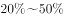
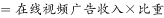
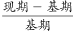
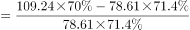

# 增长率计算（跨图表拼接量：部分量=整体量×比重，再求环比增速）

考点：[[20-考点/资料分析/增长/增长率计算（跨图表拼接量：部分量=整体量×比重，再求环比增速）|增长 / 增长率计算（跨图表拼接量：部分量=整体量×比重，再求环比增速）]]
材料：[[15-材料/资料分析/239973 2015年1季度—2017年2季度在|239973 2015年1季度—2017年2季度在]]

**问法模型**：求'移动端广告收入'的环比增速 → 因两图均未直接给出该量，先用'表格广告收入×折线图占比'拼出2017Q2与2017Q1两期值，再套(现期-基期)/基期并与区间选项对照

## 推理链
1. 第1步：定位折线图，2017Q2与2017Q1移动端广告收入占在线视频广告收入比重分别为70.0%、71.4%
2. 第2步：定位统计表，2017Q2与2017Q1在线视频广告收入分别为109.24亿元、78.61亿元
3. 第3步：按'移动端广告收入=广告收入×占比'拼接：2017Q2=109.24×70.0%≈76.5亿元，2017Q1=78.61×71.4%≈56.1亿元
4. 第4步：环比增速=(76.5-56.1)/56.1≈20.4/56.1≈36.2%
5. 第5步：36.2%落在C选项区间之内，且明显高于A、B区间上限、不到D门槛，故选C

**最快解法**：⚡ 截位直除+落区间：无需精算两期乘积全值，76.5与56.1取两位即可，增量20.4/56.1≈36%（56.1×36%≈20.2验证），直接锁定含36%的C区间

## 易错点
- ⚠ 跨图表拼接遗漏：移动端广告收入任何一图单独都给不出，必须'表格广告收入×折线图占比'，只用折线图占比下降就下结论会出错
- ⚠ 占比下降≠收入下降：占比由71.4%降至70.0%，但因广告收入总额大增（78.61→109.24），移动端收入实为正增长约36%，勿被占比回落误导
- ⚠ 环比与同比分母混淆：环比分母须用上季度2017Q1（78.61×71.4%），勿错用2016Q2；且区间型选项只需粗算落区间，不必精算

## 母题抽象
> 🧩 当题干求一个'图A总量×图B占比'推导量的环比/同比增速时，先分别拼出现期与基期值再套(现-基)/基，用截位直除粗算后对照区间选项即可

**同类特征**：环比增长速度、移动端广告收入、2017年2季度、区间型选项（低于/在…之间/以上）、折线图占比×表格总额拼接、在线视频

## 相关题
- [[10-真题/资料分析/增长/16070274 环比增长率（跨年相邻期，2025Q1对2024Q4）|16070274]]（湖北 2026，相关度1）

---

### 题干
2017年2季度，在线视频移动端广告收入环比增长速度：

### 选项
- A. 
低于

- B. 
在之间

- C. 
在之间
　✅
- D. 
在以上

### 官方解析

根据题干所求“···环比增长速度”可判定此题为增长率的计算问题，定位折线图，2017年2季度与2017年1季度移动端广告收入占在线视频广告收入的比重分别是：，。 移动端广告收入；在线视频广告收入的数据定位表格，2017年2季度与2017年1季度的分别为

109.24亿元，78.61亿元，根据增长率公式，因此答案的范围介于之间。

故正确答案为C。

### 给定材料

根据所给资料，回答下列问题。

注：“15Q1”表示2015年1季度数据，其余类推

