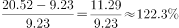
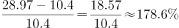
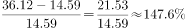
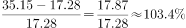

# 同比增速计算与折线趋势图匹配

考点：[[20-考点/资料分析/增长/同比增速计算与折线趋势图匹配|增长 / 同比增速计算与折线趋势图匹配]]
材料：[[15-材料/资料分析/239973 2015年1季度—2017年2季度在|239973 2015年1季度—2017年2季度在]]

**问法模型**：题干问'2016年各季度同比增速变化趋势'并给出四个折线图选项 → 只需算出四个季度同比增速的相对高低（峰、谷、升降方向），无需精算精确值即可匹配图形

## 推理链
1. 第1步：定位表格'视频增值服务'列，取2016年四个季度现期值：20.52、28.97、36.12、35.15亿元，及对应2015年同季基期值：9.23、10.40、14.59、17.28亿元
2. 第2步：同比增速=（现期-基期）÷基期，四个季度分别对照2015年同季（同比，非环比）
3. 第3步：代入计算——2016Q1：11.29/9.23≈122%；Q2：18.57/10.40≈179%；Q3：21.53/14.59≈148%；Q4：17.87/17.28≈103%
4. 第4步：排序得 Q2(179%) > Q3(148%) > Q1(122%) > Q4(103%)，趋势为'Q1升至Q2达峰、Q3回落、Q4继续降至最低'
5. 第5步：与选项对照，仅D符合'峰在Q2、谷在Q4、后两季连降'的走势，故选D

**最快解法**：⚡ 截位直除+峰谷判断：先看分子分母定性——Q2增量18.57最大且基期10.40最小，必为最高点；Q4现期35.15比Q3的36.12小而基期17.28比14.59大，必为最低点；再用截位直除排中间两项：Q3≈21.5/14.6≈1.48、Q1≈11.3/9.2≈1.23，即'升—降—降'形态锁定D，不必精算百分比

## 易错点
- ⚠ 同比误用环比：分母必须是2015年同季（如2016Q1对9.23），若错用上一季度（环比）得18.8%、41.2%、24.7%、-2.7%，形态完全不同（Q4为负）
- ⚠ 列读取错误：需取'视频增值服务'列，勿错用广告收入或其他列
- ⚠ 图形匹配不必精算小数点，重点是峰谷位置与升降方向；本题Q4现期虽接近Q3但增速反降，勿凭'收入仍在高位'误判Q4增速高

## 母题抽象
> 🧩 当题干出现'××各季度/各年同比增速变化趋势'+折线图选项时，直接用'（现期-上年同季）÷上年同季'算出各期增速相对大小，抓峰点和谷点排序即可匹配图形，无需精算精确百分比

**同类特征**：同比增速变化趋势、2016年各个季度、折线图/趋势图匹配、视频增值服务收入、需回查上年同季基期、峰谷与升降方向判断

## 相关题
（暂无）

---

### 题干

下列折线图中，能准确反映2016年各个季度在线视频增值服务收入同比增速变化趋势的是：

### 选项
- A. A
- B. B
- C. C
- D. D　✅

### 官方解析

根据题干“能准确反映2016年各个季度······同比增速变化趋势”，判定本题为一般增长率问题。定位表格数据可得：2015年1季度、2015年2季度、2015年3季度、2015年4季度在线视频增值服务收入分别为9.23亿元、10.40亿元、14.59亿元、17.28亿元；2016年1季度、2016年2季度、2016年3季度、2016年4季度在线视频增值服务收入分别为20.52亿元、28.97亿元、36.12亿元、35.15亿元。根据，可得2016年第1季度同比增速为，2016年第2季度同比增速为，2016年第3季度同比增速为，2016年第4季度同比增速为，根据计算结果可判定选项D趋势图符合。

故正确答案为D。

### 给定材料

根据所给资料，回答下列问题。

注：“15Q1”表示2015年1季度数据，其余类推

