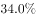

# 隔期增长率计算（基期为2015年而非上年）

考点：[[20-考点/资料分析/增长/隔期增长率计算（基期为2015年而非上年）|增长 / 隔期增长率计算（基期为2015年而非上年）]]
材料：[[15-材料/资料分析/240008 河北省2014—2018年年末电话用|240008 河北省2014—2018年年末电话用]]

**问法模型**：题干'与2015年相比，2018年…约增长了'+选项为百分数 → 用增长率模型 g=(现期值-基期值)/基期值，基期锁定2015年柱值

## 推理链
1. 第1步：题干明确比较对象为固定互联网宽带接入用户（图中黑柱序列），基期为2015年、现期为2018年
2. 第2步：从柱状图黑柱读数：2018年年末2159.8万户，2015年年末1226.5万户（勿误取2014年1127.6）
3. 第3步：套用增长率公式 g=(现期-基期)/基期=(2159.8-1226.5)/1226.5=933.3/1226.5
4. 第4步：精算933.3/1226.5≈0.7609，即约76.1%（分母截三位直除得75.9%，与A极近的B项区分需分母截四位）
5. 第5步：与选项对照，76.1%对应A项，故选A

**最快解法**：⚡ 截位直除（分母截四位）：933.3/1226.5→933.3/1227≈76.1%，直接锁定A；官方备注A、B差距极小，分母若只截三位（1226.5→123）会得75.9%误选B，故本题必须分母截四位或精算

## 易错点
- ⚠ 基期陷阱：题干是'与2015年相比'，基期应取1226.5，误取2014年的1127.6会算错（1127.6口径对应约91.5%）
- ⚠ 精度陷阱：官方明确A、B两项差距极小，分母截三位直除得约75.9%会误选B，需分母截四位或精算
- ⚠ 找数陷阱：双序列柱中误读灰柱（移动电话，6000+量级）数据；另'增长了'问的是增长率而非增长量933.3万户

## 母题抽象
> 🧩 当题干出现'与某早年相比、某年……约增长了'且选项为百分数时，在双序列柱状图中找准对应序列，用(现期值-基期值)/基期值计算；当选项数值极近时，分母截四位直除或精算以保区分度

**同类特征**：与2015年相比（基期非上年）、2018年、固定互联网宽带接入用户、约增长了（问增长率）、双序列柱状图找黑柱、选项为百分数且相邻项差距极小

## 相关题
- [[10-真题/资料分析/增长/2188379 年增长速度（环比增长率）比较|2188379]]（江西 2018，相关度1）
- [[10-真题/资料分析/增长/2374708 同比增长率比较（增幅最大）|2374708]]（广东 2019，相关度1）
- [[10-真题/资料分析/其他/2374716 表格直接读数比较（最大值识别）|2374716]]（广东 2019，相关度1）
- [[10-真题/资料分析/增长/2374835 增长量计算（现期值-基期值）|2374835]]（广东 2019，相关度1）
- [[10-真题/资料分析/比重/2374836 比重（比例）两期差值计算——百分点口径|2374836]]（广东 2019，相关度1）

---

### 题干
与2015年相比，2018年固定互联网宽带接入用户约增长了：

### 选项
- A. 

　✅
- B. 

- C. 

- D. 

### 官方解析

根据题干“与2015年相比···约增长了”结合选项有，可判定本题为一般增长率的计算问题。定位统计图可知，固定互联网宽带接入用户数：2018年为2159.8万户，2015年为1226.5万户。由，则与2015年相比，2018年固定互联网宽带接入用户增长率。

备注：本题A、B两项差距极小，若分母截三位易错选为B，建议分母截四位或精算。

故正确答案为A。

### 给定材料

2018年末，河北省电话用户总数8865.6万户，其中移动电话用户8195.6万户。

