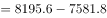
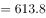
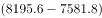
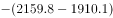

# 增长量（净增数）计算与作差比较

考点：[[20-考点/资料分析/增长/增长量（净增数）计算与作差比较|增长 / 增长量（净增数）计算与作差比较]]
材料：[[15-材料/资料分析/240008 河北省2014—2018年年末电话用|240008 河北省2014—2018年年末电话用]]

**问法模型**：题干出现'2018年比2017年净增数多多少万户'→分别用（2018年末值-2017年末值）求两序列增长量，再两个增长量作差

## 推理链
1. 第1步：从图中灰柱读数：移动电话用户2018年末8195.6万户、2017年末7581.8万户；从黑柱读数：宽带用户2018年末2159.8万户、2017年末1910.1万户
2. 第2步：年末时点数的净增数=当年末-上年末，图中不直接给出，须自行作差
3. 第3步：移动电话净增数=8195.6-7581.8=613.8万户；宽带净增数=2159.8-1910.1=249.7万户
4. 第4步：作差=613.8-249.7=364.1万户
5. 第5步：与选项对照，364.1对应A项，与官方答案一致

**最快解法**：⚡ 尾数法（综合算式一步到位）：(8195.6-7581.8)-(2159.8-1910.1)，尾数 .6-.8-.8+.1 → 末位为.1，四个选项中仅A（364.1）尾数为1，直接锁定A

## 易错点
- ⚠ 时点陷阱：'净增数'图中不直接给出，必须用当年末减上年末自行作差，不能直接拿2018年总量相减
- ⚠ 双序列混淆：灰柱（移动电话，6000+量级）与黑柱（宽带，1000+量级）量级差异大，找数勿串行
- ⚠ 问法陷阱：问'多多少万户'是增长量作差，不要再除以基期算成增长率；且单位为万户，与材料一致无需换算

## 母题抽象
> 🧩 当题干出现'两个对象净增数/增长量相差多少（绝对量）'特征时，各用'现期时点值-基期时点值'求增长量后作差，考场可合并为综合算式用尾数法快速验证选项

**同类特征**：与2017年相比，2018年、净增数、多多少万户、两序列增长量作差、年末时点数据

## 相关题
（暂无）

---

### 题干
与2017年相比，2018年移动电话用户净增数比固定互联网宽带用户净增数多多少万户？

### 选项
- A. 364.1　✅
- B. 486.7
- C. 526.8
- D. 531.0

### 官方解析

根据题干“与2017年相比，2018年···多多少万户”可判定本题为增长量的计算问题。定位统计图数据可得：移动电话用户数，2018年为8195.6万户，2017年为7581.8万户，则2018年移动电话用户净增数万户；固定互联网宽带用户数，2018年为2159.8万户，2017年为1910.1万户，则2018年固定互联网宽带用户净增数万户。则万户。

备注：本题考场可列综合算式，根据尾数为1选择A项。

故正确答案为A。

### 给定材料

2018年末，河北省电话用户总数8865.6万户，其中移动电话用户8195.6万户。

