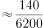
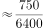
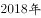

# 同比增长率比较（增速最大年份判定）

考点：[[20-考点/资料分析/增长/同比增长率比较（增速最大年份判定）|增长 / 同比增长率比较（增速最大年份判定）]]
材料：[[15-材料/资料分析/240008 河北省2014—2018年年末电话用|240008 河北省2014—2018年年末电话用]]

**问法模型**：题干问'2015～2018年增速最快的年份是'→对每一年用（当年末值-上年末值)/上年末值计算同比增长率，逐年比较取最大

## 推理链
1. 第1步：从柱状图灰柱提取移动电话年末用户（万户）：2014年6229.1、2015年6367.2、2016年7121.0、2017年7581.8、2018年8195.6
2. 第2步：数据为逐年年末时点值，各年增速=（当年末-上年末)/上年末，2015年增速须以2014年6229.1为基期
3. 第3步：2015年增量138.1，增速138.1/6229.1≈2.2%；2016年增量753.8，增速753.8/6367.2≈11.8%
4. 第4步：2017年增量460.8，增速460.8/7121.0≈6.5%；2018年增量613.8，增速613.8/7581.8≈8.1%
5. 第5步：比较四年增速2.2%<6.5%<8.1%<11.8%，2016年最大；对照选项，B为2016年，故选B

**最快解法**：⚡ 增长率比较·'先比增量、再验基期'：四年增量753.8（2016）>613.8（2018）>460.8（2017）>138.1（2015），2016年增量最大而其基期6367.2小于2018年基期7581.8，分子大分母小，直接锁定2016年增速最快，无需逐一精算

## 易错点
- ⚠ 基期陷阱：算2015年增速必须以2014年（6229.1）为基期，若漏掉2014年数据会误判2015年增速或只能比2016—2018三年
- ⚠ 增长量与增长率混淆：只看柱高增量作比较是错法，本题恰好增量序与增速序一致（2016增量也最大），但规范做法须除以基期验证，防止同类题中增量最大者非增速最快
- ⚠ 双序列混淆：黑柱是宽带用户（1000+量级），灰柱才是移动电话（6000+量级），找数勿串行；且文字段'电话用户总数8865.6'含固定电话，与本题无关

## 母题抽象
> 🧩 当题干出现'某年段内增速最快的年份'且材料为逐年年末时点柱状图时，用（当年末-上年末)/上年末逐年求同比增速（段首年以前一年为基期），可先比增量再用基期关系筛选锁定，验证最大者对应年份即为答案

**同类特征**：增速最快的年份、移动电话用户、2015～2018年逐年比较、同比增速、年末时点柱状数据、增长率最大值判定

## 相关题
- [[10-真题/资料分析/增长/5102153 同比增长率比较（增速最大年份判定）|5102153]]（湖北 2022，相关度2）
- [[10-真题/资料分析/综合/10297333 综合分析选非题（同比增速逐年比较+年均增长量+比重百分点还原）|10297333]]（浙江 2025，相关度1）
- [[10-真题/资料分析/增长/13504272 一般增长率计算与计数比较（同比增速-5%年份计数）|13504272]]（云南 2025，相关度1）
- [[10-真题/资料分析/增长/19283744 同比增速（增长率）逐年比较|19283744]]（国考 2025，相关度1）
- [[10-真题/资料分析/增长/2028440 增长率（增速）比较|2028440]]（国考 2017，相关度1）

---

### 题干
2015～2018年，移动电话用户增速最快的年份是：

### 选项
- A. 2015年
- B. 2016年　✅
- C. 2017年
- D. 2018年

### 官方解析

由题干“2015～2018年···增速最快的年份是”，判定本题为一般增长率比较问题。定位柱状图可知2014～2018年移动电话年末用户数据，根据：，可得：，，，。可见，增速最快的为2016年。

故正确答案为B。

### 给定材料

2018年末，河北省电话用户总数8865.6万户，其中移动电话用户8195.6万户。

