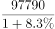
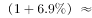
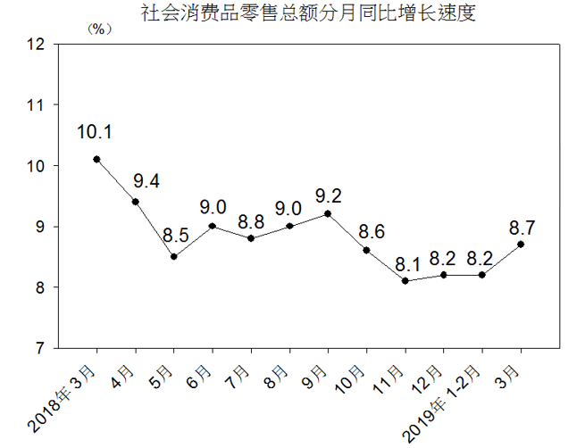

# 按上年价格计算的现期值折算（名义增速→实际增速）

考点：[[20-考点/资料分析/增长/按上年价格计算的现期值折算（名义增速→实际增速）|增长 / 按上年价格计算的现期值折算（名义增速→实际增速）]]
材料：[[15-材料/资料分析/240009 2019年一季度全国社会消费品零售总|240009 2019年一季度全国社会消费品零售总]]

**问法模型**：题干出现'按2018年一季度价格计算2019年一季度总额'→先用现期值97790÷(1+名义增速8.3%)还原为2018年基期规模，再×(1+实际增速)还原实际增长结果

## 推理链
1. 第1步：从表格'1-3月份'列提取现期值97790亿元、名义同比增速8.3%（题干要求按2018年一季度价格计算，即剔除价格上涨因素，材料导读提醒实际增速≠名义增速8.3%）
2. 第2步：所用公式为'按上年价格计算的现期值=现期名义值÷(1+名义增速)×(1+实际增速)'，其中'扣除价格因素实际增长'文字段留空（原卷为6.9%），需借选项信息补全
3. 第3步：代入计算：97790÷1.083≈90296亿元（即2018年一季度基期规模），再×1.069≈90296+90296×0.069≈90296+6230≈96526亿元
4. 第4步：与选项对照：A.85065低于基期值90296（意味着实际负增长，不合理），C.99283、D.114000均高于现期名义值97790（剔除价格因素后不可能高于名义值），仅B.96526落在基期值90296与现期值97790之间
5. 第5步：故确定答案为B

**最快解法**：⚡ 选项区间锁定法：剔除价格因素后的结果必介于基期值97790÷1.083≈9.03万与现期值97790之间，四个选项只有B.96526在此区间，秒选B；再用截位直除验证：97790÷1.083≈90300，90300×1.069≈96530，与B一致

## 易错点
- ⚠ 用名义增速8.3%冒充实际增速：若把8.3%当作实际增速直接得出97790（不变）或误算其他口径，会偏离答案；本题实际增速约6.9%，与8.3%相差1.4个百分点
- ⚠ 折算方向搞反：'按2018年价格计算'是剔除2019年价格上涨因素，应先除以(1+8.3%)再乘(1+实际增速)；若错误地直接乘以增速（如97790×1.069≈104500），会向D.114000方向误选
- ⚠ 读数口径陷阱：材料文字段增速全部留空，8.3%必须回表格'1-3月份'列（勿串到'3月份'列的8.7%）；'扣除价格因素实际增长'文字留空且表格未给，本题需借选项区间法补全该缺口

## 母题抽象
> 🧩 当题干出现'按基期年价格计算现期值'特征时，用'现期名义值÷(1+名义增速)×(1+实际增速)'折算，并验证结果必介于基期值与现期名义值之间；若实际增速在材料中缺失，直接用该区间排除选项锁定答案

**同类特征**：按2018年一季度价格计算、扣除价格因素、名义增长8.3%、实际增长、现期值折算、约为多少亿元

## 相关题
- [[10-真题/资料分析/增长/2456363 基期量计算|2456363]]（浙江 2020，相关度1）
- [[10-真题/资料分析/平均数/2579778 现期平均数计算（累计值−单月值做差求子时段总量后求月均）|2579778]]（浙江 2020，相关度1）
- [[10-真题/资料分析/平均数/4652180 现期平均数之两步拼接（单位企业利润=利润总额÷企业数，企业数由营业收入÷单位企业营业收入间接求出）|4652180]]（北京 2022，相关度1）
- [[10-真题/资料分析/其他/2388239 累计值求当月值（相邻累计差值简单计算）|2388239]]（河北 2019，相关度1）
- [[10-真题/资料分析/比重/2423341 现期比重求部分量（多品类占比求和）|2423341]]（甘肃 2019，相关度1）

---

### 题干
按照2018年一季度价格计算2019年一季度社会消费品零售总额约为多少亿元？

### 选项
- A. 85065
- B. 96526　✅
- C. 99283
- D. 114000

### 官方解析

根据题干所求“按照2018年一季度价格计算2019年一季度社会消费品零售总额约为”，可判定本题为现期计算问题，定位文字资料第一段可得“2019年一季度，社会消费品零售总额97790亿元，同比名义增长（扣除价格因素实际增长，以下除特殊说明外均为名义增长）”，所以2018年社会消费品零售总额为。“按照2018年一季度价格计算”，即扣除2019年的价格因素造成的增长，也就是按照2018年实际的增长率来计算，故2019年社会消费品零售总额为，与B选项最接近。

故正确答案为B。

### 给定材料

根据以下资料，回答下列问题。

        2019年一季度，社会消费品零售总额97790亿元，同比名义增长（扣除价格因素实际增长，以下除特殊说明外均为名义增长）。其中，3月份社会消费品零售总额31726亿元，同比增长。

        按经营单位所在地分，一季度城镇消费品零售额83402亿元，同比增长；乡村消费品零售额14388亿元，增长。其中，3月份城镇消费品零售额27192亿元，同比增长；乡村消费品零售额4534亿元，增长。

        按消费类型分，一季度餐饮收入10644亿元，同比增长；商品零售87146亿元，增长。其中，3月份餐饮收入3393亿元，同比增长；商品零售28333亿元，增长。

        按零售业态分，一季度限额以上零售业单位中的超市、百货店、专业店零售额同比分别增长、、，专卖店同比下降。

        一季度，全国网上零售额22379亿元，同比增长。其中，实物商品网上零售额17772亿元，增长，占社会消费品零售总额的比重为；在实物商品网上零售额中，吃、穿和用类商品分别增长、和。

> [!warning] 疑点（官方解析可能有误，待人工复核）
> 本题材料文字段'扣除价格因素实际增长'数值留空且表格未给，仅凭题面数据无法直接算出96526；官方答案B隐含实际增速为6.9%（97790÷1.083×1.069≈96526，与B吻合），属原卷材料信息在呈现时被挖空导致的口径缺口，非答案错误，考场可用选项区间法补全
