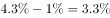
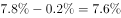
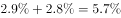

# 同比增速比较（利用'提高-回落X个百分点'回推基期增速后比大小）

考点：[[20-考点/资料分析/增长/同比增速比较（利用'提高-回落X个百分点'回推基期增速后比大小）|增长 / 同比增速比较（利用'提高/回落X个百分点'回推基期增速后比大小）]]
材料：[[15-材料/资料分析/240010 2019年1-2月与1-3月全国固定|240010 2019年1-2月与1-3月全国固定]]

**问法模型**：题干问'哪个地区投资同比增速最快'→ 先用'1-2月增速=1-3月增速−提高幅度（或＋回落幅度）'把四个地区统一回推到1-2月口径，再比较增速数值取最大者

## 推理链
1. 第1步：题干所问为2019年1-2月四地区投资增速，而材料分地区段为1-3月口径且只有增速无投资额，仅给出变动：东部增速比1-2月提高1个百分点、中部提高0.2个、西部提高0.2个、东北回落2.8个百分点。
2. 第2步：回推规则——'提高'说明1-3月增速高于1-2月，则1-2月增速=1-3月增速−提高幅度；'回落'说明1-3月低于1-2月，则1-2月增速=1-3月增速＋回落幅度，即东部回推时−1、中部−0.2、西部−0.2、东北+2.8（个百分点）。
3. 第3步：原文四个地区1-3月同比增速的具体百分数均为空白缺失，按材料导读要求不得凭空补数，回推代入须以带数值的完整版材料完成。
4. 第4步：将回推所得四个1-2月增速按数值大小比较（比的是增速数值本身，不是变动百分点），官方解析结论为中部地区增速最快。
5. 第5步：与选项对照，中部地区对应B，故正确答案为B。

**最快解法**：⚡ 回推法（增速变动反算）+数值直比：先把四个地区统一折算到1-2月口径——东部=1-3月增速−1、中部−0.2、西部−0.2、东北+2.8（个百分点），再直接比较四个百分数大小取最大即中部（B）；全程口算，切忌拿'提高1个百分点'最大去选东部

## 易错点
- ⚠ 变动幅度当增速比较：东部'提高1个百分点'是变动幅度最大者，但幅度大≠增速快，直接比百分点会误选A（东部）；增速快慢只能比增速数值大小。
- ⚠ 方向词符号处理：东北'回落2.8个百分点'意味着1-3月比1-2月低2.8个，回推1-2月时应+2.8；若按−2.8回推会把东北进一步错判为最低。
- ⚠ 时间口径错位+材料缺口：分地区段给的是1-3月累计增速，题干问1-2月必须回推，不能直接排序；且本版本原文增速具体值全部空白，回推与排序需以带数值完整版材料核对，不可凭空补数。

## 母题抽象
> 🧩 当题干问某口径'同比增速最快/最大'而材料只给'增速比上期提高/回落X个百分点'时，先用'所问期增速=所给期增速−提高幅度（或＋回落幅度）'统一回推到题干所问时点，再比较增速数值取最大，绝不用变动幅度大小代替增速大小。

**同类特征**：'投资同比增速最快'（增速大小比较）、'分地区看'定位纯增速段（无投资额）、材料给'比1-2月份提高/回落X个百分点'、题干时点(1-2月)与材料口径(1-3月)错位需回推、比较对象为增速数值而非变动幅度、文字型材料·增速变动信息为主

## 相关题
（暂无）

---

### 题干
2019年1-2月，分地区看，投资同比增速最快的地区是哪个？

### 选项
- A. 东部地区
- B. 中部地区　✅
- C. 西部地区
- D. 东北地区

### 官方解析

定位文字材料第六段“东部地区投资同比增长，增速比1-2月份提高1个百分点；中部地区投资增长，增速提高0.2个百分点；西部地区投资增长，增速提高0.2个百分点；东北地区投资增长，增速回落2.8个百分点”，可得2019年1—2月，东部地区同比增速为，中部地区同比增速为，西部地区同比增速为，东北地区同比增速为，所以投资同比增速最快的地区是中部地区。

故正确答案为B。

### 给定材料

        2019年1-2月份，全国固定资产投资（不含农户）44849亿元，同比增长，增速比2018年全年提高0.2个百分点。其中，民间固定资产投资26963亿元，同比增长。分产业看，第一产业投资950亿元，同比增长，增速比2018年全年回落9.2个百分点；第二产业投资13864亿元，增长，增速回落0.7个百分点；第三产业投资30035亿元，增长，增速提高1个百分点。

        2019年1-3月份，全国固定资产投资（不含农户）101872亿元，同比增长，增速比去年同期回落1.2个百分点。其中，民间固定资产投资61492亿元，同比增长。

        分产业看，第一产业投资2408亿元，同比增长，增速比1-2月份回落0.7个百分点；第二产业投资33224亿元，增长，增速回落1.3个百分点；第三产业投资66240亿元，增长，增速提高1个百分点。

        第二产业中，工业投资同比增长，增速比1-2月份回落1.4个百分点；其中，采矿业投资增长，增速回落26.6个百分点；制造业投资增长，增速回落1.3个百分点；电力、热力、燃气及水生产和供应业投资增长，1-2月份为下降。

        第三产业中，基础设施投资（不含电力、热力、燃气及水生产和供应业）同比增长，增速比1-2月份提高0.1个百分点。其中，水利管理业投资下降，降幅扩大3.7个百分点；公共设施管理业投资下降，降幅收窄2.3个百分点；道路运输业投资增长，增速回落2.5个百分点；铁路运输业投资增长，增速回落11.5个百分点。

        分地区看，东部地区投资同比增长，增速比1-2月份提高1个百分点；中部地区投资增长，增速提高0.2个百分点；西部地区投资增长，增速提高0.2个百分点；东北地区投资增长，增速回落2.8个百分点。

        分登记注册类型看，内资企业投资同比增长，增速与1-2月份持平；港澳台商投资增长，增速提高2.8个百分点；外商投资增长，增速提高5.3个百分点。

> [!warning] 疑点（官方解析可能有误，待人工复核）
> 本版本材料及官方解析中四个地区同比增速的具体百分数均为空白（解析中'同比增速为'后无数值），仅凭所给文本无法独立完成回推与排序验证；官方答案B按唯一事实采纳，其判定依赖完整版数值（回推后中部地区1-2月增速最大），需以带数值的完整版材料核对。另解析称定位'第六段'，而本材料分地区段按导读为第五段（第六段为分登记注册类型），段落编号略有出入但不影响结论。
