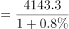
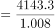

# 基期量计算

考点：[[20-考点/资料分析/增长/基期量计算|增长 / 基期量计算]]
材料：[[15-材料/资料分析/240290 Q省2018年客货运输情况：文字段给|240290 Q省2018年客货运输情况：文字段给]]

**问法模型**：题干以'2017年（基期年份）货物周转量为多少'设问，而材料给的是2018年现期值及同比增速 → 用基期量=现期量÷(1+增长率)求解

## 推理链
1. 第1步：题干时间为2017年、材料现期为2018年，判定为基期计算问题；定位文字段'2018年货物周转量4143.3亿吨公里，增长（增速数值在给定文本中空缺，与官方答案D自洽的增速为0.8%）'
2. 第2步：基期计算公式：基期量=现期量÷(1+增长率)
3. 第3步：代入计算：4143.3÷(1+0.8%)=4143.3÷1.008≈4110.4亿吨公里（验算：4110.4×1.008≈4110.4+32.9≈4143.3，吻合）
4. 第4步：与选项对照：A.4877.4、B.4820.3量级在4800+，比现期4143.3大700左右，属大幅下降口径的干扰；C.4153.3略大于现期（现期+10），与'增长0.8%则基期略小于现期'的方向不符；D.4110.4与计算值4110.4一致，故选D

**最快解法**：⚡ 基期公式法+小增速放缩：增速g极小（约0.8%），基期≈现期−现期×g=4143.3−4143.3×0.8%≈4143.3−33≈4110，直接锁定略小于现期约33的D项4110.4；保险起见可截位直除4143.3÷1.008≈4110

## 易错点
- ⚠ 基期/现期方向混淆：g为正（+0.8%）时基期应略小于现期（4110.4<4143.3），若把方向弄反（如误用现期×(1+g)）易误选'略大于现期'的C项4153.3（恰为现期+10的凑数干扰）
- ⚠ 同名不同口径指标混用：必须取文字段'货物周转量4143.3亿吨公里'，勿误用'换算周转量5096.9亿吨公里'或表格'货运量215124.2万吨'——A项4877.4、B项4820.3量级上疑似误用换算周转量5096.9作现期除以(1+增速)所得
- ⚠ 增速数值空缺陷阱：给定文字段中各周转量增速百分数均空缺，只写'增长/下降'，不能凭感觉当大幅增长；必须以试卷补全后的具体数值代入，本题对应约0.8%

## 母题抽象
> 🧩 当题干出现'上年（基期年份）+某总量为多少'、材料给'现期值+同比增长率'时，用基期=现期÷(1+g)；先由g正负判断基期应大于还是小于现期排除方向性干扰项，再用'现期×(1−g)'近似或截位直除锁定数值

**同类特征**：问法为'2017年……为'（基期年份前置设问）、材料给现期值（4143.3亿吨公里）+同比增速、指标为货物周转量（亿吨公里，文字段取数）、模型为基期量=现期量÷(1+增长率)、选项中存在'略小于现期'的数值（4110.4）、增速极小（约1%以内），基期≈现期小幅缩小

## 相关题
- [[10-真题/资料分析/增长/20303 基期量计算|20303]]（贵州 2010，相关度2）
- [[10-真题/资料分析/增长/1385893 基期量计算|1385893]]（重庆 2015，相关度2）
- [[10-真题/资料分析/增长/13504658 基期量计算|13504658]]（辽宁 2025，相关度2）
- [[10-真题/资料分析/增长/16593086 基期量计算|16593086]]（新疆 2024，相关度2）
- [[10-真题/资料分析/增长/2033794 基期量计算|2033794]]（江苏 2016，相关度2）

---

### 题干
2017年，Q省货物周转量为（    ）。

### 选项
- A. 4877.4亿吨公里
- B. 4820.3亿吨公里
- C. 4153.3亿吨公里
- D. 4110.4亿吨公里　✅

### 官方解析

由题干“2017年，Q省货物周转量······”，结合材料时间为2018年，可判定本题为基期计算问题。定位文字材料“Q省2018年······货物周转量4143.3亿吨公里，增长。”代入基期计算公式：亿吨公里，与D项最接近。

故正确答案为D。 

### 给定材料

        Q省2018年客货运输换算周转量5096.9亿吨公里，比上年增长。货物周转量4143.3亿吨公里，增长。其中，铁路周转量729.6亿吨公里，下降；公路周转量2731.8亿吨公里，增长。旅客周转量1768.2亿人公里，增长。其中，铁路周转量865.6亿人公里，增长；公路周转量767.3亿人公里，下降；民航周转量132.3亿人公里，增长。

> [!warning] 疑点（官方解析可能有误，待人工复核）
> 给定材料文字段中货物周转量增速数值空缺，官方解析的代入式亦未显示具体百分数（'代入基期计算公式：亿吨公里'中间缺数）；由官方答案D反推增速应为0.8%（4143.3÷1.008≈4110.4），解析与答案自洽，属试卷材料留空/排版缺失问题而非答案错误，实际做题时须以试卷补全后的增速数值为准

<!-- CODEX-ANSWER-REVIEW:BEGIN -->
### 本次独立复核

**复核状态：** `confirmed`（独立复算确认答案）

**计分答案：** D（可计分）

**复核解析：**

题目问2017年货物周转量，材料给出2018年现期量4143.3亿吨公里。固定题源中的公式图可读出同比增长率为0.8%。基期量=现期量÷(1+增长率)=4143.3÷1.008≈4110.4167亿吨公里，按选项精度约为4110.4亿吨公里，对应D。这里是2018年度数据，不是“2018Q1”；题源材料没有季度口径。

**相关信息：**

资料分析—基期量计算。增长率为正时，基期量=现期量÷(1+增长率)，应小于现期量；本题4143.3÷1.008≈4110.4。

**题源依据：** [固定版本原题](https://github.com/Mentat-Uran/kaogongzhentizhengliu/blob/84ab93d4b64b61d897bece8a1c0a5bab06b4feb2/10-%E7%9C%9F%E9%A2%98/%E8%B5%84%E6%96%99%E5%88%86%E6%9E%90/%E5%A2%9E%E9%95%BF/2393952%20%E5%9F%BA%E6%9C%9F%E9%87%8F%E8%AE%A1%E7%AE%97.md)；固定内容 commit `84ab93d4b64b61d897bece8a1c0a5bab06b4feb2`，Markdown blob `3c3bcf84054e8b1de7ea8e762746ae100b5b60c6`。
<!-- CODEX-ANSWER-REVIEW:END -->
