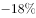

# 增长量与增长率混合计算（绝对量表述倒推基期求降幅＋给定增速精算增长量）

考点：[[20-考点/资料分析/增长/增长量与增长率混合计算（绝对量表述倒推基期求降幅＋给定增速精算增长量）|增长 / 增长量与增长率混合计算（绝对量表述倒推基期求降幅＋给定增速精算增长量）]]
材料：[[15-材料/资料分析/240291 2018年我国国民经济和社会发展主要|240291 2018年我国国民经济和社会发展主要]]

**问法模型**：题干'顺差总额和出口总额较上一年分别（增加/减少…%…亿元）'→ 双指标混合模型：含'比上年减少5217亿元'绝对量表述的顺差用'基期=现期+减少量、降幅=减少量/基期'，已知增速的出口用'增长量=现期×r/(1+r)'精算，先判方向排除、再对照数值

## 推理链
1. 第1步：定位材料第二段：2018年货物进出口顺差23304亿元、比上年减少5217亿元；2018年出口164177亿元（本版材料出口增速留白，原卷增速为7.1%）
2. 第2步：'比上年减少5217亿元'是绝对量表述，'减少'故做加法：2017年顺差=23304+5217=28521亿元；顺差增长率=变化量/基期=-5217/28521
3. 第3步：-5217/28521≈-18.3%，即顺差'减少约18.3%'→先排除方向误写为'增加'的C、D；A的百分数公式与B不同（若误用现期23304作分母则5217/23304≈22.4%），与18.3%不符，排除A
4. 第4步：出口增长量=现期×r/(1+r)=164177×7.1%/1.071，即164177-164177/1.071≈164177-153293=10884亿元（B、C仅差10，必须精算）
5. 第5步：对照选项，仅B同时满足'顺差减少（约18.3%）＋出口增加10884亿元'，与官方答案一致，故选B

**最快解法**：⚡ 方向排除＋截位直除精算：第一步由'比上年减少5217亿元'直接锁定顺差方向为'减少'，秒排C、D；第二步精算5217/28521≈18.3%（截位直除），与A的百分数不符排A；第三步出口增长量按'现期×r/(1+r)'精算：164177÷1.071≈153293，164177-153293=10884亿元，锁定B（官方亦提示：算出'减少'后结合选项可排除A、C、D直接选B）

## 易错点
- ⚠ 基期方向与分母陷阱：'比上年减少5217亿元'是绝对量，基期=23304+5217=28521亿元（勿误作23304-5217）；求降幅分母必须用基期28521，误用现期23304得约22.4%即掉入A选项陷阱
- ⚠ 方向判断陷阱：顺差为'减少'、出口为'增加'，C、D把顺差方向误写为'增加'； official解析明确'减少'后即可排除
- ⚠ 数值精度陷阱：B(10884)与C(10874)仅差10、与A(10684)差200，百化分粗估（7.1%≈1/14）分辨率不足，增长量必须精算且勿漏除(1+r)（误用现期×7.1%≈11657则全错）

## 母题抽象
> 🧩 当题干出现'A和B较上年分别…'（一问率一问量）且材料含'比上年增加/减少某绝对量'表述时，先按'基期=现期±变化量（减则加）'倒推基期、以基期作分母定方向和降幅排除半数选项，再对含增速的指标用'增长量=现期×r/(1+r)'精算，验证方向与数值双符的选项

**同类特征**：顺差总额和出口总额较上一年分别、一问增减率（%）一问增长量（亿元）、材料含'比上年减少5217亿元'绝对量表述、选项以'增加/减少'方向＋亿元数值双重设障、相邻选项数值仅差10（10884与10874）须精算

## 相关题
（暂无）

---

### 题干
2018年我国货物进出口顺差总额和出口总额较上一年分别（    ）。

### 选项
- A. 
减少，增加10684亿元

- B. 
减少，增加10884亿元
　✅
- C. 
增加，增加10874亿元

- D. 
增加，增加10654亿元

### 官方解析

根据题干“2018年···”结合选项“增加/减少···%”，可判定本题为一般增长率问题，结合选项“增加/减少···亿元”可判定本题为增长量计算问题。定位文字材料第二段，2018年货物进出口顺差23304亿元，比上年减少5217亿元；则根据公式：可得，2018年货物进出口顺差总额增长率，即减少。定位文字材料第二段，2018年我国出口164177亿元，增长；根据公式：可得，2018年出口总额增长量亿元（B、C之间差距极小，估算易错，需要精算）。

故正确答案为B。

注：在算出增长率为，即减少后，可结合选项排除A、C、D，直接选B。

### 给定材料

        2018年我国国内生产总值900309亿元，比上年增长，全国居民人均可支配收入28228元，比上年增长，全国居民恩格尔系数为。2018年我国总人口139538万人，比上年增加530万人，其中城镇常住人口83137万人，全年出生人口1523万人，死亡人口993万人。

        2018年我国货物进出口总额305050亿元，比上年增长。其中，出口164177亿元，增长；进口140873亿元，增长。货物进出口顺差23304亿元，比上年减少5217亿元。对“一带一路”沿线国家进出口总额83657亿元，比上年增长。其中，出口46478亿元，增长；进口37179亿元，增长。

        2018年社会消费品零售总额380987亿元，比上年增长。全年实物商品网上零售额70198亿元，比上年增长。按经营地统计，城镇消费品零售额325637亿元，增长；乡村消费品零售额55350亿元，增长。按消费类型统计，商品零售额338271亿元，增长；餐饮收入额42716亿元，增长。

注释：

> [!warning] 疑点（官方解析可能有误，待人工复核）
> 本版材料15处增速全部留白（含出口增速），官方解析中顺差增长率与出口增长量的公式具体数值亦为缺失图片，10884亿元无法仅凭本版留白材料硬算复现；按B项数值反推出口增速约为7.1%（164177÷1.071≈153293，差值≈10884）。此属材料版本留白问题，须以原卷完整增速数据为准，与官方答案B不矛盾。

<!-- CODEX-ANSWER-REVIEW:BEGIN -->
### 本次独立复核

**复核状态：** `resolved`（答案与解析已核定）

**计分答案：** B（可计分）

**复核解析：**

原材料公式图提供了空缺的关键数据：出口164177亿元、同比7.1%；进口140873亿元、同比12.9%；2018年顺差为23304亿元。出口同比增量=164177×7.1%/107.1%≈10884亿元。2017年顺差基期约为23304/(1−18%)，因此顺差同比减少约18%；与B项一致。疑点所称“材料增速空白”仅针对文本转录，原公式图在源文件中可读，故不需反推答案。

**相关信息：**

同比增长率 r 以小数代入时，增长量=现期量×r/(1+r)；同比下降量取正数时用现期量×|r|/(1−|r|)。百分点为两个百分率之差。单位沿用原材料。

**题源依据：** [固定版本原题](https://github.com/Mentat-Uran/kaogongzhentizhengliu/blob/84ab93d4b64b61d897bece8a1c0a5bab06b4feb2/10-%E7%9C%9F%E9%A2%98/%E8%B5%84%E6%96%99%E5%88%86%E6%9E%90/%E5%A2%9E%E9%95%BF/2394008%20%E5%A2%9E%E9%95%BF%E9%87%8F%E4%B8%8E%E5%A2%9E%E9%95%BF%E7%8E%87%E6%B7%B7%E5%90%88%E8%AE%A1%E7%AE%97%EF%BC%88%E7%BB%9D%E5%AF%B9%E9%87%8F%E8%A1%A8%E8%BF%B0%E5%80%92%E6%8E%A8%E5%9F%BA%E6%9C%9F%E6%B1%82%E9%99%8D%E5%B9%85%EF%BC%8B%E7%BB%99%E5%AE%9A%E5%A2%9E%E9%80%9F%E7%B2%BE%E7%AE%97%E5%A2%9E%E9%95%BF%E9%87%8F%EF%BC%89.md)；固定内容 commit `84ab93d4b64b61d897bece8a1c0a5bab06b4feb2`，Markdown blob `49921815d8046a1852df13f7aa568b452cca7491`。
<!-- CODEX-ANSWER-REVIEW:END -->
