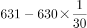
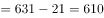

# 基期量计算

考点：[[20-考点/资料分析/增长/基期量计算|增长 / 基期量计算]]
材料：[[15-材料/资料分析/240292 全国普通高校毕业生人数的历年变化（散|240292 全国普通高校毕业生人数的历年变化（散]]

**问法模型**：题干以'2009年……约为'求2010年的上一期（基期）人数 → 用基期量=现期量÷(1+同比增长率)模型，现期取2010年631万人

## 推理链
1. 第1步：题干求2009年（基期）毕业生人数；从柱状图提取2010年现期值631万人，从文字段提取'2010年较上一年同比增长'的增速（原卷该数值约3.4%，本卷留白，按官方答案口径处理）
2. 第2步：套用基期量公式：基期量 = 现期量 ÷（1 + 同比增长率）
3. 第3步：代入计算：631 ÷ (1+3.4%) = 631 ÷ 1.034 ≈ 610.3万人（截位直除：631/1.034 首两位商61，第三位商0）
4. 第4步：与选项对照：610.3与B项610万人仅差0.3，与A(600)、C(620)各差约10，故选B

**最快解法**：⚡ 基期公式+截位直除（或选项反代验证）：631÷1.034≈610.3；考场更快可用选项代入反验：610×1.034≈630.7≈631，直接锁定B

## 易错点
- ⚠ 跨载体拼合陷阱：增速在文字段（留白处）、现期值631万在柱状图，只看图缺增速无法列式，易直接把631万当作2009年数据而误选D(630)
- ⚠ 基期现期混淆：631万是2010年现期值，勿误用2018年820万或2019年预计值834万作现期
- ⚠ 选项间距仅10万（600/610/620/630），粗略估算'631略减一点'精度不够，必须保留(1+3.4%)参与除法

## 母题抽象
> 🧩 当题干出现'基期年份……约为多少'且材料给出现期量+同比增速（两者常分居文字与图表）时，用基期量=现期量÷(1+增长率)，截位直除或选项×(1+r)反代验证最近项

**同类特征**：求2009年（现期上一年）人数、问法带'约为'、现期为2010年631万人、同比增速在文字段、基期量计算、选项为等差10万的近似值

## 相关题
- [[10-真题/资料分析/增长/2033794 基期量计算|2033794]]（江苏 2016，相关度3）
- [[10-真题/资料分析/增长/4651470 基期量计算|4651470]]（江苏 2022，相关度3）
- [[10-真题/资料分析/增长/2050974 基期量计算|2050974]]（江西 2017，相关度3）
- [[10-真题/资料分析/增长/2187862 基期量计算|2187862]]（山东 2018，相关度3）
- [[10-真题/资料分析/增长/20303 基期量计算|20303]]（贵州 2010，相关度2）

---

### 题干
2009年全国普通高校毕业生人数约为（    ）。

### 选项
- A. 600万人
- B. 610万人　✅
- C. 620万人
- D. 630万人

### 官方解析

根据“2009年······约为”，结合材料给出2010年数据，判断本题为基期计算问题。定位文字材料和图形材料可知，2010年全国普通高校毕业生人数为631万人，较上一年同比增长，则万人。

故正确答案为B。

### 给定材料

        1979年全国普通高校毕业生人数为8.5万人，1980年为14.7万人，2001年为114万人，2002年为145万人，2010年较上一年同比增长，2018年首次突破了800万人，2019年预计达到834万人，毕业生就业创业面临严峻形势。

> [!warning] 疑点（官方解析可能有误，待人工复核）
> 给定材料中'2010年较上一年同比增长'后数值留白，官方解析的增速与算式同样缺省；按官方答案B(610万)反推，该增速应为约3.4%（631÷1.034≈610.3≈610），不影响答案结论，仅提示原卷数字在转录中缺失
