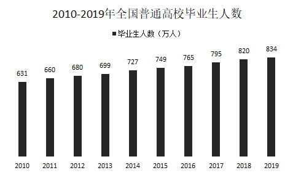
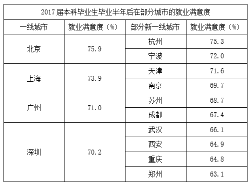

# 增长率比较（同比增长最快年份）

考点：[[20-考点/资料分析/增长/增长率比较（同比增长最快年份）|增长 / 增长率比较（同比增长最快年份）]]
材料：[[15-材料/资料分析/240292 全国普通高校毕业生人数的历年变化（散|240292 全国普通高校毕业生人数的历年变化（散]]

**问法模型**：题干出现'同比增长最快的两个年份'且选项只给出有限候选年份→对选项涉及的年份逐一计算'当年增量÷上年基期量'，比较增长率大小，绝不比增量。

## 推理链
1. 第1步：柱状图给出2010-2019逐年当期值：631、660、680、699、727、749、765、795、820、834（万人），选项只涉及2011、2014、2017、2018、2019五个候选年份
2. 第2步：规则：同比增长率=（现期-基期）÷基期=当年增量÷上年人数，逐项计算而非看柱子高度或增量
3. 第3步：代入计算：2011年29/631≈4.6%；2014年28/699≈4.0%；2017年30/765≈3.9%；2018年25/795≈3.1%；2019年14/820≈1.7%
4. 第4步：关键精确比较：2017年增量30万为全期最大、大于2014年的28万，但28×765=21420＞30×699=20970，故28/699＞30/765，2014增速反超2017
5. 第5步：排序得2011(4.6%)＞2014(4.0%)＞2017(3.9%)＞2018(3.1%)＞2019(1.7%)，最快的两年为2011年和2014年，对照选项选A

**最快解法**：⚡ 选项代入法＋截位直除/交叉相乘：只算选项涉及的5个年份增长率（29/631、28/699、30/765、25/795、14/820）；2011年基数631最小且增量29很大，明显最高；难点在2014与2017增量接近（28 vs 30），用交叉相乘28×765＞30×699一锤定音判2014＞2017，秒选A。

## 易错点
- ⚠ 比增量不比增长率：2017年增30万为最大增量，若只看柱子增量会误选B或C；增长率=增量÷基期，2017年基数765大，率反而低
- ⚠ 忽略各年基期不同：各年基数从631到820不等，28/699≈4.0%与30/765≈3.9%仅差约0.1个百分点，必须精确比较（交叉相乘或截位直除）而非估算放掉
- ⚠ 时间范围陷阱：题干为2010-2019年，但2010年增速需2009年基期（文字段留白，须回用兄弟题算出的基期值）；本题选项未含2010年可绕过，2019年为'预计'值口径略异但选项涉及时仍须按834计算

## 母题抽象
> 🧩 当题干出现'增长最快/增长率最大的年份'且选项只列少数候选年份时，只对选项年份计算'当年增量÷上年基期量'，增量接近时用交叉相乘或截位直除精确比较分数大小，切忌直接比增量或柱高。

**同类特征**：同比增长最快的两个年份、一般增长率比较、逐年柱状图当期值（非累计）、选项限定少数候选年份、增量接近须算增长率、2019年为预计值

## 相关题
- [[10-真题/资料分析/增长/10297321 同比增速计算与比较（增长率比较）|10297321]]（浙江 2025，相关度1）
- [[10-真题/资料分析/增长/18643764 分段加总后的一般增长率比较|18643764]]（天津 2026，相关度1）
- [[10-真题/资料分析/增长/5521195 增长率（同比增幅）比较|5521195]]（深圳市考 2023，相关度1）
- [[10-真题/资料分析/增长/19452637 增长率比较（增量-基期型）|19452637]]（上海 2026，相关度1）
- [[10-真题/资料分析/增长/13319340 一般增长率比较（同比增速最快年份判定）|13319340]]（江苏 2025，相关度1）

---

### 题干
在2010～2019年中，全国普通高校毕业生同比增长最快的两个年份是（    ）。

### 选项
- A. 2011年和2014年　✅
- B. 2011年和2017年
- C. 2014年和2017年
- D. 2018年和2019年

### 官方解析
根据“······同比增长最快的两个年份”可判定本题为一般增长率的比较问题。定位图形材料，根据，可得全国普通高校毕业生同比增速如下：
2011年：；
2014年：；
2017年：；
2018年：；
2019年：。
则同比增长最快的两个年份是2011年和2014年。
故正确答案为A。

### 给定材料

        1979年全国普通高校毕业生人数为8.5万人，1980年为14.7万人，2001年为114万人，2002年为145万人，2010年较上一年同比增长，2018年首次突破了800万人，2019年预计达到834万人，毕业生就业创业面临严峻形势。

