# 现期量计算（按固定增速外推两年，(1+r)²模型）

考点：[[20-考点/资料分析/增长/现期量计算（按固定增速外推两年，(1+r)²模型）|增长 / 现期量计算（按固定增速外推两年，(1+r)²模型）]]
材料：[[15-材料/资料分析/241019 2017年我国专利事业发展概况：发明|241019 2017年我国专利事业发展概况：发明]]

**问法模型**：题干出现'若以2017年的速度增长，到2019年将达到多少件'→现期外推模型：2017年值×(1+2017年增速)²，即5608×(1+r)²。

## 推理链
1. 第1步：定位材料'一带一路'段：2017年我国在沿线国家（不含中国）专利申请公开量为5608件，此为外推的现期值
2. 第2步：2017年到2019年跨度为2年，须用(1+r)²而非(1+r)；该同比增速在给定文本中为空白，按官方答案口径r=16%（反推验证：5608×1.16²=7546.2，恰为D项）
3. 第3步：列公式：2019年公开量=5608×(1+16%)²=5608×1.3456
4. 第4步：代入计算：5608×1.3456=5608+5608×0.3456≈5608+1938=7546件
5. 第5步：对照选项：7546与D项吻合；A(6505)=5608×1.16是只外推一年的干扰项，排除后锁定D

**最快解法**：⚡ 现期外推公式法（(1+r)²展开）：5608×1.16²=5608×1.3456，拆为5608×0.3456≈1682+224+31≈1938，5608+1938≈7546，秒选D；可用5608×1.16=6505快速排除A，确认'两年复合'无误

## 易错点
- ⚠ 年数陷阱：2017→2019间隔2年，只乘一次(1+r)得6505（恰为A项），命题人用单年外推设干扰；也不可错用(1+r)³
- ⚠ 数据口径：取数对象是'我国在沿线国家（不含中国）专利申请公开量5608件'，勿错用'沿线国家在华申请4319件'或印度2724/俄罗斯1354件，且单位是'件'不是'万件'，量级与国内授权（万件）差约两个数量级
- ⚠ 增速来源：'2019年'是材料外的假设年份，必须以2017年同比增速保持不变为前提外推；给定文本中该增速空白，不得臆造或错用其他段落（如执法办案6.7万件）的增速

## 母题抽象
> 🧩 当题干出现'若以××年的速度增长，到××年将达到'特征时，用现期外推公式 现期值×(1+r)ⁿ（n=目标年−现期年），先确认间隔年数，再用选项反推校验增速与年数是否匹配

**同类特征**：若以2017年的速度增长、到2019年、将达到多少件、现期外推（n年复合）、(1+r)²模型、沿线国家（不含中国）专利申请公开量

## 相关题
（暂无）

---

### 题干
若以2017年的速度增长，到2019年，我国“一带一路”沿线国家（不含中国）专利申请公开量将达到多少件？

### 选项
- A. 6505
- B. 6823
- C. 7028
- D. 7546　✅

### 官方解析

根据“若以2017年的速度增长，到2019年，······将达到多少件”，可判定本题为现期计算问题。定位材料第三段可知，2017年，我国在“一带一路”沿线国家（不含中国）专利申请公开量为5608件，同比增长。根据公式，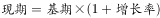，则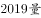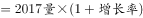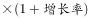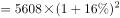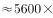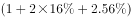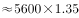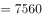，与D项最接近。

故正确答案为D。

### 给定材料

        2017年，我国发明专利申请量为138.2万件，同比增长。共授权发明专利42.0万件，同比增长。其中，国内发明专利授权32.7万件，同比增长。在国内发明专利授权中，职务发明为30.4万件，占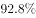；非职务发明为2.3万件，占。

        截至2017年底，我国国内（不含港澳台）发明专利拥有量共计135.6万件，每万人口发明专利拥有量达到9.8件。我国每万人口发明专利拥有量排名前十位的省（区、市）依次为：北京（94.5件）、上海（41.5件）、江苏（22.5件）、浙江（19.7件）、广东（19.0件）、天津（18.3件）、陕西（8.9件）、福建（8.0件）、安徽（7.7件）和辽宁（7.6件）。

        2017年，我国在“一带一路”沿线国家（不含中国）专利申请公开量为5608件，同比增长。其中，在印度专利申请公开量为2724件，在俄罗斯专利申请公开量为1354件，专利申请初具规模。2017年，“一带一路”沿线国家在华申请专利4319件，同比增长；在华申请专利的“一带一路”沿线国家数达到41个，较2016年增加4个。

        2017年，全国专利行政执法办案总量6.7万件，同比增长。其中，专利纠纷办案2.8万件（包括专利侵权纠纷办案2.7万件），同比增长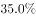；查处假冒专利案件3.9万件，同比增长。

> [!warning] 疑点（官方解析可能有误，待人工复核）
> 给定材料文本中5608件的同比增速为空白，官方解析中公式处亦未显示数字；按答案D(7546)反推增速约为16%（5608×1.16²=7546.2），官方结论与口径无误，但独立复算需以完整版材料补齐该16%方可进行
