# 增长量计算与两者增量之比（增量=现期×r-(1+r)）

考点：[[20-考点/资料分析/增长/增长量计算与两者增量之比（增量=现期×r-(1+r)）|增长 / 增长量计算与两者增量之比（增量=现期×r/(1+r)）]]
材料：[[15-材料/资料分析/241019 2017年我国专利事业发展概况：发明|241019 2017年我国专利事业发展概况：发明]]

**问法模型**：题干为'两者（专利纠纷案件数与查处假冒专利案件）的增量比'→ 对两个现期量分别套用 增量=现期×增速/(1+增速) 求出各自增长量后再作商

## 推理链
1. 第1步：定位材料末段——2017年专利纠纷办案2.8万件（同比增长r₁）、查处假冒专利案件3.9万件（同比增长r₂），2.8+3.9=6.7万件，二者是办案总量6.7万件的并列构成（'包括'的专利侵权纠纷2.7万件是纠纷的子集，不参与本比）
2. 第2步：由现期值和同比增速求增长量，公式：增长量=现期量×r/(1+r)
3. 第3步：纠纷增量=2.8×r₁/(1+r₁)万件；假冒增量=3.9×r₂/(1+r₂)万件（给定文本中这两处'同比增长'后的百分数为空白，r₁、r₂须以完整版材料补齐）
4. 第4步：增量比=[2.8×r₁/(1+r₁)]÷[3.9×r₂/(1+r₂)]=0.7179×[r₁/(1+r₁)]÷[r₂/(1+r₂)]，代入完整版材料增速计算约得0.69
5. 第5步：与选项对照：0.69∶1对应C；注意2.8/3.9≈0.72只是现期值之比（对应干扰项D），未经增量换算不能直接选

**最快解法**：⚡ 公式法+百化分：增长量=现期×r/(1+r)（r≈1/n时增量≈现期/(n+1)），先分别求出2.8万件、3.9万件两笔增量，再截位直除作商锁定0.69∶1（C）；考场上可先用2.8/3.9≈0.72排除D这一现期比干扰项，再做精确增量换算

## 易错点
- ⚠ 把'增量比'误做成'现期比'：直接用2.8/3.9≈0.72会误选D，两笔现期值必须各除以(1+增速)换成增量后再作比
- ⚠ 构成关系误用：'专利侵权纠纷办案2.7万件'是纠纷2.8万件的子集（'包括'），若拿2.7/3.9≈0.69直除，数值虽与答案巧合但方法错误，选项设计更精细时即掉坑
- ⚠ 增速取数与口径：给定文本两处'同比增长'为空白，不得臆造增速；2.8万+3.9万=6.7万为同单位（万件）并列构成、无重复计算，可直接参与作比

## 母题抽象
> 🧩 当题干出现'甲、乙两者（增长量/增量）之比'特征时，用 增量=现期×r/(1+r) 分别求出两笔增量再作商，并先用现期值之比排除最接近的干扰选项

**同类特征**：两者的增量比、同比增长（需由增速换算增量）、2017年当期值（万件同量级）、总量下的并列构成项作比、选项含现期比干扰值0.72∶1

## 相关题
（暂无）

---

### 题干
2017年，全国专利纠纷案件数和查处假冒专利案件两者的增量比为：

### 选项
- A. 0.55∶1
- B. 0.59∶1
- C. 0.69∶1　✅
- D. 0.72∶1

### 官方解析

根据“2017年，······和······比为”，可判定本题为比值计算问题。定位材料最后一段可知，2017年，专利纠纷办案2.8万件，同比增长；查处假冒专利案件3.9万件，同比增长。根据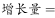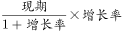，可得全国专利纠纷案件数增量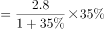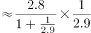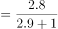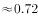万件；查处假冒专利案件增量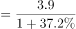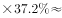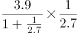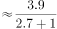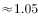万件；则二者比值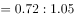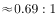。

故正确答案为C。

### 给定材料

        2017年，我国发明专利申请量为138.2万件，同比增长。共授权发明专利42.0万件，同比增长。其中，国内发明专利授权32.7万件，同比增长。在国内发明专利授权中，职务发明为30.4万件，占；非职务发明为2.3万件，占。

        截至2017年底，我国国内（不含港澳台）发明专利拥有量共计135.6万件，每万人口发明专利拥有量达到9.8件。我国每万人口发明专利拥有量排名前十位的省（区、市）依次为：北京（94.5件）、上海（41.5件）、江苏（22.5件）、浙江（19.7件）、广东（19.0件）、天津（18.3件）、陕西（8.9件）、福建（8.0件）、安徽（7.7件）和辽宁（7.6件）。

        2017年，我国在“一带一路”沿线国家（不含中国）专利申请公开量为5608件，同比增长。其中，在印度专利申请公开量为2724件，在俄罗斯专利申请公开量为1354件，专利申请初具规模。2017年，“一带一路”沿线国家在华申请专利4319件，同比增长；在华申请专利的“一带一路”沿线国家数达到41个，较2016年增加4个。

        2017年，全国专利行政执法办案总量6.7万件，同比增长。其中，专利纠纷办案2.8万件（包括专利侵权纠纷办案2.7万件），同比增长；查处假冒专利案件3.9万件，同比增长。

> [!warning] 疑点（官方解析可能有误，待人工复核）
> 给定材料文本中'专利纠纷办案2.8万件'与'查处假冒专利案件3.9万件'两处'同比增长'后的百分数均为空白，官方解析中的公式与代入数值亦被省略，故0.69∶1无法以当前文本数值复核；按材料导读要求，须以完整版材料补齐两处增速后用 增量=现期×r/(1+r) 验证，答案以官方C（0.69∶1）为准
