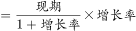
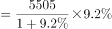
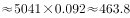

# 增长量计算（已知现期与同比增速，增长量=现期×r-(1+r)）

考点：[[20-考点/资料分析/增长/增长量计算（已知现期与同比增速，增长量=现期×r-(1+r)）|增长 / 增长量计算（已知现期与同比增速，增长量=现期×r/(1+r)）]]
材料：[[15-材料/资料分析/241024 2018年5月当月与1—5月累计的全|241024 2018年5月当月与1—5月累计的全]]

**问法模型**：‘2018年1—5月同比增加多少亿元’→增长量计算模型：先按题干时间口径锁定表中该行1—5月累计列的现期值与增速，再代入增长量=现期×r/(1+r)精算。

## 推理链
1. 第1步：题干时间口径为‘2018年1—5月’（累计），指标为‘粮油、食品类商品零售额’，据此锁定表格第三段15类商品中该行的1—5月列，切勿误取5月当月列（1038亿元、+7.3%）。
2. 第2步：本题为增长量计算，套用公式：增长量=现期×r/(1+r)；官方解析取该行1—5月现期5505亿元、同比+9.2%（所给表格图片该行印为8505，与解析口径不符，见疑点）。
3. 第3步：代入计算：增长量=5505×9.2%/109.2%，即5505×0.092=506.46。
4. 第4步：精算直除：506.46÷1.092≈463.8亿元。
5. 第5步：对照选项：A、B（70/70.6）恰为误用5月当月数据1038×7.3%/107.3%≈70.6的干扰项，先按口径排除；D(465)为分母未按109.2精算的近似值；C=463.8与精算结果一致，故选C。

**最快解法**：⚡ 精算直除（官方备注明确选项间距过小、不能估算）：先按‘1—5月’累计口径锁定该行1—5月列（5505亿元、+9.2%），算5505×9.2=50646，再÷109.2≈463.8，直接锁定C；可先用时间口径排除量级为70的A、B两项。

## 易错点
- ⚠ 当月/累计看串列：误用5月当月列（1038亿元、+7.3%）计算得约70.6亿元，正中A、B干扰项——动笔前先锁定题干‘1—5月’时间口径。
- ⚠ 选项间距极小（C与D仅差1.2、A与B仅差0.6）：百化分（9.2%≈1/11，5505/12≈459）或截位估算精度不足，在C(463.8)与D(465)之间无法裁决，本题必须精算。
- ⚠ 公式误用：增长量=现期×r/(1+r)，若漏除(1+r)得506.5（无对应选项）；同时注意本题r为正，勿与同表汽车类−1.0%负增长的符号处理混淆。

## 母题抽象
> 🧩 当题干出现‘某指标同比增加/减少多少亿元’特征时，用增长量=现期×r/(1+r)，先核对题干时间口径与表列口径（当月/累计）一致，再按选项间距决定精算还是百化分估算。

**同类特征**：同比增加多少亿元、增长量计算、1—5月累计时间口径、现期值与同比增速成对定位、选项数值高度接近需精算、当月/累计双列并存易串列

## 相关题
- [[10-真题/资料分析/增长/7159 增长量计算|7159]]（北京 2009，相关度1）
- [[10-真题/资料分析/增长/2571729 增长量计算——每增长1个百分点对应的增量（基期量×1%）|2571729]]（山东 2020，相关度1）
- [[10-真题/资料分析/增长/3018839 增长量计算（负增长情形：基期减少量）|3018839]]（广东 2021，相关度1）
- [[10-真题/资料分析/增长/10204654 增长量计算（已知现期与同比下降率求下降量）|10204654]]（安徽 2024，相关度1）
- [[10-真题/资料分析/增长/13319362 现期增长量计算（已知现期值与同比增速，用r-(1+r)公式）|13319362]]（江苏 2025，相关度1）

---

### 题干
2018年1—5月，粮油、食品类商品零售额同比增加多少亿元？

### 选项
- A. 70
- B. 70.6
- C. 463.8　✅
- D. 465

### 官方解析

根据“2018年1—5月，······同比增加多少亿元”，可判定本题为增长量计算问题。定位表格， 粮油食品类1-5月份的绝对量为5505亿元，同比增长。代入公式，增长量亿元。

故正确答案为C。

备注：由于本题A项与B项、Ｃ项与Ｄ项之间差距过小，故只能采用精算法计算。

### 给定材料

> [!warning] 疑点（官方解析可能有误，待人工复核）
> 官方解析文字存在缺漏且数值与所给表格图片冲突：解析称‘粮油食品类1-5月绝对量为5505亿元’（5505×9.2%/109.2%≈463.8，与答案C一致），但所给表格图片及材料导读中该行1—5月绝对量印为8505，按8505计算得约716.5亿元，四个选项均不匹配，且8505与5月当月1038的月度量级明显不衔接，应为图片数值转录讹误，与官方答案一致的现期值应为5505；另解析中‘同比增长’后缺增速9.2%、‘增长量亿元’后缺公式与数值过程，均不影响答案C的正确性。
