# 增长率比较（同比增速最快）

考点：[[20-考点/资料分析/增长/增长率比较（同比增速最快）|增长 / 增长率比较（同比增速最快）]]
材料：[[15-材料/资料分析/241026 2012—2016年我国乡村人口与乡|241026 2012—2016年我国乡村人口与乡]]

**问法模型**：题干出现'2016年……增速最快的是'→ 同比增长率比较模型，各选项分别按（现期-基期）/基期=增长量/基期量计算后比大小。

## 推理链
1. 第1步：定时间口径：2016年为现期、2015年为基期，从表二读取四行业数据：农业57636→59288、林业4436→4632、畜牧业29780→31703、渔业10881→11603（亿元）。
2. 第2步：明确规则：增长率=（现期-基期）/基期=增长量/基期量，四项同口径比较。
3. 第3步：代入计算：农业1652/57636≈2.9%；林业196/4436≈4.4%；畜牧业1923/29780≈6.5%；渔业722/10881≈6.6%。
4. 第4步：农业、林业明显偏小先排除；畜牧业与渔业接近，用反向验证精确区分：29780×6.5%≈1936＞1923，故畜牧业略低于6.5%；10881×6.6%≈718＜722，故渔业略高于6.6%。
5. 第5步：渔业（约6.6%）＞畜牧业（约6.5%）＞林业（约4.4%）＞农业（约2.9%），增速最快为渔业总产值，对照选项选D。

**最快解法**：⚡ 截位直除+反向验证：先算增长量/基期量——农业1652/57636、林业196/4436量级明显小直接排除；剩下畜牧业1923/29780与渔业722/10881，用基期×百分数反验：29780×6.5%≈1936＞1923（畜牧业<6.5%），10881×6.6%≈718＜722（渔业>6.6%），渔业略高，秒选D。

## 易错点
- ⚠ 畜牧业与渔业增速仅差约0.1个百分点，估算精度不够（都读成'约6%'）易误选C。
- ⚠ 绝对量迷惑：畜牧业增长量1923亿元远大于渔业722亿元，误用'增长量大=增速快'会选错，增速必须除以基期量。
- ⚠ 数据读取陷阱：柱状图只画第一产业总产值，四行业数值须读表格（2015年基期为4436、10881等），勿目测柱高、勿误用2012年数据当基期。

## 母题抽象
> 🧩 当题干出现'某年××增速最快/最慢的是'且选项为并列主体时，用 增长量/基期量 截位直除逐项比较，量级悬殊的先排除，最接近的两项用'基期×百分数'反向验证定胜负。

**同类特征**：增速最快、2016年（现期明确）、总产值、四行业并列比较、同比（相邻两年）、选项为主体名称而非数值

## 相关题
- [[10-真题/资料分析/增长/5510341 增长率比较（同比增速最快）|5510341]]（山东 2023，相关度2）
- [[10-真题/资料分析/增长/10297321 同比增速计算与比较（增长率比较）|10297321]]（浙江 2025，相关度1）
- [[10-真题/资料分析/综合/1752650 增速排序+单位数加总（查表排序求和）|1752650]]（北京 2016，相关度1）
- [[10-真题/资料分析/增长/18643764 分段加总后的一般增长率比较|18643764]]（天津 2026，相关度1）
- [[10-真题/资料分析/增长/2195847 增长率比较（增长倍数与绝对增量的口径统一）|2195847]]（黑龙江 2018，相关度1）

---

### 题干
下列选项中，2016年总产值增速最快的是：

### 选项
- A. 农业总产值
- B. 林业总产值
- C. 畜牧业总产值
- D. 渔业总产值　✅

### 官方解析

根据题干“······增速最快的是”，可判定本题为增长率的比较问题。2015年农业、林业、畜牧业、渔业总产值分别为57636、4436、29780、10881亿元，2016年农业、林业、畜牧业、渔业总产值分别为59288、4632、31703、11603亿元，则2016年农业、林业、畜牧业、渔业总产值增速分别为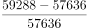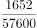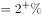、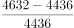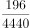、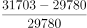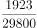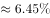、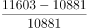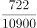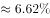，故2016年总产值增速最快的是渔业总产值。

故正确答案为D。

### 给定材料

