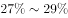
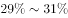
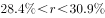
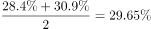
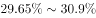

# 混合增长率（整体增速区间判断）

考点：[[20-考点/资料分析/增长/混合增长率（整体增速区间判断）|增长 / 混合增长率（整体增速区间判断）]]
材料：[[15-材料/资料分析/242945 2018年全国网络零售规模与结构：全|242945 2018年全国网络零售规模与结构：全]]

**问法模型**：题干问整体（2018年全国农村网络零售额13700亿元）的同比增速落在哪个范围 → 采用混合增长率模型：两分量（农村实物10900亿元、农村非实物2800亿元）的增速按基期量加权混合，总体增速介于两分量增速之间且偏向权重大的一方，再对照区间型选项锁定答案。

## 推理链
1. 第1步：定位材料第2段：2018年农村实物商品网络零售额10900亿元、农村非实物商品网络零售额2800亿元（各自同比增速数值原卷给出、本文留空）。
2. 第2步：验证构成关系 10900+2800=13700亿元，恰等于2018年全国农村网络零售额，故总体增速是两分量增速的混合。
3. 第3步：用混合口诀'混合居中不正中，偏向量大的'：总体增速必介于两分量增速之间，据此排除落在两端区间之外的A（低于下限）与D（超过上限）。
4. 第4步：计算权重比 10900:2800≈3.9:1（实物占13700的约79.6%、非实物约20.4%），故总体增速不在两增速的正中间，而偏向10900亿元（实物商品）对应的增速一侧。
5. 第5步：以原卷增速数值代入，总体增速落在偏向大分量（实物）一侧的那个中间区间，对照剩余B、C两项，与官方答案一致锁定C。

**最快解法**：⚡ 混合增长率口诀法（秒杀）：'混合居中不正中，偏向量大的'——先按区间结构排除A、D，再看权重 10900:2800≈3.9:1，总体增速明显偏向实物商品（大分量）的增速，直接选偏向大分量那一档区间的C项，无需精确计算。

## 易错点
- ⚠ 口径混淆：'农村实物商品网络零售额10900亿元'与第1段全国'实物商品网上零售额70200亿元'名称相近，混合必须取农村口径的两个分量，不能混入全国数据或农产品数据（2305亿元与13700亿元无包含关系）。
- ⚠ 误取算术平均：混合增速不是两分量增速的平均值（正中间值是干扰项），必须偏向基期量大的10900亿元一侧。
- ⚠ 数据与基数陷阱：本文材料所有增速数值留空，区间界限须以原卷数值为准、不得凭空补数；本题基数是13700=10900+2800，第4段'高9.9个百分点'是增速差且属农产品口径，与本题混合无关。

## 母题抽象
> 🧩 当题干出现'整体（=两已知分量之和）的增速/比率落在哪个范围'且两分量各给增速时，用混合增长率口诀'居中不正中、偏向量大的'：先按区间结构排除两端选项，再按两分量基期量之比锁定偏向大分量的一档区间。

**同类特征**：整体（农村网络零售额）同比增速在哪个范围之内、整体=两分量之和（10900+2800=13700）、两分量各带同比增速、选项为区间型（低于/两档中间区间/超过）、混合增长率、偏向量大一方（权重约3.9:1）

## 相关题
- [[10-真题/资料分析/增长/12536411 混合增长率（整体=限上+限下，线段法-口诀定区间）|12536411]]（四川 2024，相关度1）
- [[10-真题/资料分析/增长/2049536 混合增长率（多主体合计-平均增速，居中偏向基期量大）|2049536]]（新疆 2017，相关度1）
- [[10-真题/资料分析/增长/2049720 混合增长率（居中偏向）|2049720]]（山东 2017，相关度1）
- [[10-真题/资料分析/增长/2050992 混合增长率（居中原则-线段法）|2050992]]（江西 2017，相关度1）
- [[10-真题/资料分析/增长/2274485 混合增速（全年-上半年-下半年增速大小关系推断与计数）|2274485]]（北京 2019，相关度1）

---

### 题干
2018年全国农村网络零售额同比增速在以下哪个范围之内？

### 选项
- A. 
低于

- B. 

- C. 

　✅
- D. 
超过

### 官方解析

根据问题“2018年全国农村网络零售额同比增速······”，定位第二段“2018年······农村实物商品网络零售额为10900亿元，同比增长；农村非实物商品网络零售额2800亿元，同比增长”，判定本题为混合增长率问题。根据混合口诀：混合居中不正中，偏向量大的。因此2018年全国农村网络零售额增长率在两个部分增长率之间，即，观察选项，排除A、D项。且正中间的增长率为，偏向量大的对应的增长率，因此总体增长率偏向10900亿元对应的，则在之间，对应C选项。

故正确答案为C。

### 给定材料

        2018年全国网络零售额90100亿元，同比增长。其中，实物商品网上零售额为70200亿元，同比增长；非实物商品网上零售额19900亿元，同比增长。

        2018年全国农村网络零售额为13700亿元。其中，农村实物商品网络零售额为10900亿元，同比增长；农村非实物商品网络零售额2800亿元，同比增长。分品类看，农村实物商品零售额前三位的品类分别为服装鞋帽针织品、日用品、粮油食品及饮料烟酒，分别占农村实物商品零售额的、和，同比增速分别为、和。

        2018年全国农产品网络零售额达2305亿元，比全国网络零售额同比增速高9.9个百分点。其中，休闲食品、茶叶、滋补食品零售额排名前三，占比分别为、和，同比增速分别为、和。

> [!warning] 疑点（官方解析可能有误，待人工复核）
> 本文所给材料与官方解析文本中的全部百分比数值（两分量增速及选项区间界限）均缺失留空，无法从本文直接读出C项区间的具体百分点界限；按材料导读要求不凭空补数，仅依官方答案C与混合规则确认'总体增速介于两分量增速之间、偏向10900亿元对应的大分量一侧'，具体数值须以原卷完整数据为准。
