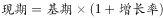
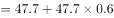
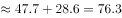
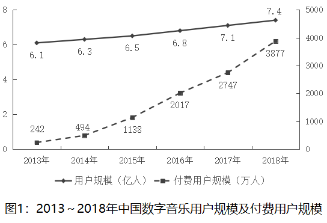
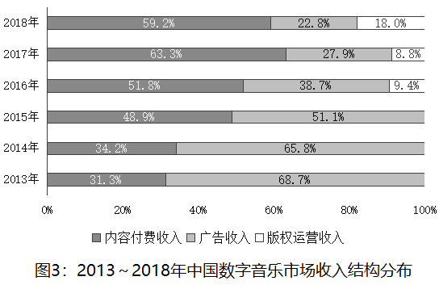

# 现期值计算（已知上一期值与同比增速求现期）

考点：[[20-考点/资料分析/增长/现期值计算（已知上一期值与同比增速求现期）|增长 / 现期值计算（已知上一期值与同比增速求现期）]]
材料：[[15-材料/资料分析/242946 2013～2018年中国数字音乐的用|242946 2013～2018年中国数字音乐的用]]

**问法模型**：题干问'2018年（图中无数值柱的年份）……约为多少亿元'→ 图中该年只给增速，用现期值=上一期值×(1+增速)间接推算

## 推理链
1. 第1步：题干求2018年收入规模，定位图2发现2018年柱值未标注，仅有同比增速点60%
2. 第2步：从图2提取条件：2017年（即2018年的基期）收入规模为47.7亿元，2018年同比增速为60%
3. 第3步：套用现期值公式：现期=基期×(1+增长率)=47.7×(1+60%)
4. 第4步：代入计算：47.7×1.6=47.7+47.7×0.6≈47.7+28.6=76.3亿元
5. 第5步：与选项对照：76.3与C项76最接近（A68、B72、D80均偏差更大），故选C

**最快解法**：⚡ 公式法+百化分速算：47.7×1.6，把×0.6看作'六成'，47.7×0.6≈28.6，加上47.7得76.3；或先粗估48×1.6≈77，锁定C（76）后用76÷47.7≈1.59≈60%反验增速吻合

## 易错点
- ⚠ 图2中2018年柱值缺失是本题主坑：误以为材料缺数据无法作答，或误取相邻年份47.7以外的柱值当基期；正确做法是用47.7×(1+60%)间接推算
- ⚠ 增速点错配：图2增速线2013年无数据点、各增速点易错位，须确认60%对应2018年、31%对应2017年；勿把2013年柱值4.3误当增速
- ⚠ 题型误判陷阱：误用47.7×60%≈28.6去匹配选项（错求增长量），或算成47.7×1.5≈71.6误选B；'约为'应取与76.3最接近的选项

## 母题抽象
> 🧩 当题干问某年数值而图表该年只标注增速未给数值时，用'现期值=上一期值×(1+增速)'间接推算，再选与计算结果最接近的选项

**同类特征**：2018年（图中未直接标注数值的年份）、约为多少亿元、已知上一年数值47.7与同比增速60%、现期计算、选项为间隔均匀的整数、图2柱线双轴图

## 相关题
- [[10-真题/资料分析/平均数/2030140 日均值×当月天数换算月总量后按阈值计数筛选|2030140]]（四川 2016，相关度1）
- [[10-真题/资料分析/增长/2050272 现期量计算（按同比增速外推一期）|2050272]]（湖南 2017，相关度1）
- [[10-真题/资料分析/增长/2184627 指数还原（由增速求现期指数，环比连乘-同比放大）|2184627]]（选调 2018，相关度1）
- [[10-真题/资料分析/增长/2456363 基期量计算|2456363]]（浙江 2020，相关度1）
- [[10-真题/资料分析/平均数/2579778 现期平均数计算（累计值−单月值做差求子时段总量后求月均）|2579778]]（浙江 2020，相关度1）

---

### 题干
2018年，中国数字音乐市场收入规模约为多少亿元？

### 选项
- A. 68
- B. 72
- C. 76　✅
- D. 80

### 官方解析

由题干“2018年······约为多少亿元”，结合材料给出2017年收入规模及2018年增速，可判定本题为现期计算问题。定位图2可得，2017年中国数字音乐市场收入规模为47.7亿元，2018年增速为。代入公式：可得，2018年，中国数字音乐市场收入规模约为亿元，与C项最接近。

故正确答案为C。

### 给定材料

