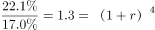
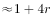
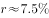
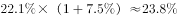
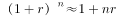
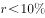

# 年均（复合）增长率计算及外推一期

考点：[[20-考点/资料分析/增长/年均（复合）增长率计算及外推一期|增长 / 年均（复合）增长率计算及外推一期]]
材料：[[15-材料/资料分析/242954 2018年全国能源消费总量（46.4|242954 2018年全国能源消费总量（46.4]]

**问法模型**：题干出现'按照2014-2018年……的平均增长率，2019年……约为'→采用年均复合增长率模型(1+g)^n=现期/基期（n=年份间隔），再乘(1+g)外推2019年占比

## 推理链
1. 第1步：从柱状图提取数据：2014年清洁能源占比17.0%，2018年为22.1%（图与文字'上升1.3个百分点'互验：20.8%+1.3=22.1%）
2. 第2步：确定期数n=2018-2014=4年（5个年份数据、间隔4年），年均增长率公式为(1+g)^4=22.1/17.0
3. 第3步：计算22.1/17.0≈1.30，即(1+g)^4≈1.30，开四次方得1+g≈1.068（验证1.068^4≈1.301），g≈6.8%
4. 第4步：外推2019年占比=22.1%×(1+g)≈22.1%×1.068≈23.6%
5. 第5步：与选项对照，约23.6%与B项最接近，故选B

**最快解法**：⚡ 公式法+开方估算：先算22.1/17≈1.3，两次开平方得1+g=1.3^(1/4)≈√1.14≈1.068（g≈6.8%），再22.1%×1.068≈23.6%直接锁定B；考场可背1.07^4≈1.31加速

## 易错点
- ⚠ 把百分点差当增速：误用(22.1-17.0)÷4=1.275个百分点/年，得22.1%+1.275%≈23.4%的算术平均错误答案，占比年均增长必须按复合增长率算
- ⚠ 期数n弄错：2014到2018是5个年份但间隔4年，n取5或3都会算错g
- ⚠ 忘记外推一步：只算出g≈6.8%就对照选项，或把占比的'%'与'个百分点'口径混同；2019年占比=22.1%×(1+g)，缺乘法这一步即错

## 母题抽象
> 🧩 当题干出现'按照某年份区间……的平均增长率、推算下一年数值'特征时，用(1+g)^n=现期/基期（n=末年-首年）解出g，再乘(1+g)外推一期，与选项对照验证

**同类特征**：按照……的平均增长率、2019年……约为、清洁能源消费量占能源消费总量的比重、柱状图多年度数据(17.0%→22.1%)、年均复合增长率外推、间隔4年推第5年

## 相关题
（暂无）

---

### 题干
按照2014-2018年清洁能源消费量占能源消费总量的平均增长率，2019年清洁能源消费量占比约为：

### 选项
- A. 

- B. 

　✅
- C. 

- D. 

### 官方解析

由题干“按照······的平均增长率，2019年清洁能源消费量占比约为”，可判定本题为年均增长率问题。定位图表可得，2014年清洁能源消费量占能源消费总量的，2018年为。代入年均增长率公式可得，，，则2019年清洁能源消费量占比约为，与B项最接近。

故正确答案为B。

注：，此公式往往是在，并且较小时使用。

### 给定材料

        2018年全年能源消费总量46.4亿吨标准煤，比上年增长。其中，煤炭消费量增长，原油消费量增长，天然气消费量增长，电力消费量增长。煤炭消费量占能源消费总量的，比上年下降1.4个百分点；天然气、水电、核电、风电等清洁能源消费量占能源消费总量的，上升1.3个百分点。

