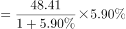
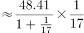
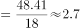
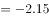
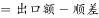
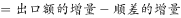
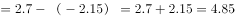

# 增长量计算（进口额同比增量：恒等式拆项间接求）

考点：[[20-考点/资料分析/增长/增长量计算（进口额同比增量：恒等式拆项间接求）|增长 / 增长量计算（进口额同比增量：恒等式拆项间接求）]]
材料：[[15-材料/资料分析/242955 2018年第一季度我国水产品进出口情|242955 2018年第一季度我国水产品进出口情]]

**问法模型**：题干问“进口额同比增量”但材料未直接给进口额及其增速 → 先用恒等式“顺差=出口额-进口额”变形为“进口额=出口额-顺差”，把进口额增量拆成“出口额增量-顺差增量”逐项求和。

## 推理链
1. 第1步：提取条件：贸易顺差19.66亿美元、同比减少2.15亿美元，即顺差同比增量=-2.15亿美元；出口额现期48.41亿美元、同比增加（本档增速数值空缺）；由总额77.15-出口48.41得现期进口额28.74亿美元（材料未直接给出）。
2. 第2步：用恒等式变形：顺差=出口额-进口额 → 进口额=出口额-顺差，故进口额同比增量=出口额同比增量-顺差同比增量。
3. 第3步：出口额增速先折成增量：增量=现期×r/(1+r)=48.41×r/(1+r)≈2.85亿美元（官方解析口径，对应r≈6.26%，百化分1/16即48.41÷17≈2.85）。
4. 第4步：代入拆项式：进口额增量≈2.85-(-2.15)=2.85+2.15≈5.0亿美元。
5. 第5步：与选项对照：5.0与A选项(5)最接近，故选A。

**最快解法**：⚡ 恒等式拆项+百化分：进口额增量=出口额增量-顺差增量=出口额增量+2.15；出口额增速（解析口径约6.26%）≈1/16，出口额增量≈48.41÷17≈2.85；2.85+2.15=5.0，直接锁定A，全程无需算基期进口额。

## 易错点
- ⚠ 进口额材料未直接给出，须由“总额77.15-出口额48.41=28.74”或恒等式倒推；切勿误用一般贸易出口额36.71亿美元或表格品种数据（三层口径递缩：整体出口→一般贸易出口→主要品种）。
- ⚠ 符号陷阱：顺差“同比减少2.15亿美元”即顺差增量为-2.15，进口额增量=出口额增量-(-2.15)=出口额增量+2.15；若漏掉负号会错算成2.85-2.15≈0.7而选错。
- ⚠ 增长量≠增长率：出口额给的是增速（百分率），须按现期×r/(1+r)折成增量，不能把48.41×6.26%≈3.03直接当增量；也不可与“个百分点”（如21.97）的增速变化口径混淆。

## 母题抽象
> 🧩 当题干求“材料未直接给出的量”的同比增量时，先用恒等式（进出口=出口+进口、顺差=出口-进口）把目标量拆成两项、逐项求增量再代数相减：给绝对量变化的直接用其增量的相反数，给增速的按现期×r/(1+r)折成增量。

**同类特征**：求未直接给出的“进口额”的同比增量、顺差以绝对量“同比减少2.15亿美元”给出、出口额只给增速需折增量、恒等式拆项（顺差=出口额-进口额）、增长量计算、单位：亿美元

## 相关题
- [[10-真题/资料分析/增长/7159 增长量计算|7159]]（北京 2009，相关度1）
- [[10-真题/资料分析/增长/2571729 增长量计算——每增长1个百分点对应的增量（基期量×1%）|2571729]]（山东 2020，相关度1）
- [[10-真题/资料分析/增长/3018839 增长量计算（负增长情形：基期减少量）|3018839]]（广东 2021，相关度1）
- [[10-真题/资料分析/增长/10204654 增长量计算（已知现期与同比下降率求下降量）|10204654]]（安徽 2024，相关度1）
- [[10-真题/资料分析/增长/13319362 现期增长量计算（已知现期值与同比增速，用r-(1+r)公式）|13319362]]（江苏 2025，相关度1）

---

### 题干
2018年第一季度我国水产品进口额同比增量约为多少亿美元？

### 选项
- A. 5　✅
- B. 7
- C. 9
- D. 11

### 官方解析

根据题干“······同比增量······”判定本题为增长量计算问题。定位材料第二段：“出口方面，2018年第一季度······出口额48.41亿美元，增加”，可知出口额的增量亿美元。定位材料第一段：“贸易顺差19.66亿美元，同比减少2.15亿美元”，可知顺差的增量亿美元，顺差，因此，进口额，则进口额的增量亿美元，与A选项最接近。

故正确答案为A。

### 给定材料

        2018年第一季度我国水产品进出口192.67万吨，同比减少，增速较上年同期减少21.97个百分点；进出口总额77.15亿美元，同比增加。贸易顺差19.66亿美元，同比减少2.15亿美元。

        出口方面，2018年第一季度我国水产品出口量98.04万吨，同比减少，出口额48.41亿美元，增加。一般贸易出口量71.18万吨，同比减少；出口额36.71亿美元，同比增加。

> [!warning] 疑点（官方解析可能有误，待人工复核）
> 本档材料原文各“同比增加/减少”后的增速数值空缺，官方解析公式亦被截断（出口额增量数值未显示）；出口额增量≈2.85亿美元系由答案A(5)=出口额增量+2.15反推，并经基期勾稽验证：基期顺差19.66+2.15=21.81，与基期出口(48.41-2.85≈45.56)减基期进口(28.74-5≈23.74)≈21.82仅差0.01舍入，口径自洽；正式命题需以含增速数值的完整原文为准。
