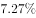
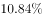
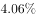
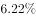
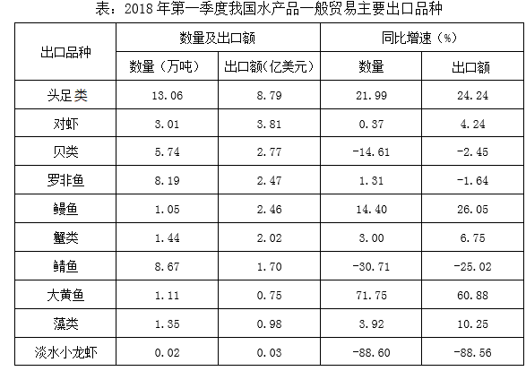

# 间隔基期量计算（隔年基期）

考点：[[20-考点/资料分析/增长/间隔基期量计算（隔年基期）|增长 / 间隔基期量计算（隔年基期）]]
材料：[[15-材料/资料分析/242955 2018年第一季度我国水产品进出口情|242955 2018年第一季度我国水产品进出口情]]

**问法模型**：题干求比现期早两年（2016Q1）的总量→间隔基期模型：基期量=现期量/[(1+r18)×(1+r17)]，隔年增速r17由'增速较上年同期减少21.97个百分点'倒推

## 推理链
1. 第1步：题干时间为2016年第一季度，材料现期为2018年第一季度，中间隔着2017年第一季度，判定为间隔基期问题，现期量=192.67万吨
2. 第2步：文字材料给出2018Q1进出口192.67万吨、同比减少（增速数值在所给原文中空缺，记为r18），且增速较上年同期减少21.97个百分点
3. 第3步：由百分点关系倒推隔年增速：2017Q1同比增速r17=r18+21.97个百分点（现期为负增速，与正的百分点变化相加，注意符号）
4. 第4步：间隔基期公式：2016Q1进出口总量=192.67÷[(1+r18)×(1+r17)]，即先求2018年对2016年的间隔总增长率再回除现期量
5. 第5步：官方解析按间隔增长率公式代入完整增速计算，192.67÷(1+间隔总增幅)≈180万吨
6. 第6步：与选项对照：A.140万吨、B.160万吨、C.180万吨、D.200万吨，180万吨最接近，故选C

**最快解法**：⚡ 公式法+截位直除：先由'减少21.97个百分点'得r17=r18+21.97pp，间隔总增长率≈r18+r17（交叉项r18×r17量级小可忽略），再192.67÷(1+r总)与选项直除比对；选项间距20万吨，估出约180万吨即锁定C

## 易错点
- ⚠ 把隔年基期当普通基期：只回除一个(1+r18)、漏掉2017年那一层(1+r17)，结果会明显偏大
- ⚠ '增速较上年同期减少21.97个百分点'是百分点差而非增速本身：r17=r18+21.97pp，现期增速为负时符号处理易错，勿把21.97%直接当2017年增速
- ⚠ 时间口径陷阱：2016Q1是隔年基期、2017Q1是同比基期，勿混用；且所给原文'同比减少□'处增速数值空缺，代入计算需以完整原文补全后为准

## 母题抽象
> 🧩 当题干出现'比现期早两年的某量最接近'特征时，用间隔基期公式 现期量/[(1+r1)(1+r2)]，隔年增速由'增速较上年同期提高/减少X个百分点'倒推（注意负增速加正百分点差的符号），验证结果与最接近选项。

**同类特征**：2016年第一季度（隔年基期时间）、进出口总量、最接近以下哪个数字、增速较上年同期减少21.97个百分点、间隔基期/隔年问题、现期量192.67万吨

## 相关题
- [[10-真题/资料分析/增长/2049720 混合增长率（居中偏向）|2049720]]（山东 2017，相关度1）
- [[10-真题/资料分析/比重/2028282 现期比重计算（多部分求和作分子）|2028282]]（国考 2017，相关度1）
- [[10-真题/资料分析/增长/2444691 增长量计算（环比增量：现期÷(n+1)型百化分估算）|2444691]]（四川 2019，相关度1）
- [[10-真题/资料分析/其他/2742291 简单加总·部分求整体（整体=私有云+公有云）|2742291]]（北京 2021，相关度1）
- [[10-真题/资料分析/增长/2172164 进出口总量增长率计算（分项加和后求一般增长率）|2172164]]（广州市考 2018，相关度1）

---

### 题干
2016年第一季度我国水产品进出口总量最接近以下哪个数字？

### 选项
- A. 140万吨
- B. 160万吨
- C. 180万吨　✅
- D. 200万吨

### 官方解析
根据题干“2016年第一季度······”，结合材料时间为2018年第一季度，可判定本题为间隔基期问题。定位材料第一段：“2018年第一季度我国水产品进出口192.67万吨，同比减少，增速较上年同期减少21.97个百分点”，则2018年我国水产品进出口同比增速，2017年同比增速，根据间隔增长率公式，可得2018年相比2016年增长率。根据，可得2016年第一季度我国水产品进出口总量万吨，C选项最接近。
故正确答案为C。

### 给定材料

        2018年第一季度我国水产品进出口192.67万吨，同比减少，增速较上年同期减少21.97个百分点；进出口总额77.15亿美元，同比增加。贸易顺差19.66亿美元，同比减少2.15亿美元。

        出口方面，2018年第一季度我国水产品出口量98.04万吨，同比减少，出口额48.41亿美元，增加。一般贸易出口量71.18万吨，同比减少；出口额36.71亿美元，同比增加。

> [!warning] 疑点（官方解析可能有误，待人工复核）
> 所给材料原文与官方解析中2018Q1同比增速数值均空缺（'同比减少□'），本题代入步骤无法从当前材料逐步复现；按官方答案C=180万吨反推，r18≈-6.95%、r17≈15.02%（间隔总增幅≈7%，192.67÷1.07≈180），需以完整原文补全增速数值后核验；官方答案C予以保留。
