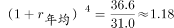
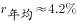
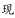
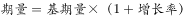
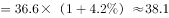

# 年均增长率外推求现期（预测值）

考点：[[20-考点/资料分析/增长/年均增长率外推求现期（预测值）|增长 / 年均增长率外推求现期（预测值）]]
材料：[[15-材料/资料分析/244992 全国社会组织的总量与构成（社会团体-|244992 全国社会组织的总量与构成（社会团体-]]

**问法模型**：题干出现'按2014～2018年年均增长速度持续增长，2019年约为多少'→ 先用年均增长率公式 r=(现期/基期)^(1/n)−1（n=2018−2014=4），再外推 2019年=现期×(1+r)

## 推理链
1. 第1步：定位图1社会团体序列，2014年=31.0万个，2018年=36.6万个（中间年份本题不用）
2. 第2步：年均增长率公式 (1+r)^n=36.6/31.0，年份间隔 n=2018−2014=4（不是5）
3. 第3步：36.6/31.0≈1.181，开四次方得 1+r≈(1.181)^(1/4)≈1.042，即年均增速约4.2%
4. 第4步：外推2019年=36.6×(36.6/31.0)^(1/4)≈36.6×1.042≈38.1万个
5. 第5步：对照选项，38.1万个即选项C；A 36.8对应年增速仅约0.5%过小，B 37.9对应约3.6%偏低，D 40.2对应约9.8%过大，均排除

**最快解法**：⚡ 公式法+开方速算：r=(36.6/31.0)^(1/4)−1，连开两次平方根：√1.181≈1.087，√1.087≈1.042，故2019年=36.6×1.042≈38.1；或直接代入选项验证：(1+r)^4=36.6/31.0≈1.181，逐年增速约4%多，36.6×1.04≈38.1，锁定C

## 易错点
- ⚠ 年份间隔n取错：2014→2018间隔为4年，误按5年（或误把2014~2018当5个增长期）算年均增速会明显偏小、结果选错
- ⚠ 只算增速不外推：求出年均增速约4.2%后直接拿它对选项（无对应项），必须再乘现期36.6得到2019年预测值
- ⚠ 基期现期颠倒：误用(31.0/36.6)^(1/4)会得负增速、推出低于36.6的值而错选A；另注意图1单位'万个'与图2单位'个'相差一万倍，本题取数仅限图1，勿混用

## 母题抽象
> 🧩 当题干出现'按基期～现期的年均增长速度持续增长，求下一年约为多少'时，用公式 下一年=现期×(现期/基期)^(1/n)，n=现期年−基期年（间隔数），验证结果应略高于现期且落在选项量级内

**同类特征**：年均增长速度持续增长、2019年的数量约为、社会团体、现期预测外推、图1双柱图取数、单位万个

## 相关题
- [[10-真题/资料分析/增长/2050528 增长量比较|2050528]]（吉林 2017，相关度1）
- [[10-真题/资料分析/增长/2166230 年均增长率外推（现期预测计算）|2166230]]（深圳市考 2018，相关度1）

---

### 题干
若按2014～2018年社会团体数量的年均增长速度持续增长，2019年的社会团体数量约为（    ）万个。

### 选项
- A. 36.8
- B. 37.9
- C. 38.1　✅
- D. 40.2

### 官方解析

根据题干“若按······年均增长速度持续增长······2019年的······数量”，可判定本题为现期计算问题。定位图1，2014社会团体数量为31.0万个，2018年为36.6万个。根据年均增长率计算公式：，则。根据，则2019年社会团体数量万个。

故正确答案为C。

### 给定材料

        截至2018年底，全国共有社会组织81.7万个，比上年增长，其中社会团体36.6万个，民办非企业单位44.4万个，基金会7034个；吸纳社会各类人员就业980.4万人，比上年增长。

