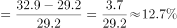
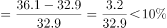
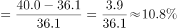
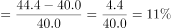
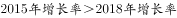
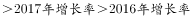

# 逐年增长率计算与折线图形态匹配

考点：[[20-考点/资料分析/增长/逐年增长率计算与折线图形态匹配|增长 / 逐年增长率计算与折线图形态匹配]]
材料：[[15-材料/资料分析/244992 全国社会组织的总量与构成（社会团体-|244992 全国社会组织的总量与构成（社会团体-]]

**问法模型**：题干问'能反映2015～2018年××增长率的折线图'→逐年计算环比增长率（2015年需以2014年为基期），按大小形态与选项折线走势匹配排除。

## 推理链
1. 第1步：从图1提取民办非企业单位序列：2014年28.2万个、2015年32.9万个、2016年36.1万个、2017年40.0万个、2018年44.4万个；2015年增长率必须以题干年限之前的2014年为基期
2. 第2步：增长率公式 r=(现期−基期)/基期×100%
3. 第3步：代入计算——2015年=(32.9−28.2)/28.2=4.7/28.2≈16.7%；2016年=(36.1−32.9)/32.9=3.2/32.9≈9.7%；2017年=(40.0−36.1)/36.1=3.9/36.1≈10.8%；2018年=(44.4−40.0)/40.0=4.4/40.0=11.0%
4. 第4步：大小关系为16.7%>11.0%>10.8%>9.7%，折线形态为'首点最高→2016年骤降为最低→后两年缓升'（先降后升）
5. 第5步：与四个选项折线图对照，只有B项呈现'首年最高、次年最低、随后逐年回升'的走势，其余选项走势（单调升降或拐点位置不同）均不符，故选B

**最快解法**：⚡ 截位直除+形态排除法：只需精算两端关键点——2015年4.7/28.2≈16.7%（四年最高）、2016年3.2/32.9≈9.7%（四年最低），锁定'高→低→升'形态即可排除A/C/D直接选B，后两年无需精算。

## 易错点
- ⚠ 基期错位：2015年增长率必须用2014年的28.2万作基期（跨出题干年限取数），误用2015年自身或漏算2015年会全盘形态错乱
- ⚠ 把'数量折线'当'增长率折线'：数量2014～2018单调递增，但增长率并非单调（2016年回落至9.7%），照抄数量走势必错
- ⚠ 增量与增长率混淆：增量2016年最小(3.2万)恰对应增长率最低，但2017年增量(3.9万)<2018年(4.4万)且增长率10.8%<11.0%，须按增长率而非增量排折线高低

## 母题抽象
> 🧩 当题干出现'能反映××年××增长率折线图/最接近的图形'特征时，用'逐年算增速→抓首末年与最值拐点→形态排除'三步法，并检查首年增速是否需取题干年限前一年作基期。

**同类特征**：能反映…增长率的折线图、逐年环比增长率比较、图1双柱序列取数、首年基期在题干年限之前、先降后升形态、图形匹配排除法

## 相关题
- [[10-真题/资料分析/增长/10297072 同比增长量计算与折线趋势匹配|10297072]]（天津 2025，相关度1）

---

### 题干
能反映2015～2018年民办非企业单位数量增长率的折线图是（    ）。

### 选项
- A. 

- B. 

　✅
- C. 

- D. 

### 官方解析

根据题干“2015～2018年······增长率”，可判定本题为一般增长率问题。定位图1，民办非企业单位数2015～2018年增长率分别为：2015年增长率；2016年增长率；2017年增长率；2018年增长率。可见大小关系为，结合选项最接近的为B项。

故正确答案为B。

### 给定材料

        截至2018年底，全国共有社会组织81.7万个，比上年增长，其中社会团体36.6万个，民办非企业单位44.4万个，基金会7034个；吸纳社会各类人员就业980.4万人，比上年增长。

> [!warning] 疑点（官方解析可能有误，待人工复核）
> 官方解析中四个增长率的具体数值与计算式被省略（仅写'2015年增长率；2016年增长率…'），但按图1数据实算16.7%、9.7%、10.8%、11.0%与答案B的形态判断一致，答案无误。

<!-- CODEX-ANSWER-REVIEW:BEGIN -->
### 本次独立复核

**复核状态：** `resolved`（答案与解析已核定）

**计分答案：** B（可计分）

**复核解析：**

民办非企业单位数量依次约29.2、32.9、36.1、40.0、44.4万家。逐年增速约为12.7%、9.7%、10.8%、11.0%，走势为先降、后升、再升；与该折线形态对应的选项为B。

**相关信息：**

折线题应从原始数量计算各年增速，而不是比较数量的绝对增量；增速图的横轴年份应与相邻区间对齐。

**题源依据：** [固定版本原题](https://github.com/Mentat-Uran/kaogongzhentizhengliu/blob/84ab93d4b64b61d897bece8a1c0a5bab06b4feb2/10-%E7%9C%9F%E9%A2%98/%E8%B5%84%E6%96%99%E5%88%86%E6%9E%90/%E5%A2%9E%E9%95%BF/2434306%20%E9%80%90%E5%B9%B4%E5%A2%9E%E9%95%BF%E7%8E%87%E8%AE%A1%E7%AE%97%E4%B8%8E%E6%8A%98%E7%BA%BF%E5%9B%BE%E5%BD%A2%E6%80%81%E5%8C%B9%E9%85%8D.md)；固定内容 commit `84ab93d4b64b61d897bece8a1c0a5bab06b4feb2`，Markdown blob `18c5e7709afebe823eb2e05749b86d4d1d8e6f44`。
<!-- CODEX-ANSWER-REVIEW:END -->
