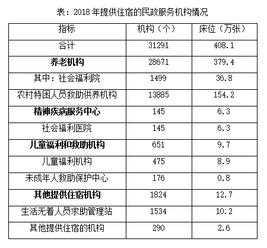
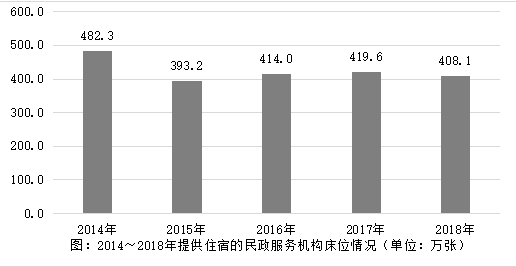

# 基期量计算（基期和差问题）

考点：[[20-考点/资料分析/增长/基期量计算（基期和差问题）|增长 / 基期量计算（基期和差问题）]]
材料：[[15-材料/资料分析/244993 2018年全国注册登记的提供住宿的民|244993 2018年全国注册登记的提供住宿的民]]

**问法模型**：题干问2017年（上年）机构总数'约多少万个' → 现期两类构成一减一增，用基期和差模型：基期合计=现期1÷(1−减少率)+现期2÷(1+增长率)，或先用'增长量抵消'判断总量是否与上年持平

## 推理链
1. 第1步：定位文字段：截至2018年底，全国注册登记的提供住宿的民政服务机构共计3.1万个，其中事业单位1.6万个（同比减少，率在所给材料中空缺）、民办非企业单位1.5万个（同比增加，率空缺），且1.6+1.5=3.1与总数吻合。
2. 第2步：题干求2017年总数，时间由2018年前移一年，为基期问题；两类一减一增，判定为基期和差模型：2017年总数=1.6÷(1−减少率)+1.5÷(1+增长率)万个。
3. 第3步：方向规则：'同比减少'项基期应大于现期1.6万（用除以(1−率)），'同比增加'项基期应小于现期1.5万（用除以(1+率)），一升一降相互抵消一部分。
4. 第4步：代入计算（原卷增速在所给材料中空缺，按官方解析）：方法一基期和差结果约为3.1万个；方法二改用增长量：事业单位的减少量与民办非企业单位的增加量方向相反、量级相当。
5. 第5步：两项增长量相抵后，2018年机构总数的总增长量≈0，即2017年总数与2018年基本持平，约3.1万个。
6. 第6步：对照选项A2.9、B3.1、C3.3、D3.5，仅B与计算结果一致，故选B。

**最快解法**：⚡ 增长量抵消法（官方方法二）：事业单位'同比减少'与民办非企业单位'同比增加'的增减量方向相反且量级相当，总增长量≈0 ⇒ 2017年总数≈2018年总数=3.1万个，直接锁定B，免去逐项基期除法；若增速差异大不可抵消，再回到基期和差公式1.6÷(1−率)+1.5÷(1+率)硬算。

## 易错点
- ⚠ 增减方向搞反：'同比减少'项求基期要除以(1−率)且基期大于1.6万，'同比增加'项要除以(1+率)且基期小于1.5万，方向弄反会误选C（3.3）或A（2.9）。
- ⚠ 单位与精度口径：文字'3.1万个'是四舍五入约数，表格合计31291个是精确值，本题选项以'万个'保留一位小数，应按文字段口径计算；且材料中增速百分数呈空缺，须以原卷完整数据代入，不得凭空补数。
- ⚠ 勿不加验证地照抄现期：答案3.1恰与现期相同，但逻辑前提是'事业单位减少量≈民办增加量、总增长量≈0'须先成立；遇增速差异大的同类题，基期合计会偏离现期，直接抄现期会掉坑。

## 母题抽象
> 🧩 当题干出现'上年（基期）两分类量之和'且两类'一减一增'、现期值相近时，先用增长量抵消法判断总增长量是否≈0（≈0则基期合计≈现期合计，直接选同值选项），否则用基期和差=∑现期÷(1±率)逐项计算，并验证结果落在选项区间。

**同类特征**：问2017年（时间前移一年的基期）总量、'共计约多少万个'求约数、材料给出两类构成且一减一增、基期和差问题、选项为一位小数（万单位）、现期为2018年底时点数

## 相关题
- [[10-真题/资料分析/增长/2434314 基期量计算（基期和差问题）|2434314]]（新疆 2019，相关度2）
- [[10-真题/资料分析/增长/12536430 基期量计算与基期和差比较|12536430]]（四川 2024，相关度1）
- [[10-真题/资料分析/增长/2376602 基期量计算与基期差值比较（基期和差问题）|2376602]]（黑龙江 2019，相关度1）
- [[10-真题/资料分析/增长/2444743 基期量和差（基期量反推+期间差求单月值）|2444743]]（四川 2019，相关度1）
- [[10-真题/资料分析/增长/2050950 基期量计算——基期和差（2014年玉米与小麦基期差值）|2050950]]（江西 2017，相关度1）

---

### 题干
2017年，全国注册登记的提供住宿的各类民政服务机构共计约多少万个？（    ）

### 选项
- A. 2.9
- B. 3.1　✅
- C. 3.3
- D. 3.5

### 官方解析
根据题干“2017年，全国注册登记······共计约多少万个”，结合材料可得“全国注册登记的提供住宿的各类民政服务机构=注册登记为事业单位的+注册登记为民办非企业单位的”，同时时间为2018年，可判定本题为基期和差问题。
方法一：定位文字材料“截至2018年底，全国注册登记的提供住宿的各类民政服务机构共计3.1万个，其中注册登记为事业单位的1.6万个，同比减少；注册登记为民办非企业单位的1.5万个，同比增加”，则2017年全国注册登记的提供住宿的各类民政服务机构万个。
方法二：根据“增长量”可得，2018年注册登记为事业单位的减少量万个；注册登记为民办非企业单位的增长量万个。则2018年全国注册登记的提供住宿的各类民政服务机构增长量，即数量与上年持平，B项满足。
故正确答案为B。

### 给定材料

根据以下资料，回答96～100题。

        截至2018年底，全国注册登记的提供住宿的各类民政服务机构共计3.1万个，其中注册登记为事业单位的1.6万个，同比减少；注册登记为民办非企业单位的1.5万个，同比增加。机构内床位408.1万张，同比减少；年末收留抚养人员211.9万人，同比减少。

       

> [!warning] 疑点（官方解析可能有误，待人工复核）
> 材料原文与官方解析中'同比减少/增加'后的具体百分数及方法一、方法二的代入数值均呈空缺（原卷增速数据未随材料给出），凭所给文本无法独立复算出3.1，只能依据官方解析'总增长量≈0、数量与上年持平'的结论锁定B；此系数据口径缺失而非答案错误，精确复核需以原卷完整增速为准。
