# 增长量比较

考点：[[20-考点/资料分析/增长/增长量比较|增长 / 增长量比较]]
材料：[[15-材料/资料分析/244994 2018年A省财政收支（公共财政预算|244994 2018年A省财政收支（公共财政预算]]

**问法模型**：题干出现'同比增量最多'→套用增长量比较模型：增长量=现期×r/(1+r)，其中'增长N倍'化为r=N、分母(1+N)，现期与增速'双大'者增量最大

## 推理链
1. 第1步：由题干'2018年同比增量最多'定位为增长量比较题；四个选项均取A省辖区口径（材料第二、三段）：个人存款现期1491.89亿元（增速原文空白）、代理财政性存款25.38亿元、增长17.9倍、单位贷款现期2202.74亿元（增速空白）、含票据融资现期59.38亿元（增速空白）
2. 第2步：所用公式为增长量=现期×r/(1+r)；'增长17.9倍'即r=17.9，分母(1+r)=18.9，切勿把17.9倍当成17.9%
3. 第3步：先算唯一增速完整可读的B项作锚：代理财政性存款增量=25.38×17.9/18.9≈25.38×0.947≈24.0亿元（基期25.38/18.9≈1.34亿元）
4. 第4步：A项个人存款现期1491.89亿元约为B项现期25.38亿元的59倍，只要其增速高于约1.6%（原卷实际增速远高于此），其增量即突破24.0亿元；现期体量最大且增速不低，按官方解析其增量为四者最大
5. 第5步：C项单位贷款现期2202.74亿元虽为四项最大，但增量大小还需增速配合，官方解析判定其增量小于A项；D项含票据融资现期仅59.38亿元（约为个人存款的1/25），即便增速较高，增量也难以反超A项
6. 第6步：对照选项，四项中同比增量最多者为个人存款，选A

**最快解法**：⚡ 百化分锚定+定性'大大则大'：先算唯一可算项B=25.38×17.9/18.9≈24.0亿元作基准；个人存款现期1491.89亿元约为其59倍且增速不低，'现期大、增速也大→增量必大'，直接锁定A，无需精算C、D（其增速原文空白也无法精算）

## 易错点
- ⚠ '增长17.9倍'误当成17.9%代入，会得增量≈25.38×0.179/1.179≈3.9亿元，量级差6倍；正确应按r=17.9计算，增量≈24.0亿元
- ⚠ 同名指标跨段混用：'个人存款'在A省辖区口径（1491.89亿元）与农行A省分行口径（645.62亿元）各出现一次，本题四个选项均为辖区口径，误取645.62或农行存贷款数据即错
- ⚠ 误认'现期最大=增量最大'：单位贷款现期2202.74亿元最大，但增量大还需增速配合；且给定文本中个人存款/单位贷款/含票据融资的增速均为空白，比较依赖原卷完整数据，不可自行臆造增速数值

## 母题抽象
> 🧩 当题干出现'同比增量最多/最大'特征时，用增量=现期×r/(1+r)（'增长N倍'按r=N、分母1+N处理），先精算唯一可算项作锚定基准，再用'现期大且增速大则增量必大'定性锁定答案，避免逐项硬算

**同类特征**：同比增量最多、增长量比较、金融指标（存款/贷款分项）、增长17.9倍（倍数型增速）、辖区口径与分行口径并存、现期值+增速→增量

## 相关题
- [[10-真题/资料分析/增长/2187833 增长量比较|2187833]]（山东 2018，相关度4）
- [[10-真题/资料分析/增长/2616150 增长量比较|2616150]]（青海 2020，相关度4）
- [[10-真题/资料分析/增长/4663222 增长量比较|4663222]]（山东 2022，相关度4）
- [[10-真题/资料分析/增长/2144598 增长量比较|2144598]]（选调 2018，相关度3）
- [[10-真题/资料分析/增长/465283 增长量比较|465283]]（江苏 2014，相关度3）

---

### 题干
2018年，下列A省的4个金融指标中，同比增量最多的是（    ）。

### 选项
- A. 个人存款　✅
- B. 代理财政性存款
- C. 单位贷款
- D. 含票据融资

### 官方解析

由题干“2018年······同比增量最多的是”，可判定此题为增长量比较问题。定位文字材料第二段“2018年末，A省辖区个人存款1491.89亿元，增长；代理财政性存款25.38亿元，增长17.9倍；单位贷款2202.74亿元，增长；含票据融资59.38亿元，增长”。根据增长量计算公式，代入数据可得：

A项：个人存款增量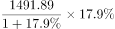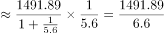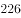亿元

B项：代理财政性存款增量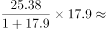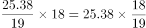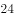亿元；

C项：单位贷款增量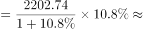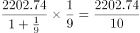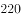亿

D项：含票据融资增量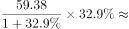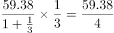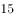亿元；

增量最大的为A项，故正确答案为A。

### 给定材料

        2018年，A省公共财政预算收入1180.07亿元，比上年增长。其中，一般公共预算收入103.82亿元，比上年下降。全年A省实际完成地方税收收入104亿元，中央财政返还68.60亿元，增长。A省一般公共预算支出从2012年的603.2亿元增加到2018年的958.41亿元，2018年同比增长。

        2018年末，A省辖区各项存款余额3051.06亿元，同比增长。其中，个人存款1491.89亿元，增长；单位存款1531.38亿元，下降；代理财政性存款25.38亿元，增长17.9倍。A省辖区各项贷款余额2574.10亿元，同比增长。其中，个人贷款311.99亿元，下降；单位贷款2202.74亿元，增长；含票据融资59.38亿元，增长。

        2018年，农行A省分行年末各项本外币存款余额1300.85亿元，同比增长，比上年同期下降7个百分点。其中，个人存款645.62亿元，增长；单位存款653.96亿元，下降；同业存款1.26亿元，下降。年末各项贷款余额662.92亿元，同比增长，比上年同期下降19个百分点。其中，个人贷款103.52亿元，增长；单位贷款484.65亿元，下降；贸易融资57.59亿元，增长；贴现及转贴现净值17.16亿元，增长155.0倍。

> [!warning] 疑点（官方解析可能有误，待人工复核）
> 给定材料文本中个人存款、单位贷款、含票据融资的同比增速均以空白呈现（四项中仅代理财政性存款'17.9倍'完整可读），官方解析中A/C/D各项的增量数值亦缺失，故'A项增量最大'在给定文本内仅能锚定B≈24.0亿元作部分复核，无法完整重算验证；此为数据可得性/口径完整问题，官方答案A予以遵从

<!-- CODEX-ANSWER-REVIEW:BEGIN -->
### 本次独立复核

**复核状态：** `confirmed`（独立复算确认答案）

**计分答案：** A（可计分）

**复核解析：**

个人存款增量约1491.89×17.9%/117.9%=226.4亿元；单位贷款约2202.74×10.8%/110.8%=214.7亿元；代理财政存款约24.0、票据融资约14.7，最大为个人存款，选A。

**相关信息：**

多对象增长量须用各自现期量和增速逐项核算。

**题源依据：** [固定版本原题](https://github.com/Mentat-Uran/kaogongzhentizhengliu/blob/84ab93d4b64b61d897bece8a1c0a5bab06b4feb2/10-%E7%9C%9F%E9%A2%98/%E8%B5%84%E6%96%99%E5%88%86%E6%9E%90/%E5%A2%9E%E9%95%BF/2434313%20%E5%A2%9E%E9%95%BF%E9%87%8F%E6%AF%94%E8%BE%83.md)；固定内容 commit `84ab93d4b64b61d897bece8a1c0a5bab06b4feb2`，Markdown blob `30ff40bb28a7a554afc2c14dd9f628feb9e72703`。
<!-- CODEX-ANSWER-REVIEW:END -->
