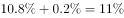
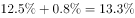

# 增长率（同比增幅）大小比较，含跨期增速逆向还原（1-9月=1-10月+回落百分点）

考点：[[20-考点/资料分析/增长/增长率（同比增幅）大小比较，含跨期增速逆向还原（1-9月=1-10月+回落百分点）|增长 / 增长率（同比增幅）大小比较，含跨期增速逆向还原（1-9月=1-10月+回落百分点）]]
材料：[[15-材料/资料分析/246136 2018年1-10月全国房地产开发投|246136 2018年1-10月全国房地产开发投]]

**问法模型**：题干'2018年下列指标中同比增长幅度最大'→逐项定位四个指标的同比增速，其中1-9月项须用'1-10月增速+回落/提高的百分点数'还原到同期，再同口径直比大小。

## 推理链
1. 第1步：题干要求比较四个指标的同比增速（'增长幅度'即增速而非增长量），四个指标分别定位材料第2段东部投资53136亿元、第4段西部商品房销售额24165亿元、第3段全国商品房销售额115913亿元、第1段住宅投资70370亿元。
2. 第2步：口径规则——A、C两项问的是1-9月增速，而材料只给1-10月增速'比1-9月回落x个百分点'，故须逆向还原：1-9月增速=1-10月增速+回落幅度；B、D直接读取1-10月同比增速。
3. 第3步：A项=东部投资1-10月增速+0.2个百分点；C项=全国商品房销售额1-10月增速+0.8个百分点（对应115913亿元'增速回落0.8个百分点'）。
4. 第4步：B项=西部商品房销售额24165亿元的1-10月'增长'增速（回落0.6个百分点只说明趋势放缓，不影响取值）；D项=住宅投资70370亿元的1-10月'增长'增速（回落0.3个百分点同理）。
5. 第5步：将还原后的A、C与直读的B、D四个增速同口径比较，官方解析判定B（1-10月西部商品房销售额增速）为四者中最大。
6. 第6步：对照选项，正确答案为B。

**最快解法**：⚡ 增速还原法+直接比较：A、C只需把'1-10月增速+回落幅度'（东部+0.2pp、全国销售额+0.8pp）口算还原成1-9月增速，B、D直读1-10月增速，四个百分数排大小直取最大者B，全程不涉及基期量或增长量计算。

## 易错点
- ⚠ 时间口径混淆：A、C问的是1-9月增速，必须把'比1-9月回落0.2/0.8个百分点'反向加回1-10月增速（1-9月=1-10月+回落幅度）；直接拿1-10月增速比较、或误把回落当成减出负数都会错。
- ⚠ '增长幅度'=同比增速而非增长量：住宅投资70370亿元、全国销售额115913亿元体量大不等于增速大，勿被绝对数带偏而错选D或C。
- ⚠ 方向词陷阱：'增速回落'不代表同比为负（回落≠下降），'降幅扩大'才是负增长加深；西部投资'提高0.9个百分点'是全材料唯一提高项，但本题考的是销售额/住宅投资口径，勿错拿西部投资增速。

## 母题抽象
> 🧩 当题干出现'下列指标中同比增长（幅度）最大/最小'且选项时间口径不一致（混有1-9月与1-10月）时，先用'1-10月增速+回落/提高的百分点数'把所有增速还原到同一期，再同口径直接比大小。

**同类特征**：同比增长幅度最大、增长率（增速）比较、1-9月与1-10月跨期口径混排、增速比1-9月回落/提高x个百分点（逆向还原）、四个选项分散于材料不同自然段

## 相关题
（暂无）

---

### 题干
在2018年的下列指标中，同比增长幅度最大的是：

### 选项
- A. 1-9月东部地区房地产开发投资
- B. 1-10月西部地区商品房销售额　✅
- C. 1-9月商品房销售额
- D. 1-10月住宅投资

### 官方解析

由题干“在2018年···同比增长幅度最大···”，可判定本题为一般增长率比较问题。

A项，定位文字材料第二段，“1-10月份，东部地区房地产开发投资53136亿元，同比增长，增速比1-9月份回落0.2个百分点；”，可计算出2018年1-9月东部地区房地产开发投资增速为；

B项，定位文字材料第四段，“1-10月份···西部地区商品房···销售额24165亿元，增长···。”，可知2018年1-10月西部地区商品房销售额增速为；

C项，定位文字材料第三段，“1-10月份，···商品房销售额115913亿元，增长，增速回落0.8个百分点。···”，可计算出2018年1-9月商品房销售额增速为；

D项，定位文字材料第一段，“2018年1-10月份，···其中，住宅投资70370亿元，增长···”，可知2018年1-10月住宅投资增速为。

比较上述增速，最大的是1-10月西部地区商品房销售额（）。

故正确答案为B。

### 给定材料

        2018年1-10月份，全国房地产开发投资99325亿元，同比增长，增速比1-9月份回落0.2个百分点。其中，住宅投资70370亿元，增长，增速回落0.3个百分点。住宅投资占房地产开发投资的比重为。

        1-10月份，东部地区房地产开发投资53136亿元，同比增长，增速比1-9月份回落0.2个百分点；中部地区投资20755亿元，增长，增速回落1.3个百分点；西部地区投资21254亿元，增长，增速提高0.9个百分点；东北地区投资4180亿元，增长，增速回落0.9个百分点。

        1-10月份，商品房销售面积133117万平方米，同比增长，增速比1-9月份回落0.7个百分点。其中，住宅销售面积增长，办公楼销售面积下降，商业营业用房销售面积下降。商品房销售额115913亿元，增长，增速回落0.8个百分点。其中，住宅销售额增长，办公楼销售额下降，商业营业用房销售额增长。

        1-10月份，东部地区商品房销售面积53545万平方米，同比下降，降幅比1-9月份扩大0.4个百分点；销售额61680亿元，增长，增速回落0.6个百分点。中部地区商品房销售面积37733万平方米，增长，增速回落1.5个百分点；销售额25380亿元，增长，增速回落1.6个百分点。西部地区商品房销售面积35430万平方米，增长，增速回落0.3个百分点；销售额24165亿元，增长，增速回落0.6个百分点。东北地区商品房销售面积6409万平方米，下降，降幅扩大1.2个百分点；销售额4688亿元，增长，增速回落2.5个百分点。

        10月末，商品房待售面积52789万平方米，比9月末减少401万平方米。其中，住宅待售面积减少321万平方米，办公楼待售面积减少19万平方米，商业营业用房待售面积减少46万平方米。

> [!warning] 疑点（官方解析可能有误，待人工复核）
> 本版本材料及官方解析中各同比增速的具体数值均被挖空（仅保留方向词与回落/提高幅度），四个选项的增速无法从所给文字直接复核；官方解析的比较逻辑（A、C按'回落x个百分点'逆向加回还原1-9月增速）与答案B自洽，解析本身未见错误，但最终比大小依赖原卷所补数值。
