# 增长量比较（同比）

考点：[[20-考点/资料分析/增长/增长量比较（同比）|增长 / 增长量比较（同比）]]
材料：[[15-材料/资料分析/246136 2018年1-10月全国房地产开发投|246136 2018年1-10月全国房地产开发投]]

**问法模型**：题干出现'四个地区按商品房销售额同比增长量排序'→对每个地区套增长量=现期×g/(1+g)逐一计算（增速百化分提速）后排序对照选项

## 推理链
1. 第1步：定位第4段四地区商品房销售额及同比增速：东部61680亿元、中部25380亿元、西部24165亿元、东北4688亿元，方向词均为'增长'（本文本增速数值处空缺，按官方解析代入东部5.7%、中部21.9%、西部21.4%、东北11.5%）。
2. 第2步：套用增长量公式：增长量=现期×g/(1+g)；将g百化分：21.9%≈2/9、21.4%≈3/14、5.7%≈1/17.5、11.5%≈1/8.7，则增长量≈现期×分子/(分母+分子)。
3. 第3步：代入计算：中部≈25380×2/11≈4610亿元（实算≈4560），西部≈24165×3/17≈4260亿元，东部≈61680×0.057/1.057≈3330亿元，东北≈4688/9.7≈480亿元。
4. 第4步：排序得中部>西部>东部>东北；四地区销售额同比均为正增长，不存在负增长项。
5. 第5步：与选项对照，仅B项排序（中部>西部>东部>东北）与计算结果一致，故选B。

**最快解法**：⚡ 百化分+排除法：①先排除东北（现期4688亿元与增速11.5%双最小，约480亿元）；②中部vs西部：现期（25380>24165）与增速（21.9%>21.4%）均略大者中部，直接判中部>西部；③西部vs东部：现期东部约为西部2.5倍但增速仅约1/4，百化分实算西部≈24165×3/17≈4260>东部≈61680/18.5≈3330；得中部>西部>东部>东北，选B。

## 易错点
- ⚠ 本文本所有增速数值空缺，必须先补全（东部5.7%、中部21.9%、西部21.4%、东北11.5%）再计算，不能只凭'增长'方向词或'回落x个百分点'作答，'回落大'不等于增速低或负增长。
- ⚠ 东部现期最大（61680）但增速最小（5.7%），与中部/西部构成'现期大、增速小'的对冲局面，直接按现期量或按增速排序都会误判，必须实算增长量。
- ⚠ 口径陷阱：应取第4段'销售额'数据而非'销售面积'（东部面积同比下降、销售额却增长，两口径背离）；待售面积与本题无关，勿混入。

## 母题抽象
> 🧩 当题干出现'多个主体按同比增长量排序'特征时，用增长量=现期×g/(1+g)，增速百化分为1/n后近似现期×分子/(分母+分子)；当现期与增速大小方向冲突（对冲）时必须实算，验证完整排序后再对照选项。

**同类特征**：四个地区横向比较、同比增长量排序、商品房销售额、现期量×g/(1+g)、现期与增速大小对冲、增速数值需先补全

## 相关题
- [[10-真题/资料分析/增长/465283 增长量比较|465283]]（江苏 2014，相关度1）
- [[10-真题/资料分析/增长/5521212 增长量计算与比较排序|5521212]]（深圳市考 2023，相关度1）
- [[10-真题/资料分析/平均数/5509985 现期平均数计算与比较（日均降雨量=总雨量÷雨季天数）|5509985]]（江西 2023，相关度1）
- [[10-真题/资料分析/其他/2255861 简单差值计算（两地区销售额之差）|2255861]]（江西 2016，相关度1）
- [[10-真题/资料分析/平均数/2443086 平均数增长率比较（商品房均价增速：销售额增速与销售面积增速合成）|2443086]]（辽宁 2019，相关度1）

---

### 题干
2018年1-10月，在东部、中部、西部、东北四个地区中，按商品房销售额同比增长量的排序正确的是哪一项？

### 选项
- A. 
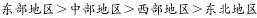

- B. 
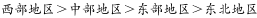
　✅
- C. 
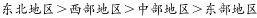

- D. 
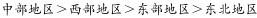

### 官方解析

由题干“2018年1-10月，···同比增长量的排序···”，可判定本题为增长量比较问题。定位文字材料第四段，“1-10月份，东部地区···销售额61680亿元，增长，···。中部地区···销售额25380亿元，增长，···。西部地区···销售额24165亿元，增长，···。东北地区···销售额4688亿元，增长，···”。根据公式，增长量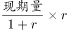，可计算出东部地区商品房销售额同比增长量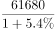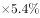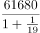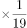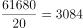亿元；中部地区商品房销售额同比增长量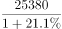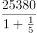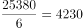亿元；西部地区商品房销售额同比增长量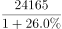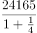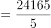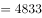亿元；东北地区商品房销售额同比增长量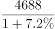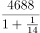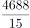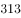亿元。比较四个数字，可知西部地区最大，满足的只有B项。

故正确答案为B。

### 给定材料

        2018年1-10月份，全国房地产开发投资99325亿元，同比增长，增速比1-9月份回落0.2个百分点。其中，住宅投资70370亿元，增长，增速回落0.3个百分点。住宅投资占房地产开发投资的比重为。

        1-10月份，东部地区房地产开发投资53136亿元，同比增长，增速比1-9月份回落0.2个百分点；中部地区投资20755亿元，增长，增速回落1.3个百分点；西部地区投资21254亿元，增长，增速提高0.9个百分点；东北地区投资4180亿元，增长，增速回落0.9个百分点。

        1-10月份，商品房销售面积133117万平方米，同比增长，增速比1-9月份回落0.7个百分点。其中，住宅销售面积增长，办公楼销售面积下降，商业营业用房销售面积下降。商品房销售额115913亿元，增长，增速回落0.8个百分点。其中，住宅销售额增长，办公楼销售额下降，商业营业用房销售额增长。

        1-10月份，东部地区商品房销售面积53545万平方米，同比下降，降幅比1-9月份扩大0.4个百分点；销售额61680亿元，增长，增速回落0.6个百分点。中部地区商品房销售面积37733万平方米，增长，增速回落1.5个百分点；销售额25380亿元，增长，增速回落1.6个百分点。西部地区商品房销售面积35430万平方米，增长，增速回落0.3个百分点；销售额24165亿元，增长，增速回落0.6个百分点。东北地区商品房销售面积6409万平方米，下降，降幅扩大1.2个百分点；销售额4688亿元，增长，增速回落2.5个百分点。

        10月末，商品房待售面积52789万平方米，比9月末减少401万平方米。其中，住宅待售面积减少321万平方米，办公楼待售面积减少19万平方米，商业营业用房待售面积减少46万平方米。

> [!warning] 疑点（官方解析可能有误，待人工复核）
> 官方解析文字'可知西部地区最大'与实算矛盾：中部≈4560亿元>西部≈4260亿元，应为'中部最大'，疑为解析笔误；正确答案B（中部>西部>东部>东北）的结论不受影响。

<!-- CODEX-ANSWER-REVIEW:BEGIN -->
### 本次独立复核

**复核状态：** `confirmed`（独立复算确认答案）

**计分答案：** B（可计分）

**复核解析：**

原图读数：东部61680增5.4%、中部25380增21.1%、西部24165增26.0%、东北4688增7.2%；同比增量约3161、4422、4988、315亿元，顺序西部>中部>东部>东北，选B。

**相关信息：**

同比增长额=现期量×r/(1+r)，不可仅按增速排序。

**题源依据：** [固定版本原题](https://github.com/Mentat-Uran/kaogongzhentizhengliu/blob/84ab93d4b64b61d897bece8a1c0a5bab06b4feb2/10-%E7%9C%9F%E9%A2%98/%E8%B5%84%E6%96%99%E5%88%86%E6%9E%90/%E5%A2%9E%E9%95%BF/2440288%20%E5%A2%9E%E9%95%BF%E9%87%8F%E6%AF%94%E8%BE%83%EF%BC%88%E5%90%8C%E6%AF%94%EF%BC%89.md)；固定内容 commit `84ab93d4b64b61d897bece8a1c0a5bab06b4feb2`，Markdown blob `0a48960b2ff7c5f5918dccdec3bec298a52d5c56`。
<!-- CODEX-ANSWER-REVIEW:END -->
