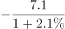
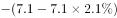

# 基期量计算（基期差值）

考点：[[20-考点/资料分析/增长/基期量计算（基期差值）|增长 / 基期量计算（基期差值）]]
材料：[[15-材料/资料分析/246299 2019年1-8月（重点8月当月）辽|246299 2019年1-8月（重点8月当月）辽]]

**问法模型**：题干问'2018年8月（基期）A类比B类约多多少亿元'而材料现期为2019年8月 → 基期差值模型：现期量÷(1+同比增速)分别折算基期后作差

## 推理链
1. 第1步：题干时间'2018年8月'早于材料现期2019年8月，且问'比……多……亿元'，判定为基期差值问题；定位表格'按产品类别分'的8月列：通讯器材类9.6亿元、同比+4.7%，日用品类7.1亿元、同比+2.1%。
2. 第2步：所用公式为基期量=现期量÷(1+同比增速)，两项分别折算到2018年8月。
3. 第3步：通讯器材类2018年8月基期量=9.6÷1.047≈9.17亿元。
4. 第4步：日用品类2018年8月基期量=7.1÷1.021≈6.95亿元。
5. 第5步：基期差值=9.17−6.95≈2.22亿元；方向校验：现期差9.6−7.1=2.5亿元，因通讯器材增速4.7%大于日用品2.1%，其基期被除得更小，基期差必小于2.5亿元。
6. 第6步：与选项对照，2.22与C项2.2最接近，故正确答案为C。

**最快解法**：⚡ 截位直除+方向排除：先看方向——现期差2.5亿元，通讯器材增速(4.7%)＞日用品(2.1%)，基期差<2.5，排除A；再截位直除9.6÷1.047≈960/105≈9.2，7.1÷1.021≈710/102≈7.0，差≈2.2，锁定C（亦可用9.6×(1−4.7%)≈9.15、7.1×(1−2.1%)≈6.95快速估算）。

## 易错点
- ⚠ 取数列名混淆：表格'8月'与'1-8月'两列混排，若误取1-8月数据（通讯80/2.4%、日用品59.2/-4.2%）则全盘皆错，取数必须核对列名。
- ⚠ 直接用现期差9.6−7.1=2.5亿元作答，忽略增速差对基期的压缩（增速大者基期更低），会偏向A(2.6)方向。
- ⚠ 折算公式误把÷(1+g)做成×(1+g)，或增速4.7%、2.1%漏看小数点当47%、21%算，量级即错；同类题遇负增速（如汽车-11.3%）须用1+负增速防符号错。

## 母题抽象
> 🧩 当题干出现'基期A比基期B多/少多少'且材料给现期量与同比增速时，用基期量=现期÷(1+g)分别折算作差；先用'现期差+两增速大小方向'锁定答案区间（增速大者基期被压更低），再截位直除验证选项。

**同类特征**：基期时间'2018年8月'+材料现期2019年8月、'比……约多……亿元'的基期差值问法、限定两个品类：通讯器材类与日用品类（名称易混项需核对）、表格'8月'与'1-8月'两列混排须选对列、选项为0.2间隔的小数精确值（2.6/2.4/2.2/2.0）

## 相关题
（暂无）

---

### 题干
2018年8月通讯器材类实现消费品零售额比日用品类约多        亿元。

### 选项
- A. 2.6
- B. 2.4
- C. 2.2　✅
- D. 2.0

### 官方解析

根据题干“2018年8月······比······亿元”，结合材料时间为2019年，可判定本题为基期和差问题。定位表格材料可知：“2019年8月，通讯器材类实现消费品零售额9.6亿元，同比增长，日用品7.1亿元，同比增长”，根据公式：基期量，2018年8月通讯器材类实现消费品零售额比日用品类多。

故正确答案为C。

### 给定材料

        2019年1-8月，辽宁省社会消费品零售总额9846.6亿元，比上年同期增长，增速回落1.6个百分点。限额以上单位消费品零售额实现2254.6亿元，同比下降，增速回落6.5个百分点。

        又知2019年1-7月全省限额以上批发业，零售业，住宿业和餐饮业实现零售额同比分别增长、、和。

