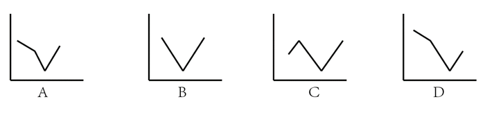
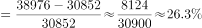
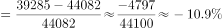
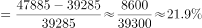

# 一般同比增长率计算＋增长率趋势折线图匹配

考点：[[20-考点/资料分析/增长/一般同比增长率计算＋增长率趋势折线图匹配|增长 / 一般同比增长率计算＋增长率趋势折线图匹配]]
材料：[[15-材料/资料分析/246298 材料主体为两张图片，文字数据不可读；|246298 材料主体为两张图片，文字数据不可读；]]

**问法模型**：问‘折线图能反映2015-2018年美洲地区销售收入同比增长率趋势的是’→向前多取一年（2014年）作基期，逐年用(现期-基期)/基期计算增长率，按数值高低排序后与选项折线形态比对。

## 推理链
1. 第1步：题干要求2015-2018年美洲地区销售收入的同比增长率，计算2015年增速必须补取2014年数据作基期，共需2014-2018五年数据。
2. 第2步：定位图2（2013-2018年华为按业务与地区分类构成堆叠图）中‘美洲’分项，2014-2018年销售收入分别为30852、38976、44082、39285、47885百万元。
3. 第3步：所用公式为一般同比增长率=(现期量-基期量)/基期量。
4. 第4步：代入计算——2015年=8124/30852≈26.3%；2016年=5106/38976≈13.1%；2017年=-4797/44082≈-10.9%（负增长）；2018年=8600/39285≈21.9%。
5. 第5步：排序得2015年最大（约26.3%）、2018年第二（约21.9%）、2016年第三（约13.1%）、2017年最低且为负值（约-10.9%）。
6. 第6步：与选项折线图对照，仅A项符合‘2015最高→2016回落→2017跌破至最低→2018回升但低于2015’的形态，排除B、C、D，故正确答案为A。

**最快解法**：⚡ 排序排除法＋截位直除：无需算出精确增长率，直接比较8124/30852、5106/38976、-4797/44082、8600/39285四个分式的量级——2015年约26%最大、2018年约22%次之、2016年约13%、2017年为负值最低；抓住‘最大在2015、次大在2018、最低点2017为负’三个特征点即可直接锁定A。

## 易错点
- ⚠ 取数定位错：美洲地区数据藏在图2堆叠柱的分地区色块中，极易误用图1的公司总收入及其已给增长率（如2017年总收入增速15.7%），指标主体（地区分项 vs 公司整体）必须一致。
- ⚠ 漏取基期：题干只问2015-2018四年，但算2015年增速必须向前多取2014年（30852百万）作基期，否则2015年增速无从计算。
- ⚠ 负增长形态陷阱：2017年增长率为-10.9%，折线最低点应明显低于其余年份甚至跌破零位；若忽略负号、只看正数大小顺序，可能误选形态相近的B、C、D。

## 母题抽象
> 🧩 当题干出现‘折线图能反映某指标若干年同比增长率趋势’时，向前多取一年作基期，逐年算增长率并抓‘最大值、次大值、最低值（警惕负增长）’三个特征点，与选项折线高低形态比对即可排除锁定答案。

**同类特征**：折线图趋势匹配、同比增长率、美洲地区销售收入、2015-2018年、堆叠结构图中取分地区数据、需补前一年作基期

## 相关题
- [[10-真题/资料分析/增长/23299 增长率计算之百分点换算（跨期增速倒推）|23299]]（安徽 2012，相关度1）
- [[10-真题/资料分析/增长/2015318 同比增长率计算|2015318]]（重庆 2016，相关度1）
- [[10-真题/资料分析/其他/2374811 简单查找比较（表格直接读数比大小）|2374811]]（广东 2019，相关度1）
- [[10-真题/资料分析/增长/2456363 基期量计算|2456363]]（浙江 2020，相关度1）
- [[10-真题/资料分析/增长/4695874 同比增长率计算（分量增速，一般增长率）|4695874]]（选调 2018，相关度1）

---

### 题干

下面折线图能反映2015-2018年华为在美洲地区销售收入同比增长率趋势的是：

### 选项
- A. A　✅
- B. B
- C. C
- D. D

### 官方解析

由题干“···2015-2018年···同比增长率”，可判定本题为一般增长率计算问题。定位统计图2，2014年-2018年华为在美洲地区销售收入分别为30852百万、38976百万、44082百万、39285百万、47885百万。根据公式，可计算出：

2015年增长率；

2016年增长率；

2017年增长率；

2018年增长率。

最大是2015年，第二是2018年，排除B、C、D三项。

故正确答案为A。

### 给定材料

