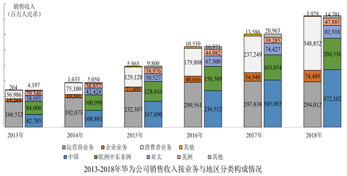

# 同比增长率读数比较（与固定阈值比对计数）

考点：[[20-考点/资料分析/增长/同比增长率读数比较（与固定阈值比对计数）|增长 / 同比增长率读数比较（与固定阈值比对计数）]]
材料：[[15-材料/资料分析/246298 材料主体为两张图片，文字数据不可读；|246298 材料主体为两张图片，文字数据不可读；]]

**问法模型**：题干问'同比增长低于10%的年份有几个'→ 直接读取统计图1折线上各年同比增长率标注，与阈值10%逐个比对后计数，无需任何计算

## 推理链
1. 第1步：从统计图1读取2010-2018年各年销售收入同比增长率：2010年24.5%、2011年11.7%、2012年8.0%、2013年8.5%、2014年20.6%、2015年37.1%、2016年32.0%、2017年15.7%、2018年19.5%
2. 第2步：判定规则——同比增长率低于10%即满足题意，图中已直接标注各年增长率，纯读数比较题
3. 第3步：逐一与10%比对：24.5%、11.7%、20.6%、37.1%、32.0%、15.7%、19.5%均高于10%，仅2012年8.0%和2013年8.5%低于10%
4. 第4步：满足条件的年份共2个（2012年、2013年），与官方解析一致，对照选项锁定A

**最快解法**：⚡ 直接读数法（零计算）：盯折线上的百分比标注找小于10%的点，一眼锁定8.0%（2012年）和8.5%（2013年）两个，秒选A；临界值11.7%（2011年）大于10%故不计入

## 易错点
- ⚠ 题干文字缺漏，'低于'后的阈值10%未显示完整，须以官方解析为准；误按其他阈值（如15%）计数会错选
- ⚠ 2011年11.7%与10%非常接近，易误判为低于10%而数出3个错选B
- ⚠ 图为柱折双轴混排：柱高是销售收入（百万元人民币）、折线点才是同比增长率，误拿柱子数值当增长率比较即踩坑；同时勿漏看2010年的24.5%数据点

## 母题抽象
> 🧩 当题干出现'某指标同比增长低于（高于）X%的年份有几个'时，直接从图上已标注的增长率读数逐一与阈值比对计数，不必计算；重点核对临界值年份（如11.7%对10%）的归属

**同类特征**：同比增长低于、年份有几个、计数型比较、柱折双轴图、增长率已直接标注、无需计算

## 相关题
- [[10-真题/资料分析/增长/16070145 同比增长率比较（逐年增速计算并计数年份）|16070145]]（贵州 2026，相关度2）
- [[10-真题/资料分析/其他/5623 直接查找比较（涨幅最大项）|5623]]（福建 2008，相关度1）
- [[10-真题/资料分析/增长/13504272 一般增长率计算与计数比较（同比增速-5%年份计数）|13504272]]（云南 2025，相关度1）
- [[10-真题/资料分析/增长/2024184 同比增长率比较（超阈值年份计数）|2024184]]（重庆 2016，相关度1）
- [[10-真题/资料分析/其他/2139506 表格定位读数与最值比较（直接查数）|2139506]]（天津 2017，相关度1）

---

### 题干

2010年-2018年华为公司销售收入同比增长低于的年份有<u>        </u>个。

### 选项
- A. 2　✅
- B. 3
- C. 4
- D. 5

### 官方解析

定位统计图1可知，2010-2018年华为公司销售收入同比增长率。其中2012年（）、2013年（）低于，所以满足题意的年份有2个。

故正确答案为A。

### 给定材料

> [!warning] 疑点（官方解析可能有误，待人工复核）
> 题干存在文字缺漏，'同比增长低于'后的阈值数值未显示；据官方解析（2012年8.0%、2013年8.5%低于阈值）及图中数据可唯一反推阈值为10%，官方答案A（2个）与图中数据完全吻合，不影响解题，仅记录题干显示口径问题
