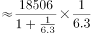
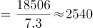

# 增长量计算（已知现期与增速，求同比增量）

考点：[[20-考点/资料分析/增长/增长量计算（已知现期与增速，求同比增量）|增长 / 增长量计算（已知现期与增速，求同比增量）]]
材料：[[15-材料/资料分析/246300 2019年1-8月全国房地产开发投资|246300 2019年1-8月全国房地产开发投资]]

**问法模型**：题干出现'比去年同期增加约____亿元'（现期与带单位的增量问法）→ 采用增长量公式：增长量=现期×r/(1+r)，配百化分r=1/n速算为现期/(n+1)

## 推理链
1. 第1步：定位文字资料第二段，提取2019年1-8月西部地区房地产开发投资现期18506亿元，同比增速16.0%（文字版百分数缺失，须从原始图表回补；'增速加快0.9个百分点'只是期际变化，不是本期增速）
2. 第2步：'比去年同期增加约X亿元'判定为增长量计算，公式：增长量=现期×r/(1+r)
3. 第3步：代入：18506×16%÷116%=2960.96÷1.16≈2552.6亿元（百化分：16%≈1/6.25，增长量=18506÷(6.25+1)=18506÷7.25≈2553）
4. 第4步：与选项对照：A为2812、B为2643、C为2552、D为2313，2552.6与C项2552最接近，故选C

**最快解法**：⚡ 百化分+截位直除：16%≈1/6.25，增长量=现期/(6.25+1)=18506/7.25≈2553，直选C项2552；验证时也可粗算18506×0.16≈2961再除以1.16收缩

## 易错点
- ⚠ 把'增速比1-7月加快0.9个百分点'误当成本期增速代入公式——该表述是增速的期际变化量，本期增速为16.0%
- ⚠ 漏除(1+r)项：直接用18506×16%≈2961当作增长量，结果偏大无法匹配选项
- ⚠ 文字版增速百分数缺失，'回落/加快X个百分点'与'增长X%'量纲不同不可混用相加，16.0%必须回补，不得用百分点数据凭空拼数
- ⚠ 时间口径：官方备注原题为'2018年1-8月'（无对应数据），已统一改为'2019年1-8月'现期口径，与现期18506亿元配套使用

## 母题抽象
> 🧩 当题干出现'某指标比去年同期增加约X（带单位）'且材料给出该指标现期值与同比增速时，用百化分r=1/n转化为增长量=现期/(n+1)，与最接近选项对照验证

**同类特征**：比去年同期增加约、带单位亿元的增长量问法、现期值18506亿元、同比增速16.0%、百化分1/6.25、增长量计算

## 相关题
- [[10-真题/资料分析/增长/7159 增长量计算|7159]]（北京 2009，相关度1）
- [[10-真题/资料分析/增长/2571729 增长量计算——每增长1个百分点对应的增量（基期量×1%）|2571729]]（山东 2020，相关度1）
- [[10-真题/资料分析/增长/3018839 增长量计算（负增长情形：基期减少量）|3018839]]（广东 2021，相关度1）
- [[10-真题/资料分析/增长/10204654 增长量计算（已知现期与同比下降率求下降量）|10204654]]（安徽 2024，相关度1）
- [[10-真题/资料分析/增长/13319362 现期增长量计算（已知现期值与同比增速，用r-(1+r)公式）|13319362]]（江苏 2025，相关度1）

---

### 题干
2019年1-8月，西部地区投资比去年同期增加约      亿元。

### 选项
- A. 2812
- B. 2643
- C. 2552　✅
- D. 2313

### 官方解析

根据题干“2019年1-8月，······增加约<u>      </u>亿元”，可判定本题为增长量计算问题。定位文字资料第二段可知，2019年1-8月，西部地区投资18506亿元，增长。则2019年1-8月西部地区投资增长量亿元，C项最接近。

故正确答案为C。

备注:原题干时间为“2018年1-8月”，但没有相关数据进行计算，故粉笔将本题时间修改为“2019年1-8月”，可以得出C项。

### 给定材料

        2019年1-8月，全国房地产开发投资84589亿元，同比增长，增速比1-7月回落0.1个百分点。其中，住宅投资65187亿元，增长，增速回落0.2个百分点。

        1-8月，东部地区房地产开发投资44857亿元，同比增长，增速比1-7月回落0.4个百分点；中部地区投资17809亿元，增长，增速加快0.3个百分点；西部地区投资18506亿元，增长，增速加快0.9个百分点；东北地区投资3418亿元，增长，增速回落1.3个百分点。

        1-8月，房地产开发企业土地购置面积12236万平方米，同比下降，每平方米土地价格同比上涨，土地成交额6374亿元。

        1-8月，东部地区商品房销售面积40303万平方米，同比下降，降幅比1-7月收窄0.6个百分点；销售额50739亿元，增长，增速加快0.3个百分点。中部地区商品房销售面积28791万平方米，增长，1-7月为下降；销售额20682亿元，增长，增速加快0.7个百分点。西部地区商品房销售面积28284万平方米，增长，增速加快1.0个百分点；销售额20363亿元，增长，增速加快0.6个百分点。东北地区商品房销售面积4471万平方米，下降，降幅收窄1.2个百分点；销售额3589亿元，增长，增速加快1.8个百分点。

> [!warning] 疑点（官方解析可能有误，待人工复核）
> 官方备注：原题干时间为'2018年1-8月'，因缺对应增速数据，粉笔改为'2019年1-8月'后可得出C项；本题题干已统一为2019年口径，与答案C无矛盾。另文字版中西部增速百分数缺失，16.0%须由原始图表回补，不回补则无法计算
