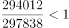
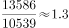
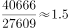
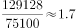

# 同比增长率比较

考点：[[20-考点/资料分析/增长/同比增长率比较|增长 / 同比增长率比较]]
材料：[[15-材料/资料分析/246298 材料主体为两张图片，文字数据不可读；|246298 材料主体为两张图片，文字数据不可读；]]

**问法模型**：题干给出'年份+业务'组合问同比增长率最高 → 对每个选项定位其现期年与基期年两期值，套用（现期-基期）÷基期逐一计算并比较大小

## 推理链
1. 第1步：从图2（2013-2018年华为销售收入按业务与地区分类构成，单位百万元人民币）读取四组数据：运营商业务2017年297838、2018年294012；其他业务2016年10539、2017年13586；企业业务2015年27609、2016年40666；消费者业务2014年75100、2015年129128
2. 第2步：确定各选项的现期/基期配对——A为2018对2017，B为2017对2016，C为2016对2015，D为2015对2014
3. 第3步：套用同比增长率=（现期值-基期值）÷基期值，A：(294012-297838)÷297838≈-1.3%，B：(13586-10539)÷10539≈28.9%，C：(40666-27609)÷27609≈47.3%
4. 第4步：算D：(129128-75100)÷75100=54028÷75100≈71.9%
5. 第5步：比较四项，71.9%＞47.3%＞28.9%＞-1.3%，2015年消费者业务同比增长率最高，对应选项D

**最快解法**：⚡ 排除法+增长率'过半'判定：A项2018年收入294012低于2017年297838，增长率为负，最先排除；再看剩余项增量是否超过基期一半——D项增量54028＞75100的一半37550（增长率＞50%），而C项增量13057＜27609的一半13805（增长率＜50%），B约29%更小，无需精算直接锁定D

## 易错点
- ⚠ 基期现期配对错误：问'2015年的消费者业务'须用2014年（基期）与2015年（现期），各选项年份与所需两个数据年一一对应，切勿错取相邻年份
- ⚠ 图2为业务×地区双层堆叠柱状图，数值标签密集且两类口径混排，易看串色块；须按图例取'运营商/企业/消费者/其他'对应色块数值，勿误取地区数据
- ⚠ 忽视负增长项：A项为负增长可直接秒排，若逐项硬算浪费时间；同时核对图1与图2单位一致（百万元人民币），避免量级疑虑

## 母题抽象
> 🧩 当题干出现'某年某分类指标同比增长率最高/最低'特征时，先按选项配对现期与基期两期值，用（现期-基期）÷基期比较：先排除负增长项，再用增量与基期一半比较（判断是否超过50%）快速排序验证

**同类特征**：同比增长率最高、各类业务（分业务构成比较）、选项为'年份+业务'组合、堆叠柱状图取数、现期基期跨年配对、一般增长率比较

## 相关题
- [[10-真题/资料分析/增长/4658501 同比增长率比较|4658501]]（四川 2021，相关度2）
- [[10-真题/资料分析/增长/1789628 同比增长率比较|1789628]]（江苏 2016，相关度2）
- [[10-真题/资料分析/增长/2578841 同比增长率比较|2578841]]（青海 2022，相关度2）
- [[10-真题/资料分析/增长/10297321 同比增速计算与比较（增长率比较）|10297321]]（浙江 2025，相关度1）
- [[10-真题/资料分析/增长/18643764 分段加总后的一般增长率比较|18643764]]（天津 2026，相关度1）

---

### 题干
2013年-2018年华为公司各类业务销售收入同比增长率最高的是：

### 选项
- A. 2018年的运营商业务
- B. 2017年的其他业务
- C. 2016年的企业业务
- D. 2015年的消费者业务　✅

### 官方解析

由题干“2013-2018年···同比增长率最高”，可判定本题为一般增长率比较问题。定位统计图2，2017年、2018年的运营商业务分别为297838百万元、294012百万元；2016年、2017年的其他业务分别为10539百万元、13586百万元；2015年、2016年的企业业务分别为27609百万元、40666百万元；2014年、2015年的消费者业务分别为75100百万元、129128百万元。根据公式，比较增长率可直接用；

A项：；

B项：；

C项：；

D项：。

比较上述数字，2013年-2018年华为公司各类业务销售收入同比增长率最高的是2015年的消费者业务。

故正确答案为D。

### 给定材料

