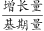
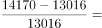
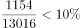
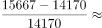
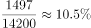
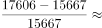
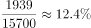
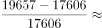
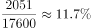

# 增长率比较（逐年环比增速比较）

考点：[[20-考点/资料分析/增长/增长率比较（逐年环比增速比较）|增长 / 增长率比较（逐年环比增速比较）]]
材料：[[15-材料/资料分析/246351 2018年我国科技事业发展情况：以R|246351 2018年我国科技事业发展情况：以R]]

**问法模型**：题干问'2014-2018年增速最快的是（哪年）'→ 对附表逐年当期值用增长率=（当年−上年）/上年逐一计算并比较大小，锁定最大者对应年份

## 推理链
1. 第1步：从附表读取2014—2018年R&D经费支出（亿元）：13016、14170、15667、17606、19657；2014—2017年数据仅附表提供，正文的11.6%只是2018年同比增速
2. 第2步：所用规则为环比增长率=（当年值−上年值）÷上年值，需比较2015、2016、2017、2018四个年份
3. 第3步：代入计算：2015年=(14170−13016)/13016=1154/13016≈8.9%；2016年=(15667−14170)/14170=1497/14170≈10.6%；2017年=(17606−15667)/15667=1939/15667≈12.4%；2018年=(19657−17606)/17606=2051/17606≈11.6%
4. 第4步：12.4%＞11.6%＞10.6%＞8.9%，2017年增速最快，与选项C（2017年）对照得出结论

**最快解法**：⚡ 增长率比较'先比增量、再看基期'：2018年增量2051亿元仅略大于2017年增量1939亿元，但2018年基期17606亿元明显大于2017年基期15667亿元（分母差异远大于分子差异），故2017年增速最大；保险起见可截位直除口算：1154/13000≈8.9%、1500/14200≈10.6%、1940/15700≈12.4%、2050/17600≈11.6%

## 易错点
- ⚠ 数据跨图表陷阱：只盯正文的'比上年增长11.6%'直接选D（2018年），漏掉2014—2017年增速必须依赖附表逐年计算
- ⚠ 混淆'增长量最大'与'增速最快'：2018年增量2051亿元为四年最大，但其基期17606亿元也最大，实际增速11.6%低于2017年的12.4%
- ⚠ 口径与时间范围：附表为逐年当期值（非累计），相邻两年相减即可；比较对象只含2015—2018四个年份，2014年无上年数据不参与比较，勿与年均增长率（间隔n=4）口径混淆

## 母题抽象
> 🧩 当题干出现'某年段内哪一年增速最快/最慢'且材料给出逐年当期值表时，用（当年−上年）/上年逐期计算比较，可先比增长量再比基期快速锁定，切勿把增量大误当增速快、也勿只取正文单一增速作答

**同类特征**：增速最快、2014-2018年逐年比较、R&D经费支出、附表逐年当期值、环比增长率比较、问年份不问数值

## 相关题
- [[10-真题/资料分析/增长/10297321 同比增速计算与比较（增长率比较）|10297321]]（浙江 2025，相关度1）
- [[10-真题/资料分析/综合/1752650 增速排序+单位数加总（查表排序求和）|1752650]]（北京 2016，相关度1）
- [[10-真题/资料分析/增长/18643764 分段加总后的一般增长率比较|18643764]]（天津 2026，相关度1）
- [[10-真题/资料分析/增长/2195847 增长率比较（增长倍数与绝对增量的口径统一）|2195847]]（黑龙江 2018，相关度1）
- [[10-真题/资料分析/增长/2377075 增长率比较（同比增速逐年计算）|2377075]]（选调 2019，相关度1）

---

### 题干
2014-2018年R&D经费支出增速最快的是

### 选项
- A. 2015年
- B. 2016年
- C. 2017年　✅
- D. 2018年

### 官方解析

根据“增速最快”判定为增长率比较问题。定位表格材料，根据增长率公式可得：

2015年增速=

2016年增速=

2017年增速=

2018年增速=

可见2017年增速最快。

故正确答案为C。

### 给定材料

        2018年我国全年研究与试验发展（R&amp;D）经费支出19657亿元，比上年增长11.6%，与国内生产总值之比为2.18%，其中基础研究经费1118亿元。全年国家重点研发计划共安排1052个项目，国家科技重大专项共安排563个课题，国家自然科学基金共资助44504个项目。截至年底，正在运行的国家重点实验室501个，累计建设国家工程研究中心132个，国家工程实验室217个，国家企业技术中心1480家。国家科技成果转化引导基金累计设立21支子基金，资金总规模313亿元。全年境内外专利申请432.3万件，比上年增长16.9%；授予专利权244.7万件，增长33.3%；PCT专利申请受理量为5.5万件。截至年底，有效专利838.1万件，其中境内有效发明专利160.2万件，每万人口发明专利拥有量11.15件。全年共签订技术合同41.2万项，技术合同成交金额17697亿元，比上年增长31.8%。

> [!warning] 疑点（官方解析可能有误，待人工复核）
> 官方解析中各年增速公式处未展示具体计算数值（留空），属展示不完整，但结论'2017年增速约12.4%为最快'经验算成立，答案C无误

<!-- CODEX-ANSWER-REVIEW:BEGIN -->
### 本次独立复核

**复核状态：** `resolved`（答案与解析已核定）

**计分答案：** C（可计分）

**复核解析：**

R&D经费2014—2018为13016、14170、15667、17606、19657亿元。同比约8.9%、10.6%、12.4%、11.6%；最快为2017年，选C。

**相关信息：**

每年用相邻两年的经费额计算同比率。

**题源依据：** [固定版本原题](https://github.com/Mentat-Uran/kaogongzhentizhengliu/blob/84ab93d4b64b61d897bece8a1c0a5bab06b4feb2/10-%E7%9C%9F%E9%A2%98/%E8%B5%84%E6%96%99%E5%88%86%E6%9E%90/%E5%A2%9E%E9%95%BF/2444067%20%E5%A2%9E%E9%95%BF%E7%8E%87%E6%AF%94%E8%BE%83%EF%BC%88%E9%80%90%E5%B9%B4%E7%8E%AF%E6%AF%94%E5%A2%9E%E9%80%9F%E6%AF%94%E8%BE%83%EF%BC%89.md)；固定内容 commit `84ab93d4b64b61d897bece8a1c0a5bab06b4feb2`，Markdown blob `c8275a2d7ecde4b0253fca98acb483b88ef5c657`。
<!-- CODEX-ANSWER-REVIEW:END -->
