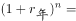
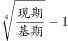
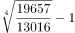
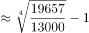

# 年均增长率计算

考点：[[20-考点/资料分析/增长/年均增长率计算|增长 / 年均增长率计算]]
材料：[[15-材料/资料分析/246351 2018年我国科技事业发展情况：以R|246351 2018年我国科技事业发展情况：以R]]

**问法模型**：题干出现'2014-2018年……年均增长率为'→用(现期值/基期值)^(1/间隔年数)−1模型，间隔年数=年份个数−1=4

## 推理链
1. 第1步：从附表《2014-2018年R&D经费支出》提取首尾年当期值：2014年13016亿元（基期）、2018年19657亿元（现期）
2. 第2步：年均增长率公式：r=(现期/基期)^(1/n)−1，2014至2018共5个年份数据，间隔n=4
3. 第3步：代入计算：19657÷13016≈1.510，故r=1.510^(1/4)−1
4. 第4步：幂次逼近验证：1.1^4=1.4641略小于1.510，试1.109^4≈1.513，与1.510最接近，故r≈10.9%
5. 第5步：对照选项，A.10.9%与之吻合，选A

**最快解法**：⚡ 选项代入法+幂次基准：先截位直除得19657÷13016≈1.51，再用1.1^4=1.4641锁定增长率略高于10%，代入A项1.109^4≈1.513≈1.51即可锁定A，无需开四次方

## 易错点
- ⚠ 间隔年数误取n=5（5个年份只有4个增长间隔），或误以2015年14170为基期起点
- ⚠ 混淆年均增长率与正文2018年同比增速11.6%，或掉入D项8.9%陷阱（8.9%是2015年单年环比增速14170/13016−1）
- ⚠ 忽视附表：2014-2017年数据仅附表提供，只凭正文的11.6%无法作答本题

## 母题抽象
> 🧩 当题干出现'某指标在[起始年]-[截止年]的年均增长率为'时，从表格取首、末两年的当期值，用(末年/首年)^(1/(年份个数−1))−1计算，再以1.1^4=1.4641等幂次基准结合选项代入验证

**同类特征**：2014-2018年、年均增长率、首尾年当期值、间隔4年、R&D经费支出（亿元）、选项为百分数

## 相关题
- [[10-真题/资料分析/增长/2385115 年均增长率计算|2385115]]（深圳市考 2019，相关度2）
- [[10-真题/资料分析/增长/3018816 年均增长率计算|3018816]]（广东 2021，相关度2）
- [[10-真题/资料分析/增长/9629 一般增长率计算（现期需由增量倒推）|9629]]（安徽 2009，相关度1）
- [[10-真题/资料分析/比重/2604234 现期比重计算|2604234]]（广东 2020，相关度1）
- [[10-真题/资料分析/增长/27835 一般增长率计算（已知现期量与增长量求增长率）|27835]]（河北 2012，相关度1）

---

### 题干
2014-2018年R&D经费支出的年均增长率为

### 选项
- A. 10.9%　✅
- B. 10.4%
- C. 9.9%
- D. 8.9%

### 官方解析

根据“年均增长率为”，结合选项为百分数，判定为年均增长率计算问题。定位表格材料，2018年R&amp;D经费支出19657亿元，2014年R&amp;D经费支出13016亿元。根据年均增长率公式可得：，代入数据，有:。

故正确答案为A。

### 给定材料

        2018年我国全年研究与试验发展（R&amp;D）经费支出19657亿元，比上年增长11.6%，与国内生产总值之比为2.18%，其中基础研究经费1118亿元。全年国家重点研发计划共安排1052个项目，国家科技重大专项共安排563个课题，国家自然科学基金共资助44504个项目。截至年底，正在运行的国家重点实验室501个，累计建设国家工程研究中心132个，国家工程实验室217个，国家企业技术中心1480家。国家科技成果转化引导基金累计设立21支子基金，资金总规模313亿元。全年境内外专利申请432.3万件，比上年增长16.9%；授予专利权244.7万件，增长33.3%；PCT专利申请受理量为5.5万件。截至年底，有效专利838.1万件，其中境内有效发明专利160.2万件，每万人口发明专利拥有量11.15件。全年共签订技术合同41.2万项，技术合同成交金额17697亿元，比上年增长31.8%。

