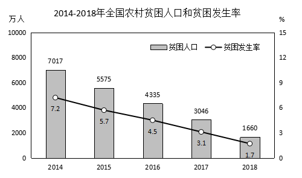

# 年均下降率（负增长型年均增长率，开n次方）

考点：[[20-考点/资料分析/增长/年均下降率（负增长型年均增长率，开n次方）|增长 / 年均下降率（负增长型年均增长率，开n次方）]]
材料：[[15-材料/资料分析/246353 2014—2018年我国农村脱贫攻坚|246353 2014—2018年我国农村脱贫攻坚]]

**问法模型**：题干出现'2014-2018年……年均下降率为'→识别为年均增长率（负增长）模型：末值/初值=(1-r)^n，n=间隔期数4，求r后与选项对照

## 推理链
1. 第1步：读柱状图（仅用柱形万人数据，勿混入折线的贫困发生率%）：2014年末贫困人口7017万人，2018年末1660万人
2. 第2步：2014—2018共5个年份、间隔n=4期，年均下降率r满足 1660=7017×(1-r)^4，即(1-r)^4=1660/7017
3. 第3步：计算比值 1660/7017≈0.2366≈0.237
4. 第4步：按官方解析代入居中且好算的r=30%，验证0.7^4=0.2401，与0.237非常接近，说明r≈30%略偏大一点
5. 第5步：反算精确值：r=1-0.2366^(1/4)≈1-0.697≈30.3%，对照选项C（30.3%）完全吻合，A（20%）、B（25.5%）、D（32.5%）均偏离
6. 第6步：锁定答案C，且可与同材料第5题③（年均下降量=(7017-1660)÷4≈1339万人取1330万口径）互验：同一首末值、同一间隔4期的口径

**最快解法**：⚡ 首末比值+居中代入验证（公式法）：间隔取4期不算5；算1660/7017≈0.237；试r=30%得0.7^4=0.2401≈0.237，锁定30%附近直接选C，无需精确开四次方；备选幂值储备：0.7^4=0.24、0.75^4≈0.316、0.8^4≈0.41

## 易错点
- ⚠ 间隔期数陷阱：2014—2018有5个年份但只隔4期，年均下降率必须开4次方、年均下降量必须÷4，错按5处理是最高频错误
- ⚠ 忘开方陷阱：直接拿1660/7017≈23.7%当下降率去比选项，或只开平方，均会错选
- ⚠ 双轴图读数陷阱：须用柱形（贫困人口万人）数据，勿误读折线的贫困发生率（7.2%、1.7%等%数据）
- ⚠ 口径混淆：'年均下降率'是相对数（开方），与第5题③'年均下降量1330万人'（相减÷4）是两个不同问法，勿套用彼此算法

## 母题抽象
> 🧩 当题干出现'某年—某年……年均下降率/年均增长率'并给出首末两年存量时，用公式 末值/初值=(1±r)^n（n=末年-首年的间隔期数，非年份数），先算比值，再代入居中好算的r（如30%、20%）用常用幂值验证即可锁定选项

**同类特征**：年均下降率、2014-2018跨5年区间、首末存量7017与1660、间隔4期开4次方、负增长型年均增速、柱状图读首末年数据

## 相关题
（暂无）

---

### 题干
2014-2018年贫困人口年均下降率为

### 选项
- A. 20%
- B. 25.5%
- C. 30.3%　✅
- D. 32.5%

### 官方解析
根据题干“……年均下降率为”，可判定本题为年均增长率问题。定位柱状图可得2018年贫困人口数量为1660万人，2014年为7017万人。代入年均增长率公式：，。优先代入居中且好算（例如接近整十的数）的数，若下降率为30%，，与0.237接近，说明下降率非常接近30%，C选项30.3%满足。
故正确答案为C。

### 给定材料

        我国脱贫攻坚成效显著。按照每人每年2300元（2010年不变价）的农村贫困标准计算，2018年年末农村贫困人口1660万人，比上年末减少1386万人；贫困发生率1.7%，比上年下降1.4个百分点。全年贫困地区农村居民人均可支配收入10371元，比上年增长10.6%，扣除价格因素，实际增长8.3%。

