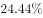
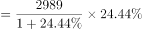
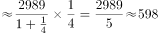

# 增长量计算（环比增量：现期÷(n+1)型百化分估算）

考点：[[20-考点/资料分析/增长/增长量计算（环比增量：现期÷(n+1)型百化分估算）|增长 / 增长量计算（环比增量：现期÷(n+1)型百化分估算）]]
材料：[[15-材料/资料分析/246391 2016年4月保监会机关及各保监局接|246391 2016年4月保监会机关及各保监局接]]

**问法模型**：题干问'较上月增加的数量'→ 环比增长量 = 现期量 − 现期量/(1+环比增速)，用百化分'现期÷(n+1)'快速估算

## 推理链
1. 第1步：题干关键词'较上月增加的数量'锁定环比增长量；材料第1句给出2016年4月有效投诉总量现期值2989件且'环比上升'（所给文本中环比增速数值空缺，按官方答案587反推增速约为24.4%）
2. 第2步：环比增长量公式：增长量 = 现期量 − 上月量 = 2989 − 2989/(1+r)，r为环比增速
3. 第3步：将r≈24.4%百化分为约1/4.1（即n=4.1），增长量≈2989/(4.1+1)=2989/5.1≈586件；或先反推上月量≈2989/1.244≈2403件，再作差2989−2403≈586件
4. 第4步：与选项对照：A.384、B.451、C.587、D.756，估算值586～587与C项587最接近，故选C

**最快解法**：⚡ 百化分速算：环比增速≈24.4%≈1/4.1，增长量=现期÷(n+1)=2989÷5.1≈586，直选最接近的C.587，全程心算可完成

## 易错点
- ⚠ 最大陷阱：误用'现期×增速'直接算增量，2989×24.4%≈729件，恰好最接近D.756，必须用'现期÷(n+1)'而非'现期×增速'
- ⚠ 口径混淆：现期总量应为2989件（含其他非保险公司投诉9件），误用保险公司投诉2980件会使结果偏小约7件，虽不改变选项但体现口径意识
- ⚠ 本材料所给文本中'环比上升'后的百分数空缺，做题时不得凭空代入或跳过增速，须先回原题核实该数值（约24.4%）再计算

## 母题抽象
> 🧩 当题干出现'较上月/上期增加（减少）多少'且材料给出现期量和环比增速r时，把r百化分为1/n，用增长量=现期÷(n+1)估算，再选最接近选项

**同类特征**：较上月增加的数量、环比、增长量计算、最接近以下哪个数字、现期量2989件、单一月份当月值

## 相关题
- [[10-真题/资料分析/增长/7159 增长量计算|7159]]（北京 2009，相关度1）
- [[10-真题/资料分析/增长/2571729 增长量计算——每增长1个百分点对应的增量（基期量×1%）|2571729]]（山东 2020，相关度1）
- [[10-真题/资料分析/增长/3018839 增长量计算（负增长情形：基期减少量）|3018839]]（广东 2021，相关度1）
- [[10-真题/资料分析/增长/10204654 增长量计算（已知现期与同比下降率求下降量）|10204654]]（安徽 2024，相关度1）
- [[10-真题/资料分析/增长/13319362 现期增长量计算（已知现期值与同比增速，用r-(1+r)公式）|13319362]]（江苏 2025，相关度1）

---

### 题干
2016年4月，保监会机关及各保监局接收各类涉及保险消费者权益的有效投诉总件数较上月增加的数量最接近以下哪个数字？

### 选项
- A. 384
- B. 451
- C. 587　✅
- D. 756

### 官方解析

根据题干“2016年4月···增加···数量”，可判定本题为增长量计算问题。定位文字材料第一段可知，2016年4月，保监会机关及各保监局共接收各类涉及保险消费者权益的有效投诉总量为2989件，环比上升。。与C项最接近。

故正确答案为C。

### 给定材料

        2016年4月，保监会机关及各保监局共接收各类涉及保险消费者权益的有效投诉总量为2989件，同比上升，环比上升。其中，接收保险公司投诉2980件，其他非保险公司投诉9件。接收保险公司投诉中，涉及保险公司合同纠纷类投诉2721件；涉嫌保险公司违法违规类投诉259件。

        所接收的2980件保险公司投诉中，财产险公司的投诉为1510件。其中，投诉量位居前10的财产险公司的投诉总和占投诉所有公司投诉总量的。人身险公司的投诉为1470件。其中，投诉量位居前10的人身险公司的投诉量总和占所有公司投诉总量的。另外，人身险涉及保险合同纠纷的投诉有1281件，其中销售纠纷481件，理赔纠纷357件，保全纠纷237件。

> [!warning] 疑点（官方解析可能有误，待人工复核）
> 所给材料文本中'环比上升'后的增速数值空缺，官方解析中也存在明显缺字（'环比上升。。与C项最接近'之间数字缺失）；按官方答案C=587反推环比增速≈24.4%（2989÷1.244≈2403，增量≈586～587），计算与官方答案自洽，但解题前必须从原题补齐该百分比数值
