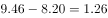
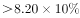
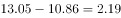
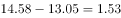
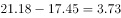

# 同比增长率计算与固定阈值比较（计数型）

考点：[[20-考点/资料分析/增长/同比增长率计算与固定阈值比较（计数型）|增长 / 同比增长率计算与固定阈值比较（计数型）]]
材料：[[15-材料/资料分析/247100 2010-2018年我国海洋主题公园|247100 2010-2018年我国海洋主题公园]]

**问法模型**：题干为'2011~2018年间非门票收入同比增速超过10%的年份有几个'的计数型问法 → 逐年以上一年为基期计算同比增速并与10%比较，符合即计数，用'现期>基期×1.1'等价判定最省时

## 推理链
1. 第1步：定位图2堆叠柱上层段，提取2010-2018年非门票收入（亿元）：8.2、9.46、10.32、10.86、13.05、14.58、15.61、17.45、21.18（本卷题干基准值显示缺失，按完整原题基准10%计）
2. 第2步：增长率公式 g=(现期-基期)/基期；'增速>10%'等价于'现期>基期×1.1'，可回避逐年精算除法
3. 第3步：2011年9.46>8.2×1.1=9.02✓；2012年10.32<9.46×1.1≈10.41✗；2013年10.86<10.32×1.1≈11.35✗
4. 第4步：2014年13.05>10.86×1.1=11.946✓；2015年14.58>13.05×1.1≈14.36✓；2016年15.61<14.58×1.1≈16.04✗
5. 第5步：2017年17.45>15.61×1.1≈17.17✓；2018年21.18>17.45×1.1≈19.20✓
6. 第6步：逐年精算增速验证：15.4%、9.1%、5.2%、20.2%、11.7%、7.1%、11.8%、21.4%，超过10%的为2011、2014、2015、2017、2018共5年，与官方解析'5个'一致
7. 第7步：对照选项，5个对应A，故正确答案为A

**最快解法**：⚡ 等价判定法（增速>10% ⟺ 现期>基期×1.1）：依次心算基期×1.1后比大小——9.46vs9.02✓、10.32vs10.41✗、10.86vs11.35✗、13.05vs11.95✓、14.58vs14.36✓、15.61vs16.04✗、17.45vs17.17✓、21.18vs19.20✓，共5个→直接锁定A，全程只需乘1.1不需做除法

## 易错点
- ⚠ 堆叠柱读数陷阱：非门票收入须读上层分段标注值（如2018年21.18），若误读柱顶总高（50.6+21.18=71.78）则分子全错
- ⚠ 基期选取：逐年同比以上一年为基期，2011年的基期是2010年的8.2亿元，勿漏用2010年数据或错用其他年份作基期
- ⚠ 临界值误判：2015年11.7%、2017年11.8%略超10%，2012年9.1%略低于10%，'超过'须严格大于，凭柱高目测极易把这几年的符合性判反；另本卷题干基准数值显示不完整，考场须以完整原题的10%基准为准

## 母题抽象
> 🧩 当题干出现'某时段内……同比增速超过X%的年份有几个'的计数特征时，用'现期>基期×(1+X%)'逐项判定替代逐年精算，数出✓的个数即为答案

**同类特征**：2011~2018年间、非门票收入、同比增速超过10%（基准值显示不全）、年份有几个、逐年计数比较、定位图2堆叠柱上层分段

## 相关题
- [[10-真题/资料分析/增长/13504272 一般增长率计算与计数比较（同比增速-5%年份计数）|13504272]]（云南 2025，相关度2）
- [[10-真题/资料分析/增长/16070145 同比增长率比较（逐年增速计算并计数年份）|16070145]]（贵州 2026，相关度1）
- [[10-真题/资料分析/增长/2024184 同比增长率比较（超阈值年份计数）|2024184]]（重庆 2016，相关度1）
- [[10-真题/资料分析/比重/2662229 现期比重比较（占比过半判断）|2662229]]（新疆 2020，相关度1）
- [[10-真题/资料分析/倍数/4673147 现期倍数比较（'多N倍'的转化判断）|4673147]]（广东 2022，相关度1）

---

### 题干

2011～2018年间，我国海洋主题公园非门票收入同比增速超过的年份有几个？

### 选项
- A. 5　✅
- B. 6
- C. 3
- D. 4

### 官方解析

根据题干“2011~2018年间······同比增速超过······”可判定本题为一般增长率问题。定位图2，可知2010-2018年每年我国海洋主题公园非门票收入。根据公式：增长率，即，，代入数据可得：

2011年：，符合；

2012年：，不符合；

2013年：，不符合；

2014年：，符合；

2015年：，符合；

2016年：，不符合；

2017年：，符合；

2018年：，符合。

综上，符合题干条件的年份一共有5个。

故正确答案为A。

### 给定材料

> [!warning] 疑点（官方解析可能有误，待人工复核）
> 本卷题干中基准数值（'超过10%'的10%）显示缺失，官方解析中的公式与中间结果亦未显示完整；按完整原题基准10%逐年验算增速为15.4%/9.1%/5.2%/20.2%/11.7%/7.1%/11.8%/21.4%，超过10%的恰为5年，与官方答案A（5个）完全吻合，无实质矛盾

<!-- CODEX-ANSWER-REVIEW:BEGIN -->
### 本次独立复核

**复核状态：** `resolved`（答案与解析已核定）

**计分答案：** A（可计分）

**复核解析：**

阈值公式读为10%。图2的非门票收入（亿元）2010—2018为8.20、9.46、10.32、10.86、13.05、14.58、15.61、17.45、21.18。2011—2018同比增速依次约为15.37%、9.09%、5.23%、20.17%、11.72%、7.06%、11.79%、21.43%。超过10%的年份为2011、2014、2015、2017、2018，共5年，选A。

**相关信息：**

本题用收入构成图中的灰色“非门票收入”系列，非总收入/游客数；2011年分母为2010年8.20亿元。

**题源依据：** [固定版本原题](https://github.com/Mentat-Uran/kaogongzhentizhengliu/blob/84ab93d4b64b61d897bece8a1c0a5bab06b4feb2/10-%E7%9C%9F%E9%A2%98/%E8%B5%84%E6%96%99%E5%88%86%E6%9E%90/%E5%A2%9E%E9%95%BF/2448403%20%E5%90%8C%E6%AF%94%E5%A2%9E%E9%95%BF%E7%8E%87%E8%AE%A1%E7%AE%97%E4%B8%8E%E5%9B%BA%E5%AE%9A%E9%98%88%E5%80%BC%E6%AF%94%E8%BE%83%EF%BC%88%E8%AE%A1%E6%95%B0%E5%9E%8B%EF%BC%89.md)；固定内容 commit `84ab93d4b64b61d897bece8a1c0a5bab06b4feb2`，Markdown blob `11d5aa2ac56eb3a2bdb77bb77a4073cee3859588`。
<!-- CODEX-ANSWER-REVIEW:END -->
