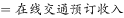
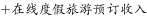
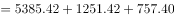
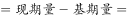

# 增长量计算（相邻两年合计数差值，含亿元→万亿元单位换算）

考点：[[20-考点/资料分析/增长/增长量计算（相邻两年合计数差值，含亿元→万亿元单位换算）|增长 / 增长量计算（相邻两年合计数差值，含亿元→万亿元单位换算）]]
材料：[[15-材料/资料分析/247099 2013～2018年中国旅游业总收入|247099 2013～2018年中国旅游业总收入]]

**问法模型**：题干'2017年…同比约增长多少万亿元'→ 用2017年在线旅游收入三项合计减2016年三项合计，再除以10000换算成万亿元的增长量差值模型

## 推理链
1. 第1步：从表格提取2017年三个分项：交通预订6389.65、住宿预订1586.19、度假游预订947.47，加总得2017年在线旅游收入8923.31亿元
2. 第2步：提取2016年三个分项：交通5385.42、住宿1251.42、度假游757.40，加总得2016年在线旅游收入7394.24亿元
3. 第3步：代入增长量公式：增长量=现期合计−基期合计=8923.31−7394.24=1529.07亿元
4. 第4步：单位换算：1529.07亿元÷10000≈0.153万亿元
5. 第5步：与选项对照：0.153最接近0.15，锁定A

**最快解法**：⚡ 截位加总+选项量级预判：先把选项化成亿元（0.15/0.20/0.25/0.30万亿元=1500/2000/2500/3000亿元）；2017年合计≈6390+1586+947≈8923，2016年合计≈5385+1251+757≈7394，差约1530亿元≈0.15万亿元，秒选A

## 易错点
- ⚠ 未加总陷阱：'在线旅游收入'无合计列，若只算交通预订分项（6389.65−5385.42≈1004亿元≈0.10万亿元）会得出错误量级
- ⚠ 单位换算陷阱：差值算出约1529亿元后忘记÷10000化为万亿元，或误把0.15万亿元当成15xx亿元的同一量级而错选
- ⚠ 时间口径陷阱：同比基期是2016年，误取2018年或2015年数据相减会得到完全不同的差值

## 母题抽象
> 🧩 当题干出现'某年XX同比约增长多少（大单位）'且XX需多分项跨列加总时，先逐年加总得各年合计，再做现期合计−基期合计，最后按'1万亿元=10000亿元'换算成题干单位并对照选项量级验证

**同类特征**：同比约增长、多少万亿元、在线旅游收入（需三列加总）、相邻两年差值、亿元→万亿元换算、增长量计算

## 相关题
- [[10-真题/资料分析/增长/2188568 增长量计算（现期+增长率，附亿元→万亿元单位换算）|2188568]]（黑龙江 2018，相关度2）
- [[10-真题/资料分析/增长/7159 增长量计算|7159]]（北京 2009，相关度1）
- [[10-真题/资料分析/增长/2571729 增长量计算——每增长1个百分点对应的增量（基期量×1%）|2571729]]（山东 2020，相关度1）
- [[10-真题/资料分析/增长/3018839 增长量计算（负增长情形：基期减少量）|3018839]]（广东 2021，相关度1）
- [[10-真题/资料分析/增长/10204654 增长量计算（已知现期与同比下降率求下降量）|10204654]]（安徽 2024，相关度1）

---

### 题干
2017年中国在线旅游收入同比约增长多少万亿元？

### 选项
- A. 0.15　✅
- B. 0.20
- C. 0.25
- D. 0.30

### 官方解析

根据题干“2017年···同比约增长···万亿元”，可判定本题为增长量计算问题。定位表格可知，中国在线旅游收入，根据表格可得，2017年在线旅游收入；2016年在线旅游收入。代入公式：增长量。

故正确答案为A。

### 给定材料

