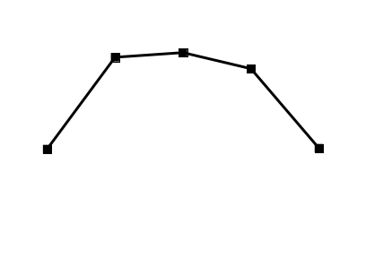

# 增长量比较（逐年同比增量序列与折线图趋势匹配）

考点：[[20-考点/资料分析/增长/增长量比较（逐年同比增量序列与折线图趋势匹配）|增长 / 增长量比较（逐年同比增量序列与折线图趋势匹配）]]
材料：[[15-材料/资料分析/247099 2013～2018年中国旅游业总收入|247099 2013～2018年中国旅游业总收入]]

**问法模型**：题干问'2014～2018年间哪项收入同比增量的变化趋势'对应折线图 → 对每个选项逐年做'后一年−前一年'求增量序列，再与折线图各点高低特征逐一比对排除

## 推理链
1. 第1步：题干要求匹配'同比增量变化趋势'的折线图，需对四个选项分别逐年计算增量=现期−基期（相邻两年相减），不能直接比较收入本身（四项收入均逐年递增，无法区分）
2. 第2步：公式：增长量=现期量−基期量；从表格逐列提取2013～2018年数据（注意B项单位为万亿元，A/C/D项为亿元）
3. 第3步：C项度假游预订增量：347.58−244.20≈104、549.97−347.58≈202、757.40−549.97≈207、947.47−757.40≈190、1051.81−947.47≈105（亿元），呈'先升、2016年见峰、后降、2018年回落至与2014年相当'的形态
4. 第4步：排除A：住宿预订增量135.35→315.12→388.85→334.77→295.30（亿元），第4点(2017年334.77)高于第2点(2015年315.12)，与折线图特征矛盾
5. 第5步：排除B：旅游业总体增量0.43→0.75→0.56→0.71→0.57（万亿元），最高点在第2点（2015年0.75），与折线图特征矛盾
6. 第6步：排除D：交通预订增量751.90→1053.58→2060.27→1004.23→431.30（亿元），第5点(431)远低于第1点(752)，与折线图特征矛盾
7. 第7步：仅C项增量序列'104—202—207—190—105'与折线图趋势完全吻合，选C

**最快解法**：⚡ 特征点排除法+截位差分：先从折线图提取2~3个关键特征（峰值在第3点即2016年、第5点≈第1点、第4点低于第2点），再对候选项截位快速做差验证——D项2018年增量431≪2014年752直接排除；B项第2点(0.75)最高排除；A项第4点(335)>第2点(315)排除；C项207(2016)为峰且第4点190<第2点202，锁定C

## 易错点
- ⚠ 混淆'收入趋势'与'增量趋势'：四项原始收入均逐年递增，若直接看收入序列会误以为无法区分或选错；必须逐年相减后再比对
- ⚠ 单位混排：B项旅游业总体单位是万亿元、其余三项是亿元，做差后量级不同（0.4~0.75万亿元 vs 上百亿元），不能混在一起比较数值大小，只比图形趋势
- ⚠ 关键点差值接近需精度：住宿2017年增量(334.77)与2015年(315.12)仅差约20、度假游2017年(190.07)与2015年(202.39)先后关系是排除A、确认C的关键，粗略估算可能判断反
- ⚠ 折线图在选项中而非材料中，材料是纯表格无图，不能'读图'，必须完全由表格数据逐年推算增量后判断

## 母题抽象
> 🧩 当题干出现'同比增量的变化趋势/折线图'特征时，先从折线图提取峰值位置、首尾点相对高低等关键特征，再对候选项逐年做'现期−基期'差分得到增量序列逐一比对，优先用矛盾最明显的选项排除，验证剩余唯一吻合项

**同类特征**：同比增量的变化趋势、折线图匹配、2014～2018年逐年判断、增长量=现期量−基期量、选项为不同收入项目（需逐项排除）

## 相关题
- [[10-真题/资料分析/增长/2028362 增长量比较（逐年同比增量计算＋折线趋势图匹配）|2028362]]（国考 2017，相关度2）
- [[10-真题/资料分析/增长/16069832 同比增量计算与柱状图趋势匹配（增长量比较）|16069832]]（贵州 2026，相关度1）
- [[10-真题/资料分析/增长/12882030 累计转当期+环比增长率计算与趋势匹配|12882030]]（内蒙古 2025，相关度1）
- [[10-真题/资料分析/增长/18643768 同比增量（增长量）正负序列与给定柱状图匹配|18643768]]（天津 2026，相关度1）
- [[10-真题/资料分析/增长/2434297 一般增长率计算与折线图匹配（增长率走势比较）|2434297]]（新疆 2019，相关度1）

---

### 题干

以下折线图反映了2014～2018年间哪项收入同比增量的变化趋势？

### 选项
- A. 在线住宿预订
- B. 旅游业总体
- C. 在线度假旅游预订　✅
- D. 在线交通预订

### 官方解析

根据题干“······同比增量的变化趋势”，可判定本题为增长量比较问题。

A项：定位表格第四列数据可得：“2013年~2018年在线住宿预订收入依次为412.10亿元、547.45亿元、862.57亿元、1251.42亿元、1586.19亿元、1881.49亿元”，根据公式：增长量=现期量-基期量，则2014-2018年在线住宿预订收入同比增量依次为2014年：547.45-412.10547-412=135亿元、2015年：862.57-547.45863-547=316亿元、2016年：1251.42-862.571251-863=388亿元；2017年：1586.19-1251.421586-1251=335亿元；2018年：1881.49-1586.191881-1586=295亿元。2017年比2015年增长量大，即折线图中第4个点应比第2个点高，与题干折线图矛盾，排除A项。

B项：定位表格第二列数据可得：“2013年~2018年旅游业总体收入依次为2.95万亿元、3.38万亿元、4.13万亿元、4.69万亿元、5.40万亿元、5.97万亿元”，则2014-2018年旅游业总体收入同比增量依次为2014年：3.38-2.95=0.43万亿元、2015年：4.13-3.38=0.75万亿元、2016年：4.69-4.13=0.56万亿元、2017年：5.40-4.69=0.71万亿元、2018年：5.97-5.40=0.57万亿元。2015年增长量最大，即折线图中第2个点应该最高，与题干折线图矛盾，排除B项。

C项：定位表格第五列数据可得：“2013年~2018年在线度假旅游预订收入依次为244.20亿元、347.58亿元、549.97亿元、757.40亿元、947.47亿元、1051.81亿元”，则2014-2018年在线度假旅游预订收入同比增量依次为2014年：347.58-244.20348-244=104亿元、2015年：549.97-347.58550-348=202亿元、2016年：757.40-549.97757-550=207亿元、2017年：947.47-757.40947-757=190亿元、2018年：1051.81-947.471052-947=105亿元。满足题干折线图趋势。

D项：定位表格第三列数据可得：“2013年~2018年在线交通预订收入依次为1519.67亿元、2271.57亿元、3325.15亿元、5385.42亿元、6389.65亿元、6820.95亿元”，则2014-2018年在线交通预订收入同比增量依次为2014年：2271.57-1519.672272-1520=752亿元、2015年：3325.15-2271.573325-2272=1053亿元、2016年：5385.42-3325.155385-3325=2060亿元、2017年：6389.65-5385.426390-5385=1005亿元、2018年：6820.95-6389.656821-6390=431亿元。2018年增长量较2014年小很多，即折线图中第5个点应比第1个点低很多，与题干折线图矛盾，排除D项。

故正确答案为C。

### 给定材料

