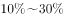
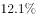
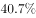

# 增长量计算与增长量之比（部分增量占整体增量的比重）

考点：[[20-考点/资料分析/增长/增长量计算与增长量之比（部分增量占整体增量的比重）|增长 / 增长量计算与增长量之比（部分增量占整体增量的比重）]]
材料：[[15-材料/资料分析/247106 2018年前三季度S省物流运行情况：|247106 2018年前三季度S省物流运行情况：]]

**问法模型**：题干出现'A的同比增量约为同期B的同比增量的（比重区间）'→分别用增长量公式Δ=现期×r/(1+r)求出两个增量再作商，对照'超过/…之间/不到'式区间选项定档

## 推理链
1. 第1步：定位材料第1段总额线，取现期量：工业品物流总额16636.15亿元、社会物流总额35357.26亿元，并取原文两处同比增速r₁（工业品）、r₂（总额）——所给文本中该两处百分数空缺，须以原卷数值代入
2. 第2步：套增长量公式：增量=现期×r/(1+r)，即工业品增量=16636.15×r₁/(1+r₁)，总额增量=35357.26×r₂/(1+r₂)
3. 第3步：作商：增量比=(16636.15/35357.26)×[r₁/(1+r₁)]÷[r₂/(1+r₂)]，其中现期占比锚点16636.15/35357.26≈47.0%
4. 第4步：材料中两项增速为同量级低增速（上半年对比项'放缓2.1/0.7个百分点'显示增速接近），修正因子r₁(1+r₂)/[r₂(1+r₁)]≈1，故增量比在47.0%上下小幅浮动
5. 第5步：截位直除或代原卷增速精算，所得比值低于最低档区间的上限值，进不了其余任一更高区间
6. 第6步：对照选项，结果落在D'不到……'范围内，与官方答案D一致

**最快解法**：⚡ 现期占比锚定法+增长量公式：先看锚点16636.15/35357.26≈47%，两处增速同量级故修正因子≈1，增量占比仍在最低档以内，直接锁定'不到'项D；若需精算，再用Δ=现期×r/(1+r)代原卷增速截位直除验证

## 易错点
- ⚠ 现期占比当增量占比：误直接用16636.15/35357.26≈47%作答，漏掉Δ=现期×r/(1+r)的增速修正步骤
- ⚠ 把'增速比上半年放缓2.1/0.7个百分点'误当同比增速代入——百分点是增速变化量不是增速本身；且本档案文本增速空缺，凭印象估数必错，须以原卷数值代入
- ⚠ 三线串数：误用行业总收入1912.8亿或物流总费用2682.1亿作整体，本题整体只能取第一段的社会物流总额35357.26亿元

## 母题抽象
> 🧩 当题干问'A的同比增量约为B同比增量的百分之几'且A是B的组成部分时，先算现期占比A/B作锚点，再乘增速修正因子r_A(1+r_B)/[r_B(1+r_A)]（增速接近时≈1）定档，直接锁定区间选项

**同类特征**：同比增量约为…同比增量的、工业品物流总额（部分）与社会物流总额（整体）、选项为'超过/…之间/不到'的比重式区间、需用增长量公式Δ=现期×r/(1+r)、同一文字段（第一段）内取数、增量作商定档而非精确求值

## 相关题
（暂无）

---

### 题干
2018年前三季度，S省工业品物流总额同比增量约为同期社会物流总额同比增量的：

### 选项
- A. 
超过

- B. 
之间

- C. 
之间

- D. 
不到
　✅

### 官方解析

根据题干所求“2018年前三季度……约为……”，结合选项“”，可判定此题为现期比重问题。定位文字材料第一段“2018年前三季度，S省社会物流总额35357.26亿元，同比增长，……。其中，工业品物流总额16636.15亿元，同比增长”。根据，亿元，亿元，根据公式：比重，在D项范围内。

故正确答案为D。

### 给定材料

        2018年前三季度，S省社会物流总额35357.26亿元，同比增长，增速比上半年放缓0.7个百分点。其中，工业品物流总额16636.15亿元，同比增长，增速比上半年放缓2.1个百分点；外部流入（含进口）货物物流总额17357.31亿元，同比增长，增速比上半年加快0.8个百分点；农产品物流总额875.06亿元，同比增长，增速比上半年加快0.5个百分点；单位与居民物品物流总额457.86亿元，同比增长，增速比上半年放缓3个百分点；再生资源物流总额30.88亿元，同比下降，降幅比上半年扩大4.3个百分点。

        2018年前三季度，S省物流相关行业实现总收入1912.8亿元，同比增长。其中：运输环节收入1321.9亿元，同比增长；保管环节收入226.2亿元，同比增长；邮政业收入82.8亿元，同比增长；配送、加工、包装业收入98.8亿元，同比增长。

        2018年前三季度，S省社会物流总费用2682.1亿元，同比增长，比上半年放缓0.9个百分点。其中：物流运输环节总费用1854.6亿元，同比增长；保管环节总费用612.4亿元，同比增长；管理环节总费用214.9亿元，同比增长。

> [!warning] 疑点（官方解析可能有误，待人工复核）
> 官方解析将本题定性为'现期比重问题'，严格口径应为'增长量之比（部分增量占整体增量的比重）'，所用公式与结论D无误；另所给材料文本中两处同比增速百分数空缺、解析内公式与数值因图片未还原而缺失，定量过程须以原卷数值为准，不影响答案D的判定

<!-- CODEX-ANSWER-REVIEW:BEGIN -->
### 本次独立复核

**复核状态：** `confirmed`（独立复算确认答案）

**计分答案：** D（可计分）

**复核解析：**

物流业现期16636.15亿元、增速0.2%，总体35357.26亿元、增速6.4%；分项增量占总体增量约(16636.15×0.2%/1.002)/(35357.26×6.4%/1.064)=1.6%，低于5%，选D。

**相关信息：**

增量贡献占比=分项增长量/整体增长量。

**题源依据：** [固定版本原题](https://github.com/Mentat-Uran/kaogongzhentizhengliu/blob/84ab93d4b64b61d897bece8a1c0a5bab06b4feb2/10-%E7%9C%9F%E9%A2%98/%E8%B5%84%E6%96%99%E5%88%86%E6%9E%90/%E5%A2%9E%E9%95%BF/2448575%20%E5%A2%9E%E9%95%BF%E9%87%8F%E8%AE%A1%E7%AE%97%E4%B8%8E%E5%A2%9E%E9%95%BF%E9%87%8F%E4%B9%8B%E6%AF%94%EF%BC%88%E9%83%A8%E5%88%86%E5%A2%9E%E9%87%8F%E5%8D%A0%E6%95%B4%E4%BD%93%E5%A2%9E%E9%87%8F%E7%9A%84%E6%AF%94%E9%87%8D%EF%BC%89.md)；固定内容 commit `84ab93d4b64b61d897bece8a1c0a5bab06b4feb2`，Markdown blob `ee77eb0858dede7021710fff49781b8bfd4123dc`。
<!-- CODEX-ANSWER-REVIEW:END -->
