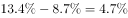

# 增长率比较（百分点差还原增速大小）

考点：[[20-考点/资料分析/增长/增长率比较（百分点差还原增速大小）|增长 / 增长率比较（百分点差还原增速大小）]]
材料：[[15-材料/资料分析/247396 江苏民航机场旅客吞吐量：文字段讲20|247396 江苏民航机场旅客吞吐量：文字段讲20]]

**问法模型**：题干问'同比增速最慢的省（市）是'→ 因材料只给'江苏比各地高X个百分点'，用'各省增速=江苏增速−差值'判断：江苏增速为同一基准，差值越大者增速越慢

## 推理链
1. 第1步：从文字段提取百分点差：江苏增速比上海高9.7个百分点、比福建高8.7、比江西高6.9、比山东高4.4（另比华东地区高6.2、与安徽持平）；江苏增速具体数值在材料中空缺
2. 第2步：规则：设江苏增速为r，则各省增速=r−差值；四个选项共用同一r，故增速快慢只取决于差值大小——差值越大，该省（市）增速越慢
3. 第3步：比较选项对应差值：上海9.7 > 福建8.7 > 江西6.9 > 山东4.4，上海差值最大，其增速r−9.7最小
4. 第4步：与选项对照：上海增速最慢，故正确答案为A

**最快解法**：⚡ 口诀速判法'差大则慢'：无需算出任何具体增速，直接在选项间比较'江苏比它高几个百分点'——9.7（上海）最大即最慢，一步锁定A；方向记法：江苏比谁高得多，谁就掉得越远

## 易错点
- ⚠ 方向搞反：把'比上海高9.7个百分点'误读成上海增速比江苏高，或误认为差值大者增速快；实际差值越大该地越慢，上海差9.7为最大即最慢
- ⚠ 把'高X个百分点'误当增速本身使用（如把9.7%当作上海或江苏的增速），百分点差≠增速数值
- ⚠ 混淆比较对象：'比华东地区高6.2个百分点'中华东是六省一市整体而非省（市），不能入选；'与安徽持平'表示安徽与江苏等速，也不参与快慢排序；另注意江苏增速数值本身空缺，涉及r具体值的计算（如小题1求增长量）无法取数

## 母题抽象
> 🧩 当题干出现'A比B高x个百分点、比C高y个百分点……'并问'谁增速最慢/最快'时，不需要A的增速数值，直接比较各差值：差值最大者增速最慢、最小者最快，一步得答案

**同类特征**：同比增速最慢、高X个百分点、百分点差还原增速、华东地区（六省一市）、文字段增速对比、同一基准比较

## 相关题
- [[10-真题/资料分析/增长/2742054 增长率比较（已知现期值与同比增加额，先减法求基期再算增速）|2742054]]（江苏 2021，相关度1）
- [[10-真题/资料分析/增长/3522353 增长率比较（定基指数同比增速）|3522353]]（青海 2021，相关度1）
- [[10-真题/资料分析/综合/2452588 综合分析判断（现期加总比较+增长量判定+两期比重变化+年均增长量倍数）|2452588]]（江苏 2020，相关度1）
- [[10-真题/资料分析/其他/4708226 折线图直接读数与增速极值比较（找同比增速最低月）|4708226]]（福建 2019，相关度1）

---

### 题干
2019年1-10月，华东地区民航机场旅客吞吐量同比增速最慢的省（市）是

### 选项
- A. 上海　✅
- B. 江西
- C. 福建
- D. 山东

### 官方解析

根据题干“2019年1—10月······同比增速最慢的省（市）是”，可判定本题为一般增长率比较问题。定位文字资料“2019年1-10月，江苏民航机场旅客吞吐量4901万人次，同比增长，增速······比上海高9.7个百分点······比山东高4.4个百分点，比福建高8.7个百分点，比江西高6.9个百分点”，则2019年1-10月，选项中各省（市）民航机场旅客吞吐量的同比增速分别为：A项，上海为；B项，江西为；C项，福建为；D项，山东为。同比增速最慢的是上海。

故正确答案为A。

### 给定材料

        2019年1-10月，江苏民航机场旅客吞吐量4901万人次，同比增长，增速比华东地区（六省一市）高6.2个百分点，比上海高9.7个百分点，比浙江高5.7个百分点，比山东高4.4个百分点，比福建高8.7个百分点，比江西高6.9个百分点，与安徽持平。

