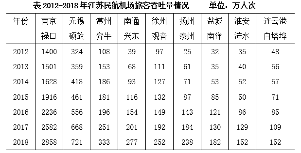

# 年均增长率比较（年均增速大小比较）

考点：[[20-考点/资料分析/增长/年均增长率比较（年均增速大小比较）|增长 / 年均增长率比较（年均增速大小比较）]]
材料：[[15-材料/资料分析/247396 江苏民航机场旅客吞吐量：文字段讲20|247396 江苏民航机场旅客吞吐量：文字段讲20]]

**问法模型**：题干问'2013-2018年……年均增速最快的机场是'→ 各机场年份差n相同，由(1+r)^n=末年量/基年量，将年均增速比较转化为比较2018年/2012年吞吐量比值的大小。

## 推理链
1. 第1步：定位统计表，提取四个选项机场的基期（2012年）与现期（2018年）吞吐量（万人次）：南京禄口1400→2858、南通兴东39→277、扬州泰州25→238、盐城南洋32→182。
2. 第2步：年均增速公式为(1+r)^n=末年量/基年量，各机场年份差n相同（2018-2012=6），故只需比较末年/基年比值。
3. 第3步：代入计算比值：A南京禄口2858/1400≈2.04，B南通兴东277/39≈7.10，C扬州泰州238/25=9.52，D盐城南洋182/32≈5.69。
4. 第4步：比值排序为C（9.52）＞B（7.10）＞D（5.69）＞A（2.04），扬州泰州最大，且在全部9个机场中也居首。
5. 第5步：与选项对照，比值最大者年均增速最快，故选C扬州泰州。

**最快解法**：⚡ 比值比较法（省去开n次方）+截位直除：年份差相同直接比2018/2012——C=238/25≈9.5、B=277/39≈7.1、D=182/32≈5.7、A=2858/1400≈2.0，C最大直接锁定，无需开方。

## 易错点
- ⚠ 基期年份口径：官方对'2013-2018年年均增速'取2012年为基期（n=6）；若误用2013年为基期（n=5，比2018/2013），则盐城南洋182/35=5.2会反超扬州泰州238/61≈3.9而误选D。
- ⚠ 误用增长量（差值）替代年均增速：南通兴东增量277-39=238大于扬州泰州238-25=213，但增速比较看末/基比值（9.52 vs 7.10），看差值会错选B。
- ⚠ 表格横向读串行：2018年淮安152与连云港152数值相同，'扬州泰州''盐城南洋'是'地市+机场名'组合代表一个机场，逐列取数时易错位。

## 母题抽象
> 🧩 当题干出现'某时期（如2013-2018年）……年均增速最快/最慢'特征时，各对象年份差相同，用比值法直接比较'末年量/基年量'（基期按官方口径取时期首年的前一年2012年），比值最大（或最小）者增速最快（或最慢），无需开n次方。

**同类特征**：2013-2018年年均增速、最快/最慢比较、9个机场中、旅客吞吐量、末年/基年比值、统计表逐列取数

## 相关题
（暂无）

---

### 题干
2013-2018年江苏9个民航机场中旅客吞吐量年均增速最快的机场是

### 选项
- A. 南京禄口
- B. 南通兴东
- C. 扬州泰州　✅
- D. 盐城南洋

### 官方解析
根据题干“2013—2018年······年均增速最快的机场是”，可判定本题为年均增长率比较问题。根据公式：，年份差（）相同，比较年均增速大小只需比较。定位表格资料可知，2012年南京禄口民航机场旅客吞吐量为1400万人次，2018年为2858万人次；2012年南通兴东民航机场旅客吞吐量为39万人次，2018年为277万人次；2012年扬州泰州民航机场旅客吞吐量为25万人次，2018年为238万人次；2012年盐城南洋民航机场旅客吞吐量为32万人次，2018年为182万人次。选项中各机场2013-2018年旅客吞吐量的分别为：A项，南京禄口为；B项，南通兴东为；C项，扬州泰州为；D项，盐城南洋为。旅客吞吐量年均增速最快的机场是扬州泰州。
故正确答案为C。

### 给定材料

        2019年1-10月，江苏民航机场旅客吞吐量4901万人次，同比增长，增速比华东地区（六省一市）高6.2个百分点，比上海高9.7个百分点，比浙江高5.7个百分点，比山东高4.4个百分点，比福建高8.7个百分点，比江西高6.9个百分点，与安徽持平。

> [!warning] 疑点（官方解析可能有误，待人工复核）
> 口径分歧提示：材料导读称'年均增速比较本质是比较2018/2013比值'，若按该口径（基期2013、n=5），盐城南洋182/35=5.2将超过扬州泰州238/61≈3.9而得D，与官方答案C矛盾；官方解析实际以2012年为基期（n=2018-2012=6）比较2018/2012比值（扬州泰州9.52最大），口径自洽且支持C，故遵照官方答案C，此处基期惯例需特别注意。
