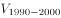
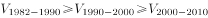
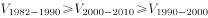
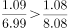
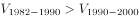

# 年均增长率大小比较

考点：[[20-考点/资料分析/增长/年均增长率大小比较|增长 / 年均增长率大小比较]]
材料：[[15-材料/资料分析/247395 新中国成立70年（1949—2018|247395 新中国成立70年（1949—2018]]

**问法模型**：题干用三个符号分别表示四次人口普查间隔期（依次记为v₁、v₂、v₃，对应8年/10年/10年三段）的劳动年龄人口年均增长率并要求判断大小关系 → 按 r=(末期/初期)^(1/n)-1 比较：年数相同比总倍数，年数不同结合总倍数与年份差

## 推理链
1. 第1步：从材料第二段提取四次普查数据：1982年5.67亿、1990年6.99亿、2000年8.08亿、2010年9.16亿；三段间隔年份差分别为8年（1982-1990）、10年（1990-2000）、10年（2000-2010），依次对应题干符号v₁、v₂、v₃
2. 第2步：年均增长率模型 r=(末期/初期)^(1/n)-1；当各段年数n相同时，r的大小完全由总倍数(末期/初期)决定，无需开方
3. 第3步：v₂与v₃年数均为10年，直接比较总倍数：8.08/6.99≈1.156 > 9.16/8.08≈1.134（分子大、分母小的分数值大），故v₂>v₃，排除与该结论矛盾的选项（官方解析明确排除B项）
4. 第4步：v₁年份差为8年，少于v₂的10年，且总倍数6.99/5.67≈1.233 > 8.08/6.99≈1.156，'年份差更小+总倍数更大'两因素同向，故v₁>v₂
5. 第5步：串联得v₁>v₂>v₃，与选项对照，A项正确

**最快解法**：⚡ 年均增长率比较的'不开n次方'技巧：①年数相同的v₂与v₃（均10年）直接比总倍数，8.08/6.99≈1.16＞9.16/8.08≈1.13，定v₂>v₃；②v₁年份差最小（8年）且总倍数最大（6.99/5.67≈1.23），必为三者最大；排除法得v₁>v₂>v₃，选A

## 易错点
- ⚠ 年份差不同不能只比总增幅：三段n分别为8、10、10年，判断v₁与v₂必须同时看总倍数与年份差；本题v₁'增幅大+年数少'双保险，但若机械套用'总增幅大者年均增长率必大'，在本材料其他间隔（如1953-1964隔11年、1964-1982隔18年）中会掉坑
- ⚠ 分段取数错位：6.99亿既是1982-1990年的末期又是1990-2000年的初期，8.08亿同理，基期与末期取错位则比较方向全反
- ⚠ 混入区间外数据：2012年末峰值9.22亿、2018年末8.97亿（非普查数据）及1953年3.10亿、1964年3.53亿均不在本题四次普查的三个间隔期内，纳入比较即错

## 母题抽象
> 🧩 当题干出现'用符号表示多个间隔期的年均增长率并排序'时，用r=(末期/初期)^(1/n)-1的比较性质：年数相同直接比总倍数（分子大分母小者大），年数不同则'总倍数更大且年数更小'者年均增长率必大，全程无需开方，验证选项不等式即可

**同类特征**：年均增长率、四次人口普查间、三个符号分别表示三段增速、下列关系正确的是（排序型）、16-59岁劳动年龄人口、选项为不等式比较

## 相关题
- [[10-真题/资料分析/增长/11226447 年均增长率大小比较|11226447]]（江苏 2025，相关度2）
- [[10-真题/资料分析/增长/12881993 年均增长率（区间型选项验证）|12881993]]（广东 2025，相关度1）
- [[10-真题/资料分析/增长/15121362 年均增速比较（年均增长率大小比较）|15121362]]（江苏 2024，相关度1）
- [[10-真题/资料分析/增长/4651694 年均增长率比较（年均增速大小排序）|4651694]]（江苏 2022，相关度1）
- [[10-真题/资料分析/增长/2145031 年均增长率计算（n=3，立方根型）|2145031]]（深圳市考 2017，相关度1）

---

### 题干

用、、分别表示四次人口普查间的全国劳动年龄人口年均增长率，下列关系正确的是

### 选项
- A. 

　✅
- B. 

- C. 

- D. 

### 官方解析

根据题干“······年均增长率······”，且选项为排序，可判定本题为年均增长率的比较问题。定位文字资料第二段“1982年、1990年、2000年和2010年四次人口普查数据显示，我国劳动年龄人口分别为5.67亿人、6.99亿人、8.08亿人和9.16亿人”。1990-2000年与2000-2010年年份差相同，可直接利用比较。1990-2000年：；2000-2010年：；由于分子大、分母小的分数值大，故，则，排除B项。因为1982-1990年的年份差少于1990-2000年，且，所以。因此。

故正确答案为A。

### 给定材料

        新中国成立70年来，我国人口由1949年末的5.4亿人增加到2018年末的近14亿人。其中，从1949年末到1970年末，我国人口由5.4亿人增加到8.3亿人；1971年末至1980年末，全国人口由8.5亿人增加到9.9亿人；20世纪80年代，全国人口由1981年末的10.0亿人增加到1990年末的11.4亿人；1991年以来，我国人口增长率稳步下降，最终在左右的增速上保持平稳。1991-2018年，我国人口年均增加878万人，自2001年以来年均增加711万人。

        1953年末全国16-59岁劳动年龄人口为3.10亿人，1964年末为3.53亿人，1982年、1990年、2000年和2010年四次人口普查数据显示，我国劳动年龄人口分别为5.67亿人、6.99亿人、8.08亿人和9.16亿人。在2012年末我国劳动年龄人口总量达到峰值9.22亿人后增量由正转负，2018年末为8.97亿人。

        新中国成立之初，全国的人口都是文盲。1982年末全国高中及以上受教育程度人口占总人口的，1990年末占，2000年末占，2010年末达到，2018年末提高到。1982年末大专及以上受教育程度人口仅占总人口的，1990年末为，2000年末为，2010年末为，2018年末达到。

