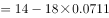

# 基期量计算（已知年均增量倒推基期）

考点：[[20-考点/资料分析/增长/基期量计算（已知年均增量倒推基期）|增长 / 基期量计算（已知年均增量倒推基期）]]
材料：[[15-材料/资料分析/247395 新中国成立70年（1949—2018|247395 新中国成立70年（1949—2018]]

**问法模型**：题干问2018年末之前某时点（2000年末）的总量→采用'基期量=现期量-年均增量×年数'从近14亿倒推

## 推理链
1. 第1步：从材料第1段提取条件：2018年末全国人口为'近14亿人'，'自2001年以来年均增加711万人'
2. 第2步：确定时间口径：以2018年末为现期、2000年末为基期，间隔18年（2001—2018），须用与该区间匹配的年均增量711万人，而非1991—2018年的878万人
3. 第3步：列公式：基期量=现期量-年均增量×年数
4. 第4步：代入计算：14亿-711万×18=140000万-12798万=127202万≈12.7亿（'近14亿'若按13.9亿计，则13.9亿-1.28亿≈12.62亿）
5. 第5步：与选项对照：结果12.6～12.7亿与C项12.6亿最接近（A11.6、B12.1、D13.1偏差均大），故选C

**最快解法**：⚡ 公式法+截位估算：711万×18≈1.28亿（711×18=12798万），14亿-1.28亿≈12.7亿，'近14亿'实略低于14亿，结果更贴近12.6亿，直接锁定C，无需精算

## 易错点
- ⚠ 年均增量选错：材料有两个口径（878万人对应1991—2018年28年、711万人对应2001—2018年18年），倒推2000年末只能用711万人
- ⚠ 年数数错：2000年末至2018年末为18年，若误用28年（1991—2018）会得约11.5亿而误选A
- ⚠ 单位与约数陷阱：1亿=10000万须统一量级再运算；'近14亿'是约数不能当精确值，按14亿算得12.7亿、按13.9亿算得12.62亿，均指向C，不能因12.7≠12.6而动摇

## 母题抽象
> 🧩 当题干问'现期之前的某年数值'且材料给出'自某年以来年均增加X'时，用'基期=现期-X×年数'倒推，先核对年均增量的起止年份与所求间隔年数是否匹配，再统一单位量级计算

**同类特征**：问历史时点（2000年末）数值、基期量计算、材料含两个年均增量（878万/711万）、现期为约数'近14亿'、单位混合（亿人/万人）、选项间隔约0.5亿

## 相关题
- [[10-真题/资料分析/增长/12019697 基期量计算（现期累计值−当期新增值）|12019697]]（广东 2026，相关度1）
- [[10-真题/资料分析/增长/2033794 基期量计算|2033794]]（江苏 2016，相关度1）
- [[10-真题/资料分析/增长/2166218 基期量计算（同比下降型）|2166218]]（深圳市考 2018，相关度1）
- [[10-真题/资料分析/增长/2187625 基期量计算（现期−增长量还原基期）|2187625]]（选调 2018，相关度1）
- [[10-真题/资料分析/增长/2187798 基期量计算（现期÷(1+同比增速)）＋单位换算（亿元→万亿元）|2187798]]（天津 2018，相关度1）

---

### 题干
2000年末全国人口为

### 选项
- A. 11.6亿人
- B. 12.1亿人
- C. 12.6亿人　✅
- D. 13.1亿人

### 官方解析

根据题干“2000年末全国人口为”，结合资料所给时间为2018年，可判定本题为基期量的计算问题。定位文字资料第一段“新中国成立70年来，我国人口由1949年末的5.4亿人增加到2018年末的近14亿人······自2001年以来年均增加711万人”，则2000年末全国人口亿人，与C项最接近。

故正确答案为C。

### 给定材料

        新中国成立70年来，我国人口由1949年末的5.4亿人增加到2018年末的近14亿人。其中，从1949年末到1970年末，我国人口由5.4亿人增加到8.3亿人；1971年末至1980年末，全国人口由8.5亿人增加到9.9亿人；20世纪80年代，全国人口由1981年末的10.0亿人增加到1990年末的11.4亿人；1991年以来，我国人口增长率稳步下降，最终在左右的增速上保持平稳。1991-2018年，我国人口年均增加878万人，自2001年以来年均增加711万人。

        1953年末全国16-59岁劳动年龄人口为3.10亿人，1964年末为3.53亿人，1982年、1990年、2000年和2010年四次人口普查数据显示，我国劳动年龄人口分别为5.67亿人、6.99亿人、8.08亿人和9.16亿人。在2012年末我国劳动年龄人口总量达到峰值9.22亿人后增量由正转负，2018年末为8.97亿人。

        新中国成立之初，全国的人口都是文盲。1982年末全国高中及以上受教育程度人口占总人口的，1990年末占，2000年末占，2010年末达到，2018年末提高到。1982年末大专及以上受教育程度人口仅占总人口的，1990年末为，2000年末为，2010年末为，2018年末达到。

