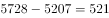
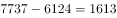
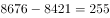
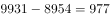

# 增长量比较（逐年做差找最大年份）

考点：[[20-考点/资料分析/增长/增长量比较（逐年做差找最大年份）|增长 / 增长量比较（逐年做差找最大年份）]]
材料：[[15-材料/资料分析/247412 以2018年为重点、回溯2010—2|247412 以2018年为重点、回溯2010—2]]

**问法模型**：题干问'2011-2018年增加最多的年份是' → 将各年末存量逐年版做差（本年−上年），比较增长量取最大者

## 推理链
1. 第1步：从图形点线（右轴，单位'个'）读出机构数存量：2010年5207、2011年5728、2012年6124、2013年7737、2014年8421、2015年8676、2016年8954、2017年9931、2018年10160个
2. 第2步：增长量=本年末数−上年末数（全部为年末时点存量）
3. 第3步：代入计算选项对应年份增量：2011年=5728−5207=521个；2013年=7737−6124=1613个；2015年=8676−8421=255个；2017年=9931−8954=977个
4. 第4步：补扫其余年份防漏：2012年396、2014年684、2016年278、2018年229个，均小于1613
5. 第5步：与选项对照，2013年增量1613个为最大，故选B

**最快解法**：⚡ 逐年做差+截位心算：只对四个选项年份做差——2011年增约520、2013年增约1610、2015年增约260、2017年增约980，心算首位即知2013年（1613）远超其他年份，直接锁定B，无需算完全部八个增量

## 易错点
- ⚠ 双轴混合图读数陷阱：机构数是点线、对应右轴（个），错读左轴柱状从业人员（人，十几万级）会算出荒谬增量
- ⚠ 视觉陷阱：折线斜率上2013年段最陡易直接看出，但2017年段斜率次之易被误判为第二候选，必须以数值做差为准（977<1613）
- ⚠ 增量对应年份错位：2011年的增量须用2011年末−2010年末，若漏取2010年基期或误用同年份两系列相减（机构数−从业人数）即错

## 母题抽象
> 🧩 当题干出现'某时段内××增加最多（增长最快）的年份'且材料给逐年年末存量时，用'本年−上年'逐年版做差比较差值取最大，读数前先确认所指标对应哪条数据系列与哪根纵轴

**同类特征**：增加最多的年份、增长量比较、年末时点存量、双轴混合图点线系列、选项为具体年份、逐年做差即可排除

## 相关题
- [[10-真题/资料分析/增长/15121335 增长量比较|15121335]]（江苏 2024，相关度2）
- [[10-真题/资料分析/增长/2144598 增长量比较|2144598]]（选调 2018，相关度1）
- [[10-真题/资料分析/增长/23447 增长量比较（现期量×r-(1+r)）|23447]]（云南 2011，相关度1）
- [[10-真题/资料分析/增长/49789 增长量（变化绝对值）比较|49789]]（云南 2013，相关度1）
- [[10-真题/资料分析/增长/465283 增长量比较|465283]]（江苏 2014，相关度1）

---

### 题干
2011-2018年全国文物机构数增加最多的年份是

### 选项
- A. 2011年
- B. 2013年　✅
- C. 2015年
- D. 2017年

### 官方解析

根据题干“2011-2018年······增加最多的年份是”，可判定本题为增长量比较问题。定位图形资料可得2010-2018年全国文物机构数，根据公式：增长量现期量基期量，计算出各项年份文物机构数的增长量，进行比较即可。

A项：2011年，个。

B项：2013年，个。

C项：2015年，个。

D项：2017年，个。

综上可知，2013年全国文物机构数增加最多。

故正确答案为B。

### 给定材料

        2018年末，全国共有各类文物机构10160个，比上年末增加229个。其中，文物保护管理机构3550个，占；博物馆4918个，占。全国文物机构从业人员16.26万人，比上年末增加0.11万人。其中，高级职称占，中级职称占。全国文物机构拥有文物藏品4960.61万件，比上年末增长。其中，博物馆文物藏品3754.25万件，文物商店文物藏品751.40万件。

图  2010—2018年全国文物机构及其从业人员情况

