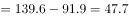
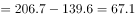
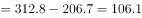
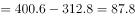

# 增长量比较

考点：[[20-考点/资料分析/增长/增长量比较|增长 / 增长量比较]]
材料：[[15-材料/资料分析/247416 2013-2017年全国快递业务量（|247416 2013-2017年全国快递业务量（]]

**问法模型**：题干问'与上年相比增长量最大的年份'→ 对各年用现期值减上年值（相邻柱做差），逐一比较取差值最大者

## 推理链
1. 第1步：从柱状图（左轴，亿件）读出2013-2017年快递业务量：91.9、139.6、206.7、312.8、400.6亿件
2. 第2步：增长量=现期值-基期值，逐年相邻做差；2013年因缺2012年基期数据无法计算，只需比较2014-2017四个年份
3. 第3步：代入计算：2014年139.6-91.9=47.7亿件；2015年206.7-139.6=67.1亿件；2016年312.8-206.7=106.1亿件；2017年400.6-312.8=87.8亿件
4. 第4步：比较四年增长量：106.1＞87.8＞67.1＞47.7，最大者为2016年的106.1亿件
5. 第5步：对照选项，2016年对应B，故正确答案为B

**最快解法**：⚡ 柱差目测+重点验证：柱子逐年升高，增长量比较只需抓柱高差最大的两段——2015→2016差约106亿件、2016→2017差约88亿件（截位口算312.8-206.7≈106、400.6-312.8≈88），锁定2016年柱差最大直接选B，前两年差额明显更小可心算排除

## 易错点
- ⚠ '增长量'与'增长速度'一字之差：增长量看柱差（2016年106.1亿件最大），增速看比值（2014年约51.9%略高于2016年约51.3%），增速最高的年份与增长量最大的年份不是同一年，按折线增速选会出错
- ⚠ 误把柱高（业务量本身）当增长量：业务量最大的是2017年400.6亿件，错选A
- ⚠ 2013年缺2012年基期数据且折线无数值标注，其增长量无法验证，不能默认其最小或最大纳入比较；同时勿被双轴图误导用左轴刻度读折线

## 母题抽象
> 🧩 当题干出现'增长量最大（最小）的年份'时，直接对相邻两期数据做差比较（只需算差额最接近的2-3段），并牢记'增长量看柱差、增速看比值'，勿以柱高或折线走势代替做差

**同类特征**：与上年相比、增长量最大、年份比较、相邻两年做差、柱状图有数值标注、增长量与增速一字之差

## 相关题
- [[10-真题/资料分析/增长/2387627 增长量比较|2387627]]（浙江 2019，相关度3）
- [[10-真题/资料分析/增长/2719394 增长量比较|2719394]]（国考 2021，相关度3）
- [[10-真题/资料分析/增长/2144598 增长量比较|2144598]]（选调 2018，相关度2）
- [[10-真题/资料分析/增长/465283 增长量比较|465283]]（江苏 2014，相关度2）
- [[10-真题/资料分析/增长/15121335 增长量比较|15121335]]（江苏 2024，相关度2）

---

### 题干
快递业务量与上年相比增长量最大的年份是：

### 选项
- A. 2017年
- B. 2016年　✅
- C. 2014年
- D. 2015年

### 官方解析

由题干“…增长量最大的年份”，可判定本题为增长量比较问题。定位柱状图，2013-2017年快递业务量分别为91.9亿件、139.6亿件、206.7亿件、312.8亿件、400.6亿件。根据增长量公式：，可得

2014年增长量亿件；

2015年增长量亿件；

2016年增长量亿件；

2017年增长量亿件。

则增长量最大的年份为2016年。

故正确答案为B。

### 给定材料

