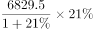
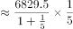
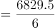
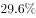
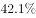
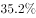

# 增长量计算（已知现期值与同比增速）

考点：[[20-考点/资料分析/增长/增长量计算（已知现期值与同比增速）|增长 / 增长量计算（已知现期值与同比增速）]]
材料：[[15-材料/资料分析/247417 2018年1-2月份全国规模以上工业|247417 2018年1-2月份全国规模以上工业]]

**问法模型**：题干'……比上年同期增长约（多少亿元）'→ 增长量计算模型：增长量=现期×r/(1+r)，而非现期×r

## 推理链
1. 第1步：从材料定位'股份制企业实现利润总额6829.5亿元，增长 '，现期为2018年1-2月累计值，求比上年同期的增长额（材料文本增速留空，官方解析按21%代入）
2. 第2步：题干问'比上年同期增长约多少亿元'，判定为增长量计算，公式：增长量=现期×r/(1+r)
3. 第3步：代入r=21%，增长量=6829.5×21%/(1+21%)=6829.5×21/121=143419.5/121
4. 第4步：截位直除143419.5÷121≈1185.3亿元，首两位商11
5. 第5步：与选项对照，1185.3与D项1185亿元最接近；A(864)、C(666)量级偏离，B(1434)恰为6829.5×21%≈1434.2的'现期×r'干扰值，故排除B选D

**最快解法**：⚡ 公式法+截位直除：增长量=6829.5×21/121≈6829.5×0.1736≈1185，直除首两位商11直接锁定D；亦可用百化分21%≈1/4.76，增长量≈现期/(n+1)=6829.5/5.76≈1185

## 易错点
- ⚠ 把增长量误算成现期×增速：6829.5×21%≈1434亿元，恰好落入B项陷阱，正确须除以(1+r)，即乘r/(1+r)
- ⚠ 增速数值在材料原文中留空（材料导读已提示），若未从配套完整数据中读出21%而凭感觉代入其他增速，会错选A或C
- ⚠ 时间口径：现期为2018年1-2月累计值（非全年），基期为2017年1-2月，勿与全年数据或其他年份混用

## 母题抽象
> 🧩 当题干出现'现期值+同比增速、问比上年同期增长约多少亿元'时，用增长量=现期×r/(1+r)（百化分后除以n+1），并警惕'现期×r'式干扰选项

**同类特征**：比上年同期增长约、问增长量（单位亿元）、给出现期利润总额与同比增速、1-2月累计口径、选项含现期×r的强干扰项、单一文字型材料取数

## 相关题
- [[10-真题/资料分析/增长/10204605 增长量计算（已知现期值与同比增速）|10204605]]（辽宁 2024，相关度2）
- [[10-真题/资料分析/增长/2172268 增长量计算（已知现期值与同比增速）|2172268]]（江苏 2018，相关度2）

---

### 题干
2018年1-2月份股份制企业实现利润总额比上年同期增长约：

### 选项
- A. 864亿元
- B. 1434亿元
- C. 666亿元
- D. 1185亿元　✅

### 官方解析

题干所求为“······比上年同期增长······亿元”，判定本题为增长量计算问题。定位文字材料“股份制企业实现利润总额6829.5亿元，增长”，则增长量，直除首数为11，D项最为接近。

故正确答案为D。

### 给定材料

        2018年1-2月份，全国规模以上工业企业实现利润总额9689亿元，同比增长。其中，国有控股企业实现利润总额2918.1亿元，同比增长；集体企业实现利润总额36.9亿元，增长；股份制企业实现利润总额6829.5亿元，增长；外商及港澳台商投资企业实现利润总额2259.6亿元，增长；私营企业实现利润总额2830.8亿元，增长。按行业分其中采矿业实现利润总额877.9亿元，同比增长；制造业实现利润总额8100亿元，增长；电力、热力、燃气及水生产和供应业实现利润总额711.1亿元，增长。

> [!warning] 疑点（官方解析可能有误，待人工复核）
> 材料原文中各同比增速数值均留空缺失，官方解析隐含股份制企业增速为21%（由6829.5×21/121≈1185.3锁定D、且B项=6829.5×21%≈1434.2可反向验证）；答案D本身无误，但仅凭本材料文本无法独立完成数值计算，需以原卷完整增速数据为准。

<!-- CODEX-ANSWER-REVIEW:BEGIN -->
### 本次独立复核

**复核状态：** `resolved`（答案与解析已核定）

**计分答案：** D（可计分）

**复核解析：**

2018年1–2月股份制企业利润总额6829.5亿元、同比增长21%。增量=6829.5×21%/121%≈1185亿元，D。

**相关信息：**

增长量=现期量×增长率/(1+增长率)；同比下降题先明确增长量符号。百分点和百分比需按材料口径区分。

**题源依据：** [固定版本原题](https://github.com/Mentat-Uran/kaogongzhentizhengliu/blob/84ab93d4b64b61d897bece8a1c0a5bab06b4feb2/10-%E7%9C%9F%E9%A2%98/%E8%B5%84%E6%96%99%E5%88%86%E6%9E%90/%E5%A2%9E%E9%95%BF/2452878%20%E5%A2%9E%E9%95%BF%E9%87%8F%E8%AE%A1%E7%AE%97%EF%BC%88%E5%B7%B2%E7%9F%A5%E7%8E%B0%E6%9C%9F%E5%80%BC%E4%B8%8E%E5%90%8C%E6%AF%94%E5%A2%9E%E9%80%9F%EF%BC%89.md)；固定内容 commit `84ab93d4b64b61d897bece8a1c0a5bab06b4feb2`，Markdown blob `9c11ca4f06d227bb3fe8b51b089516e9a100b478`。
<!-- CODEX-ANSWER-REVIEW:END -->
