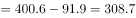

# 增长量计算（现期-基期）

考点：[[20-考点/资料分析/增长/增长量计算（现期-基期）|增长 / 增长量计算（现期-基期）]]
材料：[[15-材料/资料分析/247416 2013-2017年全国快递业务量（|247416 2013-2017年全国快递业务量（]]

**问法模型**：题干'A年比B年…增加'+选项带单位（亿件）→ 增长量计算模型：增长量=现期量-基期量=400.6-91.9

## 推理链
1. 第1步：由题干'2017年比2013年增加'且选项均带单位'亿件'，判定为增长量计算，非增长率问题
2. 第2步：定位柱状图（左轴，亿件），读取端点数据：基期2013年=91.9亿件，现期2017年=400.6亿件
3. 第3步：代入增长量公式：增长量=现期-基期=400.6-91.9
4. 第4步：计算：400.6-91.9=308.7亿件（尾数0.6-0.9借位后尾数为7，十位为0，排除318.7）
5. 第5步：与选项对照：A.261、B.312.8、C.318.7、D.308.7，仅D吻合，故选D

**最快解法**：⚡ 尾数法+末两位直减：400.6-91.9，先看尾数6-9不足减借位得7，十位0-1借位得0，得308.7，秒排C(318.7)；也可用估算法91.9≈92，400.6-92≈308.6≈308.7锁定D

## 易错点
- ⚠ 干扰项C=318.7与正确答案仅差10，是'减数91.9误看成81.9'或借位错误的定向陷阱，减法必须核对尾数与十位
- ⚠ 勿被右侧增长速度折线干扰：本题求增长量（绝对量亿件），与%折线无关，且折线无数值标签、双轴刻度不同（左500右200），不能目测读数
- ⚠ 时间口径：2017为现期、2013为基期，若颠倒相减会得负值或误判方向

## 母题抽象
> 🧩 当题干出现'某现期年比某基期年增加（多）+选项带单位'时，直接用'现期柱值-基期柱值'求增长量，用尾数法/估算法排除相邻干扰项；若问'增长百分之几'才用除法算增速

**同类特征**：'2017年比2013年'、'增加'+选项带单位（亿件）、跨多年首尾差值、柱状图端点均有数值标注、增长量而非增长速度、相邻干扰项差10的减法陷阱

## 相关题
（暂无）

---

### 题干
2017年比2013年快递业务量增加：

### 选项
- A. 261亿件
- B. 312.8亿件
- C. 318.7亿件
- D. 308.7亿件　✅

### 官方解析

由题干“2017年比2013年…增加”，结合选项有单位，可判定本题为增长量计算问题。定位柱状图，2013年和2017年快递业务量分别为91.9亿件、400.6亿件。根据增长量公式：亿件。

故正确答案为D。

### 给定材料

