# 增长量比较（计数型：同比增量与阈值45亿元逐一比较后数个数）

考点：[[20-考点/资料分析/增长/增长量比较（计数型：同比增量与阈值45亿元逐一比较后数个数）|增长 / 增长量比较（计数型：同比增量与阈值45亿元逐一比较后数个数）]]
材料：[[15-材料/资料分析/247417 2018年1-2月份全国规模以上工业|247417 2018年1-2月份全国规模以上工业]]

**问法模型**：题干为'……同比增长额大于45亿元的有几个'的计数型问法 → 采用增长量比较模型：对每类用Δ=现期×r/(1+r)求增量并与45亿元阈值比较，统计满足条件的类别个数

## 推理链
1. 第1步：题干筛选对象为按企业性质分的5类，取现期利润总额：国有控股2918.1亿元、集体企业36.9亿元、股份制6829.5亿元、外商及港澳台2259.6亿元、私营2830.8亿元，阈值为45亿元
2. 第2步：量级秒杀——集体企业现期总额36.9亿元本身已小于45亿元，其同比增长额必不可能超过45亿元，直接排除，无需计算
3. 第3步：增长量公式 Δ=现期×r/(1+r)=现期−现期/(1+r)，对剩余四类分别代入各自同比增速（增速数值在材料正文留空，须读配套图片取数）
4. 第4步：临界增速判定——Δ>45 ⇔ r>45/(现期−45)，代入现期值得临界增速：国有控股约1.6%、股份制约0.7%、外商及港澳台约2.0%、私营约1.6%，实际增速超过临界值者入选
5. 第5步：按官方解析结论，国有控股企业、股份制企业、私营企业三类的同比增长额大于45亿元，集体企业与外商及港澳台商投资企业两类不大于45亿元
6. 第6步：满足'增长额大于45亿元'的企业类型共3个，对照选项A.1个、B.2个、C.3个、D.4个，选C

**最快解法**：⚡ 量级排除+临界增速法：①集体企业现期36.9亿元<45亿元，秒杀排除；②对其余四类，由Δ>45⇔r>45/(现期−45)求出临界增速（均仅约0.7%~2%，即45除以'现期减45'），把各类实际增速与临界增速比大小即可判入选，无需精算增量；③数得国有控股、股份制、私营3类，选C

## 易错点
- ⚠ 概念混淆：材料给的是'同比增长率'，题干比较的是'同比增长额'（增量），必须用Δ=现期×r/(1+r)，切勿拿增速数值直接与45比较，或把现期总额误当增长额
- ⚠ 量级陷阱：集体企业现期仅36.9亿元，与总利润9689亿元相差两个数量级，可直接用现期<45排除，不必逐项精算；也勿误套9689亿元总利润做基数
- ⚠ 口径陷阱：①企业性质五类之和14874.9亿元>9689亿元，五类交叉重叠，本题只计数不涉及比重，勿做占比处理；②'1-2月份'为累计口径；③原文增速数值全部留空，必须读配套图片取数，不得凭空编造增速代入

## 母题抽象
> 🧩 当题干出现'……同比增量（增长额）大于X的有几个/哪几类'特征时，用增长量比较计数法：先用'现期<X'做量级秒杀排除，再以Δ=现期×r/(1+r)或临界增速r>X/(现期−X)逐一判定，最后数出满足个数

**同类特征**：同比增长额大于45亿元、按企业性质分类筛选、计数型问法（有几个）、现期值在题干材料给定、增速需读图、增长量比较、分类五项存在交叉口径

## 相关题
- [[10-真题/资料分析/增长/2144598 增长量比较|2144598]]（选调 2018，相关度1）
- [[10-真题/资料分析/增长/23447 增长量比较（现期量×r-(1+r)）|23447]]（云南 2011，相关度1）
- [[10-真题/资料分析/增长/49789 增长量（变化绝对值）比较|49789]]（云南 2013，相关度1）
- [[10-真题/资料分析/增长/465283 增长量比较|465283]]（江苏 2014，相关度1）
- [[10-真题/资料分析/增长/12881989 增长量比较（部分=整体×比重跨图还原后逐年作差）|12881989]]（广东 2025，相关度1）

---

### 题干
2018年1-2月份按企业性质分类中实现利润总额同比增长额大于45亿元的有：

### 选项
- A. 1个
- B. 2个
- C. 3个　✅
- D. 4个

### 官方解析

题干所求为“同比增长额大于45亿元的有······”，判定本题为增长量比较问题。定位文字材料“国有控股企业实现利润总额2918.1亿元，同比增长；集体企业实现利润总额36.9亿元，增长；股份制企业实现利润总额6829.5亿元，增长；外商及港澳台商投资企业实现利润总额2259.6亿元，增长；私营企业实现利润总额2830.8亿元，增长”，则各类企业增长量情况如下：

国有控股企业：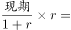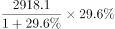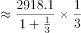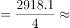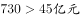；

集体企业：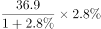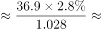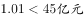；

股份制企业：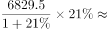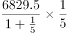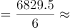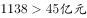；

外商及港澳台商投资企业：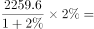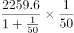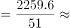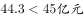；

私营企业：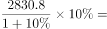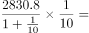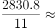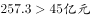。

则2018年1-2月份实现利润总额同比增长额大于45亿元的企业类型有国有控股企业、股份制企业、私营企业3种。

故正确答案为C。

### 给定材料

        2018年1-2月份，全国规模以上工业企业实现利润总额9689亿元，同比增长。其中，国有控股企业实现利润总额2918.1亿元，同比增长；集体企业实现利润总额36.9亿元，增长；股份制企业实现利润总额6829.5亿元，增长；外商及港澳台商投资企业实现利润总额2259.6亿元，增长；私营企业实现利润总额2830.8亿元，增长。按行业分其中采矿业实现利润总额877.9亿元，同比增长；制造业实现利润总额8100亿元，增长；电力、热力、燃气及水生产和供应业实现利润总额711.1亿元，增长。

> [!warning] 疑点（官方解析可能有误，待人工复核）
> 材料正文与官方解析中各分组的同比增速数值均留空（原为图片数据被抹去），各类型增量的具体计算过程无法复核，本题'国有控股、股份制、私营3类'的结论只能依据官方解析给定；其中外商及港澳台商投资企业的临界增速约2.0%，若原始增速口径与其被排除的判定存在出入，个别类型可能反转，一切以官方答案C为准

<!-- CODEX-ANSWER-REVIEW:BEGIN -->
### 本次独立复核

**复核状态：** `confirmed`（独立复算确认答案）

**计分答案：** C（可计分）

**复核解析：**

原公式图增速为国有29.6%、集体2.8%、股份制21%、外资2%、私营10%；增长额约666、1、1186、44.3、257亿元。严格大于45的有国有、股份制、私营3类，选C。

**相关信息：**

阈值比较按增长量，不把增长率直接与45比较。

**题源依据：** [固定版本原题](https://github.com/Mentat-Uran/kaogongzhentizhengliu/blob/84ab93d4b64b61d897bece8a1c0a5bab06b4feb2/10-%E7%9C%9F%E9%A2%98/%E8%B5%84%E6%96%99%E5%88%86%E6%9E%90/%E5%A2%9E%E9%95%BF/2452887%20%E5%A2%9E%E9%95%BF%E9%87%8F%E6%AF%94%E8%BE%83%EF%BC%88%E8%AE%A1%E6%95%B0%E5%9E%8B%EF%BC%9A%E5%90%8C%E6%AF%94%E5%A2%9E%E9%87%8F%E4%B8%8E%E9%98%88%E5%80%BC45%E4%BA%BF%E5%85%83%E9%80%90%E4%B8%80%E6%AF%94%E8%BE%83%E5%90%8E%E6%95%B0%E4%B8%AA%E6%95%B0%EF%BC%89.md)；固定内容 commit `84ab93d4b64b61d897bece8a1c0a5bab06b4feb2`，Markdown blob `5dca7da4c6473c29a08133aa6a83706ab49ad00e`。
<!-- CODEX-ANSWER-REVIEW:END -->
