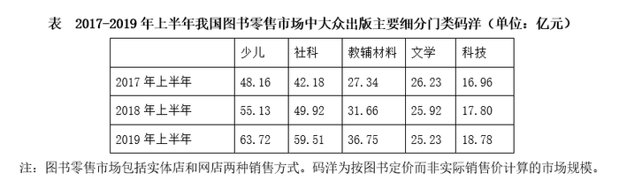

# 增长率比较（多年同比增速趋势判断）

考点：[[20-考点/资料分析/增长/增长率比较（多年同比增速趋势判断）|增长 / 增长率比较（多年同比增速趋势判断）]]
材料：[[15-材料/资料分析/247427 2016-2019年上半年中国图书零|247427 2016-2019年上半年中国图书零]]

**问法模型**：题干问'2017-2019年每年上半年同比增速'的变化趋势 → 逐年用 增长率=(现期-基期)/基期 计算2017/2018/2019三个增速值，再看比值序列的升降走向

## 推理链
1. 第1步：由图1提取网店码洋四年上半年数据：2016年109.22、2017年141.98、2018年173.37、2019年215.31亿元（2017年增速的基期必须是2016年上半年）
2. 第2步：套用增长率公式：同比增速=(现期-上年同期)/上年同期
3. 第3步：2017年增速=(141.98-109.22)/109.22=32.76/109.22≈30.0%
4. 第4步：2018年增速=(173.37-141.98)/141.98=31.39/141.98≈22.1%
5. 第5步：2019年增速=(215.31-173.37)/173.37=41.94/173.37≈24.2%
6. 第6步：增速序列为30.0%→22.1%→24.2%，先降后升，对照选项只有D'先降低后升高'符合

**最快解法**：⚡ 截位直除+定性比较：2018年与2017年比，增长量32.76→31.39减小而基期109.22→141.98增大，分子减分母增，增速必降（无需细算）；2019年与2018年比，增长量31.39→41.94明显增大，只需验证41.94/173.37>31.39/141.98（交叉相乘：41.94×141.98≈5954>31.39×173.37≈5442成立），故先降后升选D，全程只需一次精确除法

## 易错点
- ⚠ 基期口径错误：2017年增速的基期是2016年上半年（109.22），表从2017年起、只有图1有2016年数据，漏看图1会算不出2017年增速而只比2018/2019两年
- ⚠ 增长量趋势≠增长率趋势：2019年增长量41.94亿元大于2018年31.39亿元，若只看柱高差（增长量）会误判2019年增速最高；增速=增长量/基期，2018→2019是分子分母同增，必须算比值
- ⚠ 时间口径与量级陷阱：所有数据均为'上半年'半年期值，勿套用全年概念；网店数值是实体店的数倍，双系列柱颜色相近，勿误读实体店系列（47.26/46.59/45.22/39.92，本身逐年下降）

## 母题抽象
> 🧩 当题干出现'连续多年每年同比增速'并要求判断升降趋势时，逐年套(现期-上年同期)/上年同期；先用'增长量与基期一增一减→增速方向确定'的定性规则排除，再对方向不明确的相邻年份做一次截位直除即可定序

**同类特征**：同比增速、连续多年（2017-2019）每年、趋势判断（逐年升高/降低/先升后降/先降后升）、网店图书零售码洋、柱状图双系列取某一系列、增长率比较模型

## 相关题
- [[10-真题/资料分析/综合/10297333 综合分析选非题（同比增速逐年比较+年均增长量+比重百分点还原）|10297333]]（浙江 2025，相关度1）
- [[10-真题/资料分析/增长/13504272 一般增长率计算与计数比较（同比增速-5%年份计数）|13504272]]（云南 2025，相关度1）
- [[10-真题/资料分析/增长/19283744 同比增速（增长率）逐年比较|19283744]]（国考 2025，相关度1）
- [[10-真题/资料分析/增长/2388036 同比增长率比较（增速最大年份判定）|2388036]]（河北 2019，相关度1）
- [[10-真题/资料分析/增长/2423335 同比增长率计算与逐年增速趋势比较|2423335]]（甘肃 2019，相关度1）

---

### 题干
2017-2019年，每年上半年网店图书零售码洋同比增速                    。

### 选项
- A. 逐年升高
- B. 逐年降低
- C. 先升高后降低
- D. 先降低后升高　✅

### 官方解析
根据“2017-2019年，每年上半年网店图书零售码洋同比增速”，结合选项判断趋势，判定本题为一般增长率比较问题。定位图形，2016年-2019年，每年上半年网店图书零售码洋分别为109.22、141.98、173.37、215.31亿元。根据公式：增长率，则2017年上半年网店图书零售码洋同比增速为；2018年上半年同比增速为；2019年上半年同比增速为。因此同比增速先降低后升高，D选项符合。
故正确答案为D。

### 给定材料

根据下列资料，回答76～80题。

