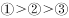
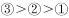
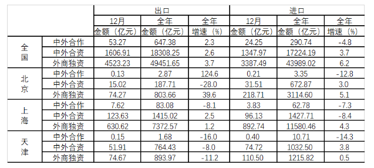

# 增长量计算与比较（出口+进口复合口径的增量排序）

考点：[[20-考点/资料分析/增长/增长量计算与比较（出口+进口复合口径的增量排序）|增长 / 增长量计算与比较（出口+进口复合口径的增量排序）]]
材料：[[15-材料/资料分析/247437 2018年全国及北京、上海、天津三市|247437 2018年全国及北京、上海、天津三市]]

**问法模型**：题干出现'按2018年全年进出口贸易总额同比增量从高到低排列'→对出口、进口分别用增量=现期×r/(1+r)（负增速代入负值）求增量，代数加总后从高到低排序

## 推理链
1. 第1步：定位上海三行'全年金额+全年增速'列：中外合作出口83.08亿元(-8.1%)、进口62.78亿元(-7.3%)；中外合资出口1415.02亿元(+2.5%)、进口1427.71亿元(-8.4%)；外商独资出口7372.57亿元(+1.2%)、进口11580.46亿元(+4.3%)
2. 第2步：公式：分项增量=现期×r/(1+r)，负增速代入负值；总额增量=出口增量+进口增量（代数和）
3. 第3步：中外合作：出口≈83.08×(-8.1%)/91.9%≈-7.3亿元，进口≈62.78×(-7.3%)/92.7%≈-4.9亿元，合计≈-12.3亿元
4. 第4步：中外合资：出口≈1415.02×2.5%/102.5%≈+34.5亿元，进口≈1427.71×(-8.4%)/91.6%≈-131亿元，合计≈-96.4亿元
5. 第5步：外商独资：出口≈7372.57×1.2%/101.2%≈+87亿元，进口≈11580.46×4.3%/104.3%≈+477亿元，合计≈+565亿元（两项增速均为正，增量必为正且最大）
6. 第6步：排序：外商独资(+565)＞中外合作(-12.3)＞中外合资(-96.4)，对照选项得A

**最快解法**：⚡ 定性+百化分口算：外商独资出口、进口增速均为正→总额增量为正，必排第一；中外合作与中外合资均为负增量，比较绝对值：百化分（2.5%≈1/40，8.4%≈1/12，8.1%≈1/12.3，7.3%≈1/13.7）：中外合资出口正增量≈1415/41≈+35，进口负增量≈-1428/11≈-130，净约-96；中外合作两项负增量仅-83/11.3≈-7与-63/12.7≈-5，净约-12。负得少者排前，故外商独资＞中外合作＞中外合资

## 易错点
- ⚠ 误取'12月当月'列而非'全年'列（如把7.62/3.83当作中外合作全年值），量级差数倍至上百倍
- ⚠ 增量≠现期×增速，须除以(1+r)；负增长时基期更大，直接乘负增速会低估负增量绝对值（如-8.4%应对应-131而非-120）
- ⚠ 出口与进口一正一负（上海中外合资：出口+2.5%、进口-8.4%），总额增量为代数和，丢正负号或取绝对值相加会排错顺序；且须跨出口、进口两组列拼数据，只看一组不完整

## 母题抽象
> 🧩 当题干要求对多个主体按'复合指标（如进出口总额）的同比增量'排序时，先对每个分项用增量=现期×r/(1+r)（负增速代入负值）求增量，再代数加总，最后先定性排除（增速全正者增量必最大）再精算或百化分比较负增量绝对值

**同类特征**：按…同比增量从高到低排列、进出口贸易总额=出口+进口需自行加总、分主体分类型排序、全年累计口径、增速有正有负、增长量比较

## 相关题
- [[10-真题/资料分析/增长/4637425 增长量比较（负增速的带符号增量排序）|4637425]]（国考 2022，相关度2）
- [[10-真题/资料分析/增长/2144598 增长量比较|2144598]]（选调 2018，相关度1）
- [[10-真题/资料分析/增长/23447 增长量比较（现期量×r-(1+r)）|23447]]（云南 2011，相关度1）
- [[10-真题/资料分析/增长/49789 增长量（变化绝对值）比较|49789]]（云南 2013，相关度1）
- [[10-真题/资料分析/增长/465283 增长量比较|465283]]（江苏 2014，相关度1）

---

### 题干
将上海市的中外合作企业、中外合资企业和外商独资企业按2018年全年进出口贸易总额同比增量从高到低排列，正确的是            。

### 选项
- A. 

　✅
- B. 

- C. 

- D. 

### 官方解析
根据题干“将上海市的······同比增量从高到低排列”，可判定此题为增长量的比较问题。由，定位表格材料数据可得三种类型外资企业进出口贸易总额。根据增长量，则所求同比增量分别为：
①中外合作亿元；
②中外合资亿元；
③外商独资出口额增速、进口额增速均为正值，同比增量大于0，则。
故正确答案为A。

### 给定材料

                             表  2018年全国及京津沪各类型外资企业进出口贸易额及同比增速

